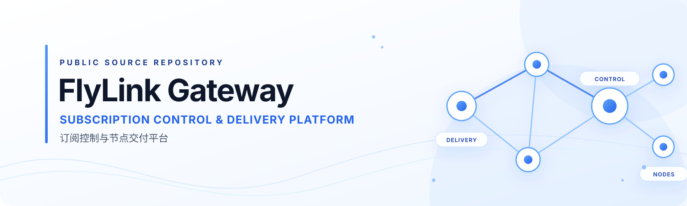

  

  <a href="README_EN.md">English</a> ·
  <a href="docs/COMMUNITY_GUIDE.md">开发者指南</a> ·
  <a href="docs/README.md">完整文档索引</a> ·
  <a href="CONTRIBUTING.md">贡献指南</a> ·
  <a href="SECURITY.md">安全报告</a>

  
  
  
  

# FlyLink Gateway

**订阅控制与节点交付平台**

FlyLink Gateway 是一个以 Node.js 为核心的工程项目，围绕账户与订阅生命周期、运营工作流、配置交付和节点协作，提供可审查的服务端、管理界面、CLI 与 Agent 代码。

它不是一个代理客户端，也不意味着仓库中的每项能力都已经部署或对外开放。这里展示的是可追踪的项目源码、模块边界和开发入口。

## 项目能做什么

| 模块 | 能力范围 | 源码边界 |
| --- | --- | --- |
| Operator CLI | 统一命令入口、能力发现、项目检查和受控工作流路由 | 命令可用不等于获得生产操作授权 |
| Control Plane | Node.js / Express 服务、账户与订阅域、订单与权益、用量证据和审计投影 | 当前源码控制面；运行状态须由独立证据确认 |
| Admin & Portal | React 管理界面、用户门户和公司站点前端源码 | 三个界面共享 Admin 工作区与工具链，不代表三个独立部署已完成 |
| Agent & Delivery | 本地 Agent、节点执行适配器、订阅渲染及交付契约 | 真实节点访问、配置应用和运行时变更仍受独立门禁约束 |
| Cloudflare Worker | Workers + D1 控制面迁移方向的本地验证切片 | Miniflare 合成数据验证；尚非生产控制面，也未部署远程 D1 |

## 架构概览

~~~mermaid
flowchart TB
    subgraph ENTRY["访问与运营入口"]
        CLI["gccgw CLI"]
        ADMIN["受保护 Admin"]
        PORTAL["User Portal"]
        CLIENT["Clash / Mihomo 客户端"]
    end

    subgraph CURRENT["当前源码控制面"]
        API["Node.js / Express"]
        DOMAIN["账户 · 订阅 · 订单 · 权益 · 审计"]
        DB[("SQLite")]
        DELIVERY["订阅渲染与交付接口"]
        API --> DOMAIN
        DOMAIN --> DB
        API --> DELIVERY
    end

    subgraph DATA["Agent 与数据面"]
        AGENT["Agent / 节点适配器"]
        NODES["Node / Channel Runtime"]
        AGENT --> NODES
    end

    subgraph FUTURE["未来目标 · 本地合成验证"]
        WORKER["Cloudflare Workers"]
        D1[("Cloudflare D1")]
        WORKER --> D1
    end

    CLI --> API
    ADMIN --> API
    PORTAL --> API
    DELIVERY --> CLIENT
    API --> AGENT
    WORKER -. "通过独立迁移门禁后替代控制面" .-> API

    classDef current fill:#EFF6FF,stroke:#60A5FA,color:#1E3A8A
    classDef future fill:#F8FAFC,stroke:#94A3B8,color:#475569,stroke-dasharray:5 5
    class API,DOMAIN,DB,DELIVERY current
    class WORKER,D1 future
~~~

> **阶段说明：** 这是面向开发者的逻辑源码架构图，不是生产部署拓扑或实时健康图。当前源码控制面仍是 Node.js / Express + SQLite。Cloudflare Workers + D1 是已批准的未来迁移方向；仓库中的 Worker 切片仅在本地 Miniflare 环境使用合成数据，尚未接管生产读写，也未部署远程 D1。迁移必须经过独立实施、数据迁移和切换门禁。

## 1 分钟快速开始

### 环境要求

- Node.js 版本遵循根目录 package.json 的 engines 声明：20.10.x（不含 21.x），以及 22.x–26.x。
- npm 与仓库 lockfile 配套使用。
- Git。

### 安装并检查项目

~~~bash
git clone https://github.com/FlyLink-com/proxy-gateway-minimal.git
cd proxy-gateway-minimal

npm ci

# 查看 CLI 能力
npm run cli -- capabilities

# 查看 CLI 命令
npm run cli -- commands

# 运行根目录服务端源码测试
npm test
~~~

### 启动本地开发界面

需要开发 Admin / Portal 界面时：

~~~bash
npm ci --prefix admin
npm run admin:dev
~~~

Vite 开发服务器绑定本机回环地址。不要将本地开发服务器作为公网 Admin 服务使用。

需要启动后端服务时，先阅读 [Server Workspace](server/README.md) 和 [本地开发环境边界](docs/LIGHTWEIGHT_OPERATING_DEV_ENVIRONMENT.md)，为本机准备隔离的本地配置与测试数据，再执行：

~~~bash
npm run server
~~~

不要把生产环境的 .env、数据库、订阅链接、用户数据或节点凭据复制到本地开发环境。仓库中的 .env.example 是目标运行环境变量模板，不是可直接用于本地的安全配置包。

## 技术栈

| 层次 | 技术 |
| --- | --- |
| Runtime | Node.js |
| HTTP 服务 | Express 5 |
| 数据存储 | SQLite / better-sqlite3 |
| Web UI | React 19 / Vite |
| Operator Tooling | gccgw CLI |
| Agent | Node.js Agent 与节点适配器 |
| Future Control Plane | Cloudflare Workers + D1（本地合成验证阶段） |

## 仓库结构

| 路径 | 作用 |
| --- | --- |
| bin/ | gccgw CLI 路由与兼容入口 |
| server/ | Express 应用、路由、领域服务与持久化适配器 |
| admin/ | Admin、User Portal、公司站点的 React / Vite 前端源码 |
| agent/ | 本地 Edge Agent、数据面 Agent Runner 与适配器 |
| workers/control-plane/ | Workers + D1 的本地合成验证切片 |
| schemas/ | 共享数据结构与版本化契约 |
| docs/ | 架构、开发、API、验证与项目治理文档 |

## 文档导航

| 想了解 | 从这里开始 |
| --- | --- |
| 开发者入门与项目目录 | [Community & Developer Guide](docs/COMMUNITY_GUIDE.md) |
| 完整文档分类与权威入口 | [Documentation Index](docs/README.md) |
| 项目定位与领域边界 | [Project Context](docs/PROJECT_CONTEXT.md) |
| 逻辑拓扑与当前 / 未来阶段 | [Project Topology](docs/PROJECT_TOPOLOGY.md) |
| API 兼容说明 | [API Compatibility](docs/API_COMPATIBILITY.md) |
| CLI 使用入口 | [CLI Workspace](bin/README.md) |
| 后端服务 | [Server Workspace](server/README.md) |
| 前端工作区 | [Admin Workspace](admin/README.md) |
| Agent 与节点适配 | [Edge Agent Workspace](agent/README.md) |
| Worker 本地验证 | [Control-Plane Worker](workers/control-plane/README.md) |
| 验证命令与风险分级 | [Validation Baseline](docs/VALIDATION_BASELINE.md) |
| 安全漏洞报告 | [Security Policy](SECURITY.md) |

## 状态与安全边界

- GitHub 上的 master 是受审查源码，不等于某个生产环境正在运行的版本。
- 源码存在、测试通过、构建成功、制品发布、生产部署和运行时健康是不同状态，不能互相替代。
- Admin 保持受保护边界；不要把本地预览或源代码可用性理解为公网管理入口。
- 真实云资源、数据库迁移、节点、凭据、DNS、部署与生产切换均遵循独立审批和验证流程。
- 报告漏洞时不要创建公开 Issue。请按 [SECURITY.md](SECURITY.md) 使用私密报告渠道。

## 贡献与许可证

欢迎先通过 GitHub Issues 讨论问题与改进方向。代码贡献请阅读 [CONTRIBUTING.md](CONTRIBUTING.md)。

**许可证状态：** 当前仓库根目录尚无 LICENSE 文件。仓库公开可见不等于已授予 MIT、Apache-2.0 或其他开源许可证；在维护者正式发布许可证前，请不要假定拥有复制、修改、分发或商用权限。

---

  FlyLink Gateway · Subscription Control & Delivery Platform

