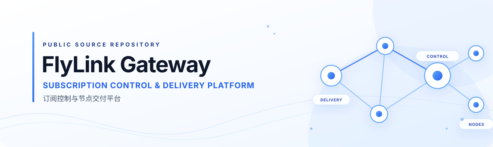

  

  <a href="README.md">简体中文</a> ·
  <a href="docs/COMMUNITY_GUIDE.md">Community Guide</a> ·
  <a href="docs/README.md">Full Documentation Index</a> ·
  <a href="CONTRIBUTING.md">Contributing</a> ·
  <a href="SECURITY.md">Security</a>

  
  
  
  

# FlyLink Gateway

**Subscription Control & Delivery Platform**

FlyLink Gateway is a Node.js engineering project for subscription lifecycle management, operator workflows, configuration delivery, and node coordination. It brings together service-side code, web interfaces, a command-line tool, and Agent components under reviewable module boundaries.

It is not a proxy client, and the presence of a capability in the repository does not mean that capability is deployed or publicly enabled. This page describes the source tree, its boundaries, and the entrypoints developers can use.

## What the project provides

| Area | Scope | Source boundary |
| --- | --- | --- |
| Operator CLI | Unified command entrypoint, capability discovery, project checks, and controlled workflow routing | A command being available does not authorize production operations |
| Control Plane | Node.js / Express service, account and subscription domains, orders and entitlements, usage evidence, and audit projections | Current source control plane; runtime state requires separate evidence |
| Admin & Portal | React management UI, user portal, and company-site frontend source | The three surfaces share the Admin workspace and toolchain; this does not imply three completed independent deployments |
| Agent & Delivery | Local Agent, node execution adapters, subscription rendering, and delivery contracts | Real node access, configuration apply, and runtime changes remain separately gated |
| Cloudflare Worker | Local validation slice for the Workers + D1 control-plane migration direction | Synthetic data under Miniflare; not the production control plane and not deployed to remote D1 |

## Architecture overview

~~~mermaid
flowchart TB
    subgraph ENTRY["Access & Operator Entry Points"]
        CLI["gccgw CLI"]
        ADMIN["Protected Admin"]
        PORTAL["User Portal"]
        CLIENT["Clash / Mihomo Client"]
    end

    subgraph CURRENT["Current Source Control Plane"]
        API["Node.js / Express"]
        DOMAIN["Accounts · Subscriptions · Orders · Entitlements · Audit"]
        DB[("SQLite")]
        DELIVERY["Subscription Rendering & Delivery API"]
        API --> DOMAIN
        DOMAIN --> DB
        API --> DELIVERY
    end

    subgraph DATA["Agent & Data Plane"]
        AGENT["Agent / Node Adapters"]
        NODES["Node / Channel Runtime"]
        AGENT --> NODES
    end

    subgraph FUTURE["Future Target · Local Synthetic Validation"]
        WORKER["Cloudflare Workers"]
        D1[("Cloudflare D1")]
        WORKER --> D1
    end

    CLI --> API
    ADMIN --> API
    PORTAL --> API
    DELIVERY --> CLIENT
    API --> AGENT
    WORKER -. "Replaces the control plane only after separate migration gates" .-> API

    classDef current fill:#EFF6FF,stroke:#60A5FA,color:#1E3A8A
    classDef future fill:#F8FAFC,stroke:#94A3B8,color:#475569,stroke-dasharray:5 5
    class API,DOMAIN,DB,DELIVERY current
    class WORKER,D1 future
~~~

> **Phase boundary:** This is a logical source architecture for developers, not a production deployment topology or live health view. The current source control plane remains Node.js / Express + SQLite. Cloudflare Workers + D1 is an approved future migration direction; the Worker slice in this repository runs locally under Miniflare with synthetic data. It has not taken over production reads or writes, and no remote D1 has been deployed. Migration requires its own implementation, data-migration, and cutover gates.

## Quick start

### Requirements

- Node.js versions follow the root package.json engines declaration: 20.10.x (excluding 21.x), plus 22.x–26.x.
- npm compatible with the repository lockfile.
- Git.

### Install and inspect the project

~~~bash
git clone https://github.com/FlyLink-com/proxy-gateway-minimal.git
cd proxy-gateway-minimal

npm ci

# Discover CLI capabilities
npm run cli -- capabilities

# List CLI commands
npm run cli -- commands

# Run the root server-source test suite
npm test
~~~

### Start the local development UI

For Admin / Portal UI development:

~~~bash
npm ci --prefix admin
npm run admin:dev
~~~

The Vite development server binds to the local loopback interface. Do not use a local development server as a public Admin service.

To start the backend locally, first read [Server Workspace](server/README.md) and the [local development environment boundary](docs/LIGHTWEIGHT_OPERATING_DEV_ENVIRONMENT.md). Prepare isolated local configuration and test data, then run:

~~~bash
npm run server
~~~

Do not copy production .env files, databases, subscription links, user data, or node credentials into local development. The repository .env.example is a target-runtime environment template, not a ready-to-use safe local configuration bundle.

## Technology stack

| Layer | Technology |
| --- | --- |
| Runtime | Node.js |
| HTTP service | Express 5 |
| Data store | SQLite / better-sqlite3 |
| Web UI | React 19 / Vite |
| Operator tooling | gccgw CLI |
| Agent | Node.js Agent and node adapters |
| Future control plane | Cloudflare Workers + D1 (local synthetic validation phase) |

## Repository map

| Path | Responsibility |
| --- | --- |
| bin/ | gccgw CLI routing and compatibility entrypoints |
| server/ | Express application, routes, domain services, and persistence adapters |
| admin/ | React / Vite source for Admin, User Portal, and company site |
| agent/ | Local Edge Agent, data-plane Agent Runner, and adapters |
| workers/control-plane/ | Local synthetic validation slice for Workers + D1 |
| schemas/ | Shared data shapes and versioned contracts |
| docs/ | Architecture, development, API, validation, and project-governance documentation |

## Documentation

| If you want to learn about | Start here |
| --- | --- |
| Developer onboarding and repository map | [Community & Developer Guide](docs/COMMUNITY_GUIDE.md) |
| Full document taxonomy and authoritative entrypoints | [Documentation Index](docs/README.md) |
| Project context and domain boundaries | [Project Context](docs/PROJECT_CONTEXT.md) |
| Logical topology and current / future phases | [Project Topology](docs/PROJECT_TOPOLOGY.md) |
| API compatibility notes | [API Compatibility](docs/API_COMPATIBILITY.md) |
| CLI entrypoint | [CLI Workspace](bin/README.md) |
| Backend service | [Server Workspace](server/README.md) |
| Frontend workspace | [Admin Workspace](admin/README.md) |
| Agent and node adapters | [Edge Agent Workspace](agent/README.md) |
| Local Worker validation | [Control-Plane Worker](workers/control-plane/README.md) |
| Validation commands and risk tiers | [Validation Baseline](docs/VALIDATION_BASELINE.md) |
| Vulnerability reporting | [Security Policy](SECURITY.md) |

## Status and security boundaries

- GitHub master is reviewed source; it is not a claim about which version is running in production.
- Source availability, passing tests, successful builds, artifact publication, production deployment, and runtime health are distinct states and must not be conflated.
- Admin remains a protected surface. Local preview or source availability does not make it a public management endpoint.
- Real cloud resources, database migration, nodes, credentials, DNS, deployment, and production cutover follow separate approval and validation processes.
- Do not disclose vulnerability details in a public Issue. Follow the private reporting process in [SECURITY.md](SECURITY.md).

## Contributing and license

Please use GitHub Issues to discuss questions and improvement ideas. For code contributions, read [CONTRIBUTING.md](CONTRIBUTING.md).

**License status:** There is currently no LICENSE file at the repository root. Public repository visibility does not grant an MIT, Apache-2.0, or other open-source license. Until the maintainers publish a license, do not assume permission to copy, modify, distribute, or commercially use the code.

---

  FlyLink Gateway · Subscription Control & Delivery Platform

