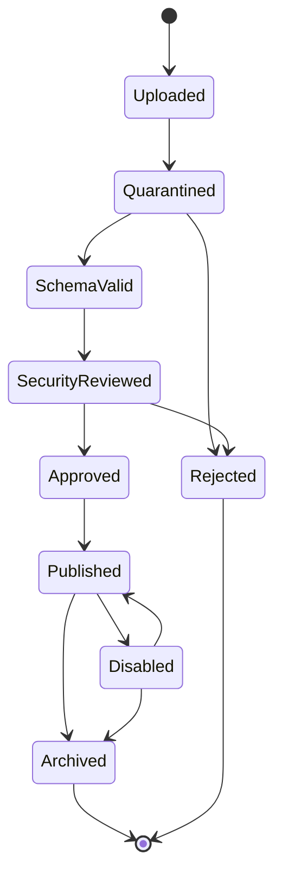

# Admin Console App Registry Review Design

Last updated: 2026-06-18, America/Los_Angeles.

> Status:
> - Type: Future Admin OS app registry and review mechanism design.
> - Risk: C for this document only.
> - Production impact: None.
> - Execution authority: Does not authorize production, AWS, Vultr, DNS,
>   Nginx, systemd, DB, runtime, auth model, schema/migration, token,
>   credential, subscription URL, raw config/log/env, SQLite row, customer-data,
>   remote app import, app upload, or plugin execution.

This document defines the future mechanism for turning reviewed App YAML files
into Admin OS applications. It is not implemented yet. The current source of
truth remains `admin/src/app/admin-app-manifest.ts`, with authoring rules in
`docs/ADMIN_CONSOLE_APP_MANIFEST_AUTHORING_STANDARD.md` and catalog mapping in
`docs/ADMIN_CONSOLE_APP_MAP.md`.

## Core Principle

An uploaded YAML file is a capability request, not a capability grant.

```text
upload != install
install != publish
publish != user permission
```

The App YAML describes what an application wants to be: identity, category,
layout, component slots, safe data capabilities, and operator-facing metadata.
The control plane decides whether it may be registered, published, visible, and
usable for a specific operator role.

The first safe implementation path is:

1. Keep all executable React components bundled in the repository.
2. Let YAML reference only approved component and capability keys.
3. Review and register YAML through a backend registry before it can appear in
   App Library.
4. Enforce user and API permissions at runtime through backend authorization.

Do not let uploaded YAML carry arbitrary JavaScript, CSS, URLs, secrets, raw
runtime config, or direct backend routes.

## Relationship To Existing Admin OS Work

| Layer | Current source | Future registry role |
| --- | --- | --- |
| App authoring standard | `docs/ADMIN_CONSOLE_APP_MANIFEST_AUTHORING_STANDARD.md` | Defines the fields a YAML app must satisfy. |
| App map | `admin/src/app/admin-app-manifest.ts` | Becomes the bundled internal registry seed. |
| App Library | Current React App Library | Reads published app entries, not raw uploads. |
| Workspace layout | Local plugin workspace engine | Uses published app ids and user layout preferences. |
| Permissions | Current protected Admin session boundary | Adds app capability checks before API access. |
| Audit | Current docs/test discipline | Records upload, review, publish, disable, archive, and rollback events. |

Current phase boundary: no remote/runtime app registry is introduced by this
document. Future implementation must be split into separate B or A tasks based
on whether it touches only frontend code or backend auth/schema/runtime state.

## App Lifecycle



| State | Meaning | UI visibility | Runtime authority |
| --- | --- | --- | --- |
| `uploaded` | File accepted into an isolated draft area. | Hidden from App Library. | None. |
| `quarantined` | Stored for validation and review. | Hidden from App Library. | None. |
| `schema-valid` | YAML shape and required fields passed validation. | Hidden from App Library. | None. |
| `security-reviewed` | Components, capabilities, routes, and forbidden fields reviewed. | Review console only. | None. |
| `approved` | Platform administrator approved this version. | Ready to publish. | None until published. |
| `published` | Registry record is active for allowed roles. | Visible by role. | Still requires API permission. |
| `disabled` | Existing version is stopped without deleting history. | Hidden or disabled marker. | None. |
| `archived` | Version is retained for audit and rollback history. | Hidden from normal users. | None. |
| `rejected` | Upload failed review. | Hidden from App Library. | None. |

## Required Review Gates

Every uploaded App YAML must pass these gates before publication:

| Gate | Requirement | Failure result |
| --- | --- | --- |
| Schema validation | Required fields, enums, ids, layout sizes, and version format match the standard. | Reject or return to draft. |
| Canonicalization | Normalize YAML into canonical JSON before digesting. | Reject if normalization changes unsafe values. |
| Digest | Store immutable content hash for the reviewed version. | Reject if digest conflicts with another app/version. |
| Component allowlist | Every component key maps to a bundled, reviewed component. | Reject unknown components. |
| Capability allowlist | Every capability maps to a backend-known capability. | Reject unknown or overbroad capabilities. |
| Data boundary | Data sources use safe capability refs, not arbitrary URLs. | Reject direct URL or raw route claims. |
| Forbidden fields | No token, secret, credential, subscription URL, raw endpoint, raw env/config/log, SQLite row, or customer data. | Reject and redact evidence. |
| Risk tier | Capabilities are classified as C, B, or A. | Require stronger review for B/A. |
| Operator approval | A platform admin approves the exact digest and version. | Stay pending. |
| Audit event | Upload, review, approve, publish, disable, archive, and rollback are logged. | Block state transition. |

## Permission Model

The registry needs three independent permission checks:

1. **Import permission**
   Controls who can upload or update App YAML. Normal operators and portal
   users cannot import apps.

2. **App publication permission**
   Controls who can approve, publish, disable, archive, or roll back a reviewed
   app version.

3. **Runtime capability permission**
   Controls what a specific operator may see or do after opening an app.

Runtime access is granted only when all conditions pass:

```text
app is published
operator role may see app
app requests capability
workspace policy allows capability
backend API allows the operator session
```

The frontend may hide or disable controls, but the backend remains the authority
for every read or mutation.

## Conceptual Registry Records

This is a design shape, not a database migration.

```text
admin_app_uploads
  upload_id
  uploaded_by
  uploaded_at
  original_filename
  canonical_digest
  review_state
  rejected_reason_code

admin_app_versions
  app_id
  version
  canonical_digest
  manifest_json
  risk_tier
  reviewed_by
  reviewed_at
  approved_by
  approved_at

admin_app_publications
  app_id
  version
  status
  role_visibility_policy_ref
  published_by
  published_at
  disabled_by
  disabled_at

admin_app_audit_events
  event_id
  app_id
  version
  actor_ref
  event_type
  safe_summary
  created_at
```

Do not store raw upload content in logs. Store canonical safe summaries and
digests. Keep rejected evidence redacted.

## YAML Contract Draft

The first YAML contract should be a serialized form of the existing authoring
standard. It should use safe keys and capability refs instead of direct API
URLs.

```yaml
apiVersion: admin.globalcircle.ai/v1
kind: AdminAppSuite
metadata:
  suiteId: globalcircle.proxy-gateway-minimal
  version: 0.1.0-design-draft
  source: internal-bundled
  digestPolicy: canonical-sha256
review:
  state: design-only
  riskTier: C
  requiresHumanApproval: true
  uploadDoesNotPublish: true
safety:
  dataBoundary: safe-summary-only
  executableCode: forbidden
  arbitraryCss: forbidden
  arbitraryUrls: forbidden
  forbiddenFields:
    - token
    - secret
    - credential
    - subscriptionUrl
    - authHeader
    - rawEndpoint
    - rawEnv
    - rawConfig
    - rawLog
    - sqliteRow
    - customerPrivateData
capabilityRefs:
  - platform.health.read
  - risk.case.read
  - activity.event.read
  - user.account.read
  - order.summary.read
  - subscription.artifact.read.safe
  - quota.policy.read
  - usage.sample.read
  - channel.summary.read
  - collector.status.read
  - receipt.status.read
componentRefs:
  - workspace.page
  - plugin.card
  - metric.group
  - risk.queue
  - object.table
  - event.timeline
  - status.chip
  - safe.action.link
workspaceApps:
  - appId: operations-overview
    title: Operations Overview
    subtitle: Operations overview
    category: monitoring
    primaryObject: platform health
    icon: grid
    entryType: workspace-app
    route:
      kind: internal-workspace
      page: overview
    capabilities:
      - platform.health.read
      - risk.case.read
      - activity.event.read
    layout:
      defaultSize: large
      allowedSizes:
        - large
        - compact
        - icon-only
      visibility: pinned
    plugins:
      - health-summary
      - risk-queue
      - next-actions
  - appId: accounts-resources
    title: Accounts & Resources
    subtitle: Accounts and resources
    category: management
    primaryObject: user account
    icon: users
    entryType: workspace-app
    route:
      kind: internal-workspace
      page: accounts
    capabilities:
      - user.account.read
      - order.summary.read
      - subscription.artifact.read.safe
      - quota.policy.read
    layout:
      defaultSize: large
      allowedSizes:
        - large
        - compact
        - icon-only
      visibility: pinned
    plugins:
      - account-overview
      - resource-orders
      - quota-usage
      - lifecycle
      - history-events
  - appId: usage-channels
    title: Usage & Channels
    subtitle: Usage and channels
    category: monitoring
    primaryObject: usage sample
    icon: activity
    entryType: workspace-app
    route:
      kind: internal-workspace
      page: usage
    capabilities:
      - usage.sample.read
      - channel.summary.read
      - collector.status.read
      - receipt.status.read
    layout:
      defaultSize: large
      allowedSizes:
        - large
        - compact
        - icon-only
      visibility: pinned
    plugins:
      - freshness
      - channel-coverage
      - usage-ledger
      - collection-anomalies
      - receipts-collectors
plannedApps:
  - appId: planned.audit-workflow
    title: Audit & Cases
    category: audit-workflow
    entryType: planned-app
    state: planned
    publishGate: durable-case-history-model
  - appId: planned.platform-development
    title: Platform Development
    category: platform-tools
    entryType: planned-app
    state: planned
    publishGate: safe-platform-tool-model
  - appId: planned.system-settings
    title: System Settings
    category: configuration
    entryType: planned-app
    state: planned
    publishGate: private-settings-permission-model
```

This YAML is a design draft for the existing minimal project only. It must not
be imported or treated as a runtime registry file until schema validation,
review storage, permission checks, tests, and operator review flows exist.

## Implementation Phases

| Phase | Scope | Risk | Exit criteria |
| --- | --- | --- | --- |
| 0. Design freeze | This document plus authoring standard alignment. | C | `git diff --check` passes. |
| 1. Static manifest schema | TypeScript schema derived from current manifest fields. | B | Manifest tests reject unsafe fields and unknown components. |
| 2. YAML parser dry-run | Local CLI or test helper parses YAML into canonical safe JSON without persistence. | B | Parser tests cover valid, invalid, and malicious examples. |
| 3. Review queue model | Backend review state and audit model design. | A if schema/auth changes. | Separate approval before DB/schema/auth work. |
| 4. Upload quarantine | Admin-only upload endpoint or CLI command stores pending drafts. | A if auth/schema/runtime touched. | Upload does not publish and cannot render. |
| 5. Publication registry | Approved versions become visible to App Library by role. | A if permissions/schema touched. | Published entries remain backend-gated. |
| 6. Export/import packages | Signed app packages for controlled migration. | A/B depending on storage and signature scope. | Signature, digest, rollback, and audit are mandatory. |

## Acceptance Rules For Future Work

Future implementation must satisfy these rules before it can be considered
complete:

1. Unknown component refs fail closed.
2. Unknown capability refs fail closed.
3. Uploaded YAML cannot execute code.
4. Uploaded YAML cannot declare arbitrary URLs.
5. Upload, review, publish, disable, archive, and rollback produce audit events.
6. App Library reads only published registry entries or bundled internal seed
   entries.
7. Operator role visibility is checked separately from backend API authority.
8. Sensitive fields are rejected without echoing raw submitted values.
9. High-risk capabilities remain blocked until a separate A-tier approval
   covers auth, schema, runtime, and rollback.
10. The bundled minimal app suite remains the first reference implementation
    before any third-party or remote-upload workflow is allowed.

## Non-Goals

- No remote app marketplace.
- No public app uploads.
- No arbitrary JavaScript, CSS, or iframe app execution.
- No direct route or URL declaration from YAML.
- No production deployment or runtime mutation.
- No schema migration or auth model change from this document alone.
- No secrets, tokens, subscription URLs, credentials, raw config/log/env,
  SQLite rows, or customer-private data in YAML, registry summaries, tests, or
  audit logs.
