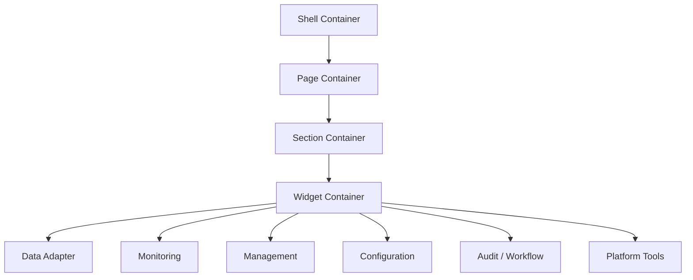
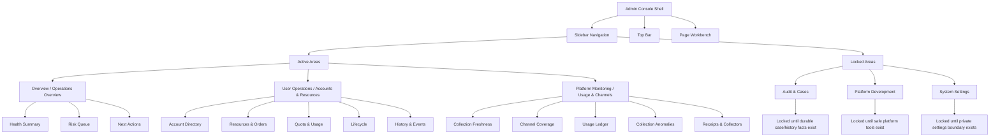
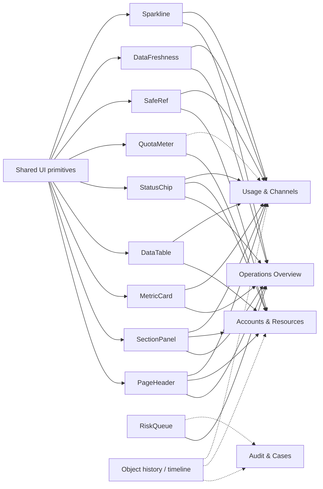
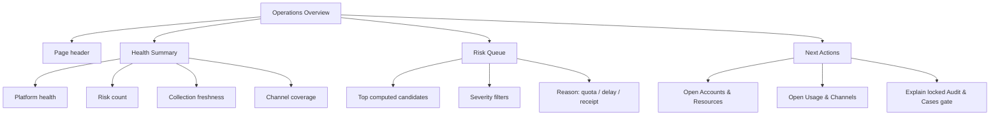
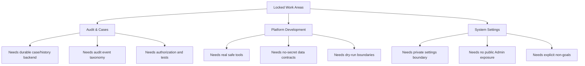
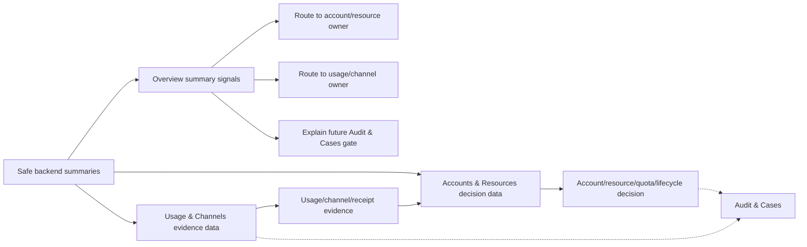

# Admin Console Frontend Structure Blueprint

Last updated: 2026-06-24, America/Los_Angeles.

> Status:
> - Linear: GCC-73 under GCC-42
> - Risk: C for this Phase 1 structure blueprint; follow-up React implementation
>   is B unless it touches auth, schema, runtime, production gates, or deploys.
> - Production impact: None.
> - Execution authority: Does not authorize production, AWS, Vultr, DNS,
>   Nginx, systemd, DB, runtime, auth model, schema/migration, token,
>   credential, subscription URL, raw config/log/env, raw log, audit export,
>   SQLite row, or customer-data actions.

This document freezes the Phase 1 frontend page structure and module ownership
before more UI implementation work continues. It is a structure blueprint, not a
React implementation plan and not a design-system token spec.

Use it after:

- `docs/ADMIN_CONSOLE_UI_PROMPT_TRACEABILITY.md`
- `docs/ADMIN_CONSOLE_DOMAIN_DICTIONARY.md`
- `docs/ADMIN_CONSOLE_NAVIGATION_IA.md`

Use it before:

- `docs/ADMIN_CONSOLE_VISUAL_PROTOCOL.md`
- `docs/ADMIN_CONSOLE_APP_MAP.md`
- `docs/ADMIN_CONSOLE_COMPONENT_FUNCTION_BLUEPRINT.md`
- any Phase 2 design-system work
- any Phase 3 React page implementation or cleanup

## Phase Boundary

Phase 1 only defines the product UI structure:

1. business requirements;
2. page ownership;
3. page-local sections;
4. rough page/module layout;
5. content fields and state coverage;
6. prompt path for later implementation.

Phase 1 does not implement React, wire new backend APIs, perform Browser QA,
create production actions, or introduce new runtime authority.

Current follow-up React work keeps that boundary: it implements only the local
Admin shell, System Search / route index, page-owned module container rules,
and persisted browser layout preferences. It does not add backend authority,
production mutation, schema migration, or sensitive runtime data exposure.

The 2026-06-20 to 2026-06-21 Admin sequence closed the relationship model,
capability-gated frontend registration, and static Platform Monitoring
expansion. The active follow-up is backend DTO contract design in
`docs/ADMIN_BACKEND_DTO_CONTRACT.md`.

Backend DTO design remains docs-only until a separate implementation PR adds
read-only summary tests and adapters. Super-admin-only Key/Audit/Log surfaces
remain deferred until after that contract work.

## Frontend Containerization Model

The Admin console is designed as a frontend container system, not as a set of
unrelated pages. Each function enters the UI through a bounded container first,
then connects to safe backend adapters later.

| Layer | Purpose | Current rule |
| --- | --- | --- |
| Shell Container | Sidebar, top bar, search, environment, and operator context. | Shared shell only; no page-specific business tables here. |
| Page Container | One navigation page owns one operator question. | The page contract decides whether content is owner, preview, or evidence only. |
| Section Container | One task-focused group inside a page. | No unrelated long-scroll collections inside the same section. |
| Widget Container | Cards, tables, queues, timelines, drawers, forms, or tool panels. | Widgets expose layout and interaction boundaries before API connection. |
| Data Adapter | Static design data now, safe backend API adapter later. | Backend data must stay redacted, paged/filterable when needed, and scoped to the container. |

| Category | UI responsibility | Examples |
| --- | --- | --- |
| Monitoring | Read-only health, freshness, channel, usage, and anomaly evidence. | Health cards, channel coverage, usage ledger, anomaly queue. |
| Management | User, account, resource, order, artifact, quota, and lifecycle supervision. | Account directory, resource/order table, lifecycle review. |
| Configuration | Default values, thresholds, quota policy, private operator preferences. | Quota policy panel, future refresh/settings panels. |
| Audit / Workflow | Review candidates, object history, cases, work orders, and routing. | Risk queue, history preview, future durable cases. |
| Platform Tools | Safe diagnostics, channel tools, node onboarding, dry-run utilities. | Receipts/collectors diagnostics entry, future platform tools. |

Overview is a summary-and-routing surface, not a draggable desktop. All active
pages use fixed page-owned panels, route/subpage ownership, bounded local
scroll, and deterministic responsive rules. If content no longer fits the
first screen, split it into a page-owned subpage, detail drawer, or paginated
section instead of adding hideable or reorderable widgets.

The current React implementation treats each visible module as a page-owned
panel: System Search and page-local controls are discovery/routing entrypoints,
and `admin/src/app/admin-ui-projection.ts`,
`admin/src/app/navigation.ts`, and `admin/src/app/admin-search-index.ts` own the
projection, route, and safe search contracts. Page frames must not invent editor
panels, global app drawers, AppLibrary/NavigationLibrary surfaces, or
drag/resize/minimize semantics.
`admin/src/app/admin-app-manifest.ts` is now the concrete App Map source for
workspace pages, page modules, console utilities, planned slots, and safe
System Search fields; `docs/ADMIN_CONSOLE_APP_MAP.md` documents that contract.
New app entries should also follow
`docs/ADMIN_CONSOLE_APP_MANIFEST_AUTHORING_STANDARD.md`, which freezes the
required authoring fields, entry types, layout sizes, runtime states, and
safe-search boundaries before additional visible UI is added.

## Viewport Strategy

The Admin console has two design targets, not one desktop layout with narrow
CSS overrides:

| Target | Primary frame | Layout model | Current rule |
| --- | --- | --- | --- |
| Web / desktop workbench | `1600 x 1024` first, then tablet-safe collapse | Multi-column operator workspace with page-owned modules, System Search recovery, bounded subpages, and dense evidence widgets. | This is the primary design and implementation target for the current Admin UI closeout. |
| Mobile review mode | `390 x 844` first, with `375 x 667` as the small-height guard | Single-column review flow for quick status, risk, and owner-page handoff. | Must be designed as a separate projection, not by reusing the desktop column map, plugin grid, card density, or page scroll plan. |

The current mobile CSS may keep the page safe from clipping while the web
layout is being closed, but it is not the final mobile design. Final mobile
work must define its own information architecture before implementation:

1. top status summary and current page identity;
2. page-local priority tabs or compact section switcher;
3. one active review card at a time with drill-in details;
4. compact primary routes and System Search recovery that do not cover content;
5. safe empty/stale/disconnected states;
6. no hidden privileged key, audit, log, raw URL, token, credential, raw log, or
   customer-private data surfaces.

Mobile should reuse the same domain facts, redaction rules, route ownership,
and capability gates as desktop. It should not reuse desktop component
geometry when the operator task is different.

## Design Grammar Contract

The active Admin frontend now has a first-pass Design Grammar layer:

- `admin/src/design/grammar/layout.ts` defines layout archetypes and required
  rendered metadata.
- `admin/src/design/grammar/density.ts` defines density and touch-target
  rules.
- `admin/src/design/grammar/hierarchy.ts` defines the order of metric,
  context, state, action, evidence, and detail.
- `admin/src/design/grammar/components.ts` defines system/container/content/
  control/state responsibilities.
- `admin/src/app/admin-ui-contract.ts` binds the three active pages to
  page-level contracts.

The active pages must render stable metadata so Browser/Chrome/Playwright QA can
validate the contract without treating CSS class names as product semantics:

| Page | `data-layout` | `data-density` | `data-mobile-projection` |
| --- | --- | --- | --- |
| `Operations Overview` | `dashboard` | `normal` | `single-column-review-flow` |
| `Accounts & Resources` | `table` | `normal` | `single-column-review-flow` |
| `Usage & Channels` | `dashboard` | `normal` | `single-column-review-flow` |

QA is therefore a compliance layer over the grammar. It should check rendered
metadata, required blocks, redaction, privileged-surface absence, overflow, and
touch targets; it should not be the layer that decides new design density or
layout hierarchy.

## Visual Container Rules

The container model also defines the first visual style baseline:

- Shell, top bar, panels, subnav, widgets, and popovers must use shared Admin
  CSS tokens rather than one-off color/radius/shadow values.
- The desktop theme is part of the shell contract: canvas background,
  ShellRail, TopBar, System Search, and page-owned panel surfaces each use
  dedicated tokens so future pages do not restyle the operator console one
  component at a time.
- The current accepted Figma baseline is `06 AI Exploration`: `373:716`,
  `373:866`, and `373:1016`. Older bottom shelf, dock, AppLibrary,
  NavigationLibrary, and freeform windowing language is historical exploration,
  not the current implementation target.
- Phase 4 visual work must follow `docs/ADMIN_CONSOLE_VISUAL_PROTOCOL.md`
  before adding System Search, module panels, workspace chrome, or richer
  layout behaviors.
- Sidebar navigation, page-local subnavigation, top-bar route links, and
  route/action cards share one nav-card format: compact height, 8px radius, 1px
  border, icon or marker slot, blue owner/selected state, and muted preview or
  locked state.
- Primary interaction color is blue; status colors are semantic only.
- Page sections use one visible panel layer. Do not nest cards inside cards.
- Overview widgets may be reorderable later; owner-page sections stay
  predictable and use collapsible/lazy detail containers instead.
- Workspace pages may keep container contracts in collapsed details, but the
  visible chrome should read as the operator console instead of a design draft.
- Plugin contracts use category chips, category connector bars, bounded metadata
  cells, and counted content/state/boundary slots so the React workspace can be
  reviewed before API wiring without showing redundant planning copy by default.

## Frontend Page Structure

## Page Ownership Map

| Page | Role | Primary question | Sections | Must not own |
| --- | --- | --- | --- | --- |
| `Operations Overview` | Overview and routing surface | What needs attention, and where should the operator go next? | `Health Summary`, `Risk Queue`, `Next Actions` | Account/resource ledger, object timeline, channel ledger, quota editing, order pause/archive, runtime apply. |
| `Accounts & Resources` | Decision owner | Which account owns which resources, and what quota or lifecycle decision is needed? | `Account Directory`, `Resources & Orders`, `Quota & Usage`, `Lifecycle`, `History & Events` | Collector activation, channel strategy, runtime apply, platform tooling, operator settings. |
| `Usage & Channels` | Evidence owner | Are usage collection, channels, and receipts trustworthy? | `Collection Freshness`, `Channel Coverage`, `Usage Ledger`, `Collection Anomalies`, `Receipts & Collectors` | Account create/disable, quota ownership, order pause/archive, artifact lifecycle, runtime apply. |
| `Audit & Cases` | Locked future work area | What happened over time, who reviewed it, and what case state is durable? | `Case Inbox`, `Object History`, `Audit Notes`, `Work Orders`, `Close / False Positive Review` | Direct production execution. |
| `Platform Development` | Locked future work area | Which platform tool, strategy, or onboarding path should be reviewed? | `Channel Strategy`, `Node Onboarding`, `Collector Lab`, `API Diagnostics`, `Dry-run Tools` | User account operations and ungated production mutation. |
| `System Settings` | Locked future work area | How is this private console configured? | `Connection Settings`, `Environment Profiles`, `Refresh Policy`, `Permissions`, `Safety Policy` | Public user settings and auth model changes without a separate gate. |

## Relationship Model Mapping

The expanded relationship model maps into this Phase 1 structure without
creating immediate route sprawl:

| Relationship item | Current structural owner | Current-wave rule |
| --- | --- | --- |
| User Management | `Accounts & Resources` sections | Keep user directory, order count, active order count, and user usage in the existing management page until GCC-114 decides a split. |
| Order Management | `Accounts & Resources -> Resources & Orders` / `Quota & Usage` / `Lifecycle` | Keep per-order usage, lifecycle, artifact safe refs, and quota evidence in the existing page until DTO ownership justifies a split. |
| Platform Monitoring, route latency, agent status, inspection summaries | `Usage & Channels` sections | Current static UI expansion under existing modules; backend DTO ownership remains pending. |
| Account & Permissions | `System Settings` / future permission panel | Document as scoped operator-permission content; do not change auth model in this wave. |
| About | Future safe system-info panel | Can be designed as a low-risk surface after build/version DTO fields are defined. |
| Key Management | Privileged, not registered for non-super-admin | No route, System Search entry, search source, command result, notification link, hidden DOM, or API call for non-super-admin users. |
| Audit Center | Privileged, separate from normal risk/case summaries | Normal operators may see risks/anomalies, not audit rows or raw history. |
| Log Access | Privileged ephemeral view session | No raw log UI in normal monitoring; no cache/search/localStorage fixture for raw logs. |

## Module Ownership Graph

## Operations Overview Structure

Purpose: show operator attention and route to the owner page.

Content requirements:

| Module | Content fields | State coverage | Route target |
| --- | --- | --- | --- |
| Health cards | label, value, source note, trend, freshness | loading, disconnected, ready, stale | None or owner-page action. |
| Risk queue | severity, reason, affected safe refs, count, source | empty, filtered, warning, danger | Owner page or future case page. |
| Next actions | owner page, why open it, gated/future state | ready, disabled, locked | `Accounts & Resources`, `Usage & Channels`, future `Audit & Cases`. |

Overview must not render full account tables, object timelines, or channel
ledgers. If a module needs filters, paging, drawers, or row-level action, it
belongs to the owner page.

## Accounts & Resources Structure

Purpose: own user account, resource, order, quota, and lifecycle decisions.

```mermaid
flowchart TD
  Accounts["Accounts & Resources"]
  Accounts --> Header["Page header"]
  Accounts --> Directory["Account Directory"]
  Accounts --> Resources["Resources & Orders"]
  Accounts --> Quota["Quota & Usage"]
  Accounts --> Lifecycle["Lifecycle"]
  Accounts --> History["History & Events"]

  Directory --> A1["Safe account refs"]
  Directory --> A2["Risk state"]
  Directory --> A3["Resource count"]

  Resources --> R1["Orders"]
  Resources --> R2["Entitlements"]
  Resources --> R3["Subscription artifact safe refs"]
  Resources --> R4["Delivery state"]

  Quota --> Q1["Default limit"]
  Quota --> Q2["Edited limit"]
  Quota --> Q3["Used / total"]
  Quota --> Q4["Measured channels as evidence"]
  Quota --> Q5["Audit note required gate"]

  Lifecycle --> L1["Account enabled/disabled"]
  Lifecycle --> L2["Order paused/expired"]
  Lifecycle --> L3["Artifact revoked"]
  Lifecycle --> L4["Archive candidate"]

  History --> H1["Case candidates"]
  History --> H2["Safe computed events"]
  History --> H3["Future durable audit entry"]
```

Content requirements:

| Section | Primary objects | Decisions owned here | Evidence allowed |
| --- | --- | --- | --- |
| Account Directory | user account | account review, create/disable planning | risk badges from usage/case summaries |
| Resources & Orders | resource, order, entitlement, artifact | resource/order lifecycle, artifact lifecycle review | channel refs and collection state |
| Quota & Usage | quota, usage summary | quota policy, over-limit disposition | freshness, measured channel count |
| Lifecycle | account, order, artifact | account disabled, order paused, expired, revoked, archive candidate | future audit/case evidence |
| History & Events | safe event, case candidate | review entry only until durable backend | usage/channel facts as context |

## Usage & Channels Structure

Purpose: own usage collection, channel coverage, receipt, and collector evidence.

```mermaid
flowchart TD
  Usage["Usage & Channels"]
  Usage --> Header["Page header"]
  Usage --> Fresh["Collection Freshness"]
  Usage --> Coverage["Channel Coverage"]
  Usage --> Ledger["Usage Ledger"]
  Usage --> Anomalies["Collection Anomalies"]
  Usage --> Receipts["Receipts & Collectors"]

  Fresh --> F1["Generated time"]
  Fresh --> F2["Observed age"]
  Fresh --> F3["Unknown / stale count"]

  Coverage --> C1["Issued channels"]
  Coverage --> C2["Measured channels"]
  Coverage --> C3["Missing channels"]
  Coverage --> C4["Receipt blockers"]
  Coverage --> C5["Channel health"]
  Coverage --> C6["Route latency p50 / p95 / p99"]

  Ledger --> L1["Account safe ref"]
  Ledger --> L2["Order safe ref"]
  Ledger --> L3["Channel safe ref"]
  Ledger --> L4["Traffic: upload / download / total"]
  Ledger --> L5["Collected time"]

  Anomalies --> A1["Delayed collection"]
  Anomalies --> A2["True zero usage"]
  Anomalies --> A3["Not collected"]
  Anomalies --> A4["Missing receipt"]

  Receipts --> R1["Receipt freshness"]
  Receipts --> R2["Collectors: availability"]
  Receipts --> R3["Agent heartbeat / version"]
  Receipts --> R4["Inspection summaries"]
  Receipts --> R5["Future safe diagnostics"]
```

Content requirements:

| Section | Primary objects | Decisions owned here | Forbidden here |
| --- | --- | --- | --- |
| Collection Freshness | collector, usage sample | collection trust and stale/unknown diagnosis | quota editing, account disable |
| Channel Coverage | channel, route, receipt, edge credential ref | measured/missing channel diagnosis, health state, route latency evidence | channel runtime apply |
| Usage Ledger | usage sample, account/order refs | measurement evidence and correlation | order pause/archive decision |
| Collection Anomalies | usage sample, collector, receipt | anomaly classification | durable case close/reopen |
| Receipts & Collectors | receipt, collector, agent, inspection run | evidence availability, agent health, inspection summary, and future diagnostics | raw logs, audit rows, raw config, credentials |

## Locked Page Structure

Locked pages may be visible as non-clickable navigation slots, but they do not
get empty route pages.

Privileged Key Management, Audit Center, and Log Access are stricter than
ordinary locked slots. For non-super-admin users, they are not rendered as
locked placeholders; they are absent from registration entirely. The first
frontend task for those surfaces is GCC-110 capability-gated registration, and
the first fixture UI task is deferred to GCC-113.

## Data And Decision Flow

Rules:

- Overview summarizes and routes.
- Accounts & Resources owns user/resource/quota/lifecycle decisions.
- Usage & Channels owns measurement evidence and anomaly diagnosis.
- Audit & Cases owns durable case/history workflow only after backend facts
  exist.
- No page may display subscription URLs, tokens, credentials, raw runtime
  config, raw logs, raw env, raw SQLite rows, or customer-private data.

## Implementation Mapping

This blueprint maps to the current React contract without requiring immediate
implementation:

| Design concept | Current code anchor | Implementation note |
| --- | --- | --- |
| Top-level active areas | `consoleSections` in `admin/src/app/navigation.ts` | Keep active pages limited to real content. |
| Active pages | `AdminPage` in `admin/src/app/navigation.ts` | Current routes: `dashboard`, `portalRequests`, `usageMonitor`. |
| Page-local sections | `pageSubNavigation` in `admin/src/app/navigation.ts` | Section IDs must match page content anchors and tests. |
| Ownership boundary | `pageWorkbenchContracts` in `admin/src/app/navigation.ts` | Update docs, contract, tests, and QA together if ownership changes. |
| App and module registry | `admin/src/app/admin-app-manifest.ts` | System Search indexing, safe route targets, and module restore metadata must come from the manifest. |
| Expanded relationship model | `docs/ADMIN_CONSOLE_RELATIONSHIP_DRAFT.md` | Use as sequencing and Figma handoff input; do not convert every surface into an active route in one wave. |
| Page panel projection | `admin/src/app/admin-ui-projection.ts`, `admin/src/components/primitives/panel-frame.tsx` | Keep page-owned panel order, route targets, bounded rows, and subpage split rules deterministic; do not reintroduce hide/restore/resize/reorder engines. |
| Panel container primitive | `admin/src/components/primitives/panel-frame.tsx` | Card-level status and local actions belong in the panel header/body; no separate page-level editor card. |
| Shared UI modules | `docs/ADMIN_CONSOLE_COMPONENT_FUNCTION_BLUEPRINT.md` | Phase 2 design-system work should refine component states before broad implementation. |
| Visual QA | `docs/ADMIN_CONSOLE_VISUAL_QA_LEDGER.md` | Phase 3 implementation should verify rendered pages against this structure. |

## Phase 1 Completion Checklist

Before starting Phase 2 or Phase 3 work, confirm:

1. Every active page has one primary operator question.
2. Every section has one owner page.
3. Every repeated object is marked owned, preview-only, or evidence-only.
4. Overview has no detailed account/resource ledger, object timeline, or channel
   ledger.
5. Accounts & Resources owns quota and lifecycle decisions.
6. Usage & Channels owns collection/channel/receipt evidence only.
7. Locked pages have entry gates and no empty route pages.
8. Future implementation has a code anchor and test anchor.
9. Privileged key/audit/log surfaces are absent for non-super-admin users, not
   rendered as disabled placeholders.
10. Current implementation must stay within the active wave boundary: GCC-112
   is docs-only backend DTO contract work until a separate implementation gate
   exists.
