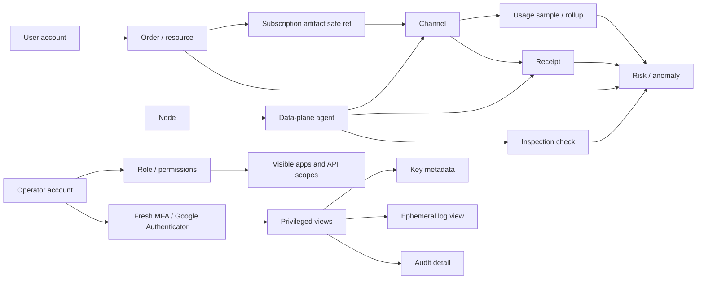

# Admin Console Relationship Draft

Last updated: 2026-06-21, Asia/Shanghai.

> Status:
> - Type: Active relationship and page-design contract.
> - Risk: C for this document; follow-up Admin UI implementation is B.
> - Production impact: None.
> - Execution authority: Does not authorize production, AWS, Vultr, DNS,
>   Nginx, systemd, DB, runtime, auth model, schema/migration, token,
>   credential, subscription URL, raw config/log/env, SQLite row, raw log,
>   audit export, or customer-data actions.

This document turns the current Admin UI discussion into one reviewable frontend
relationship model. It is a planning source for Figma, React UI work, backend
DTO design, and Linear task splitting. It does not promote any locked page to
production use and does not authorize access to secrets, raw logs, audit rows,
or runtime material.

React-visible Admin copy is currently English canonical. Chinese labels in this
document are planning labels; implementation should either map them to the
existing English UI labels or add an explicit locale layer with tests.

## Design Position

Admin is a protected operator console for supervision and review. It is not the
customer User Portal, not a public Admin surface, not a direct runtime execution
panel, and not a raw log or audit browser.

The draft uses four front-end principles:

1. Show safe summaries first; drill down only through explicit safe object refs.
2. Split business decisions from measurement evidence.
3. Hide privileged functions at registration time, not with disabled UI.
4. Keep raw logs, audit details, and key material behind backend authority,
   super-admin permission, fresh MFA, reason code, TTL, and audit retention.

## Current Execution Boundary

This relationship model is intentionally larger than the current delivery
batch. Do not treat every surface below as simultaneous implementation work.

| Wave | Linear scope | Delivery boundary |
| --- | --- | --- |
| Closed | `GCC-109`, `GCC-103` | Relationship model, Admin IA/docs, and Figma/UI handoff boundaries are documented. |
| Closed | `GCC-110`, `GCC-111` | Capability-gated frontend registration and static Platform Monitoring details are on `master`. |
| Current | `GCC-101`, `GCC-112` | Design backend DTO, redaction, retention, and privilege contracts before live integration. This remains C while it is design-only and becomes A if auth/schema/retention changes start. |
| Deferred | `GCC-113`, `GCC-114` | Keep super-admin Key/Audit/Log fixture surfaces and User/Order page splitting out of the current wave. |

Current WIP limit: `GCC-101` / `GCC-112` design-only contract work. The rest of
this document is a map for sequencing, not a commitment to finish every page in
one PR.

## Object Relationship Model



Relationship rules:

- A user can own many orders/resources.
- An order has usage and lifecycle state; it may reference one or more channel
  safe refs through a subscription artifact.
- Channel and agent facts are evidence for decisions, not account/order
  mutation authority.
- Audit and log facts are privileged supervision facts. They must not be
  visible to non-super-admin operators and must not be included in normal
  search, notification, or page-summary APIs.

## Role And Visibility Matrix

| Surface | Normal operator | Admin | Super admin | Super admin + fresh MFA |
| --- | --- | --- | --- | --- |
| Operations Overview | Visible | Visible | Visible | Visible |
| Platform Monitoring summaries | Visible | Visible | Visible | Visible |
| User Management | Limited or none | Visible | Visible | Visible |
| Order Management | Limited or none | Visible | Visible | Visible |
| Account & Permissions | Own profile only | Role summary | Full role summary | Sensitive permission detail |
| Key Management | Not registered | Not registered | Metadata entry visible | Key metadata detail visible |
| System Settings | Own preferences only | Safe local settings | Permission-gated settings | Sensitive setting detail |
| About | Visible | Visible | Visible | Visible |
| Inspection summaries | Visible as health state | Visible | Visible | Visible |
| Audit Center | Not registered | Not registered | Visible | Detail visible |
| Log Access | Not registered | Not registered | Entry visible | Ephemeral session visible |

Hard registration rule:

```ts
const registeredApps = [
  operationsOverviewApp,
  platformMonitoringApp,
  userManagementApp,
  orderManagementApp,
  accountPermissionsApp,
  systemSettingsApp,
  aboutApp
];

if (permissions.isSuperAdmin) {
  registeredApps.push(keyManagementApp);
  registeredApps.push(auditCenterApp);
  registeredApps.push(logAccessApp);
}
```

Non-super-admin behavior:

- no audit route;
- no log route;
- no key-management route;
- no System Search entry, primary-route item, or module restore launcher for
  audit/log/key-management;
- no global-search source for audit/log/key-management;
- no command palette result for audit/log/key-management;
- no notification deep link to audit/log/key-management;
- no hidden DOM entry or disabled placeholder;
- no frontend call to audit, log, or key metadata APIs.

Backend remains the security authority. Frontend visibility only prevents
accidental exposure and unnecessary calls.

## Navigation Draft

| Group | Page | First modules | Visibility |
| --- | --- | --- | --- |
| Overview | Operations Overview | health, risk summary, inspection summary, next actions | all authorized Admin users |
| Monitoring | Platform Monitoring | channel health, route latency, agent status, usage collection, receipts | all authorized Admin users |
| Management | User Management | user directory, user usage, user orders, lifecycle state | admin and above |
| Management | Order Management | order table, order usage, quota, artifact safe ref, lifecycle | admin and above |
| Security | Account & Permissions | operator accounts, roles, MFA status, permission matrix | scoped by role |
| Security | Key Management | key inventory metadata, scope, rotation status, access guard | super admin only; detail needs fresh MFA |
| Settings | System Settings | connection, environment, refresh policy, notification thresholds | scoped by role |
| System | About | version, created time, build time, changelog, compatibility | all authorized Admin users |
| Restricted | Audit Center | audit summaries, permission changes, key access records, log access records | super admin only; detail needs fresh MFA |
| Restricted | Log Access | ephemeral log request, reason, MFA, one-time session, burned state | super admin only; detail needs fresh MFA |

Normal operators should see risks and anomalies as business states, not as audit
or log features. For example, a normal user may see "Inspection failed" or
"Channel receipt missing", but not "audit event row" or "raw log excerpt".

## Page Drafts

### 1. Operations Overview

Purpose: answer what needs attention and where the operator should go next.

Primary widgets:

| Widget | Data family | Visualization | Interaction |
| --- | --- | --- | --- |
| Platform health | Admin/API/source status | KPI card plus small trend | opens monitoring summary |
| Risk candidates | computed risk/anomaly summaries | severity queue | routes to owner page, not audit detail for non-super-admin |
| Collection freshness | generatedAt, last observed, P95 age | KPI card plus sparkline | opens Platform Monitoring freshness |
| Channel coverage | issued/measured/missing/receipt states | KPI card plus stacked status | opens Channel Health |
| Inspection summary | last run, failed checks, stale checks | compact check cards | opens inspection summaries |
| Next actions | page ownership | action cards | navigate to allowed owner pages |

Must not render:

- raw logs;
- audit trail;
- key metadata;
- raw subscription URLs;
- production execution controls.

### 2. Platform Monitoring

Purpose: show whether channels, routes, agents, usage collection, and receipts
are trustworthy enough to support user/order decisions.

Sections:

| Section | Required fields | Chart/artifact family | Notes |
| --- | --- | --- | --- |
| Channel Health | channelRef, state, utilization, error rate, receipt state, last measured | table with status chips and in-cell bars | req/s and error rate require backend rollup |
| Route Latency | source, target, route type, p50, p95, p99, sample count, stale state | heatmap or ranked table with trend sparklines | keep values visible without hover |
| Agent Status | agentRef, nodeRef, version, heartbeat, desired-state pull, receipt push, collector state | table plus compact timeline | no raw agent logs |
| Usage Collection | generatedAt, measured orders, zero usage, not collected, stale | KPI cards plus trend | distinguish true zero from missing data |
| Receipts | receipt status, pending count, missing count, last receipt | table and anomaly queue | receipt state is evidence only |
| Inspection Runs | check name, latest result, duration, next run, owner object | check table and trend | raw logs hidden from this page |

Monitoring state taxonomy:

- healthy;
- degraded;
- failed;
- stale;
- unknown;
- not collected;
- collector disabled;
- receipt missing;
- receipt delayed;
- inspection overdue.

### 3. User Management

Purpose: supervise users and their owned orders/resources.

Sections:

| Section | Required fields | UI |
| --- | --- | --- |
| User Directory | userRef, state, order count, active order count, total traffic used, risk state | dense table |
| User Detail | selected user, order list, total quota, recent safe events | right drawer or split panel |
| User Usage | upload, download, total, quota ratio, measured channel count | quota meter and trend |
| User Orders | created orders, active orders, expired/revoked orders | grouped table |
| Lifecycle | enabled, disabled, pending, review required | state cards |

User Management owns user-level supervision, not key access, raw audit, or log
inspection.

### 4. Order Management

Purpose: make order state, usage, quota, and artifact lifecycle inspectable.

Sections:

| Section | Required fields | UI |
| --- | --- | --- |
| Order Table | orderRef, userRef, plan, state, createdAt, validUntil, active flag | sortable table |
| Order Usage | upload, download, total, usageRatio, last observed, collection state | usage cards and sparkline |
| Channel Binding | issued channels, measured channels, missing channels, receipt blockers | object chain and status table |
| Artifact Safe Ref | artifactRef, artifactStatus, firstSeen, lastSeen | safe-ref panel |
| Lifecycle | pending, delivered, paused, expired, revoked, archive candidate | timeline |

Order Management may show evidence from Platform Monitoring, but quota/lifecycle
decisions remain separate gated actions.

### 5. Account & Permissions

Purpose: show operator accounts, roles, MFA state, and feature visibility.

Sections:

| Section | Required fields | Visibility |
| --- | --- | --- |
| Operator Accounts | operatorRef, display name, role, status, MFA state, last login | admin and above |
| Role Matrix | page visibility, action capability, data scope | admin and above |
| My Permissions | own role, visible apps, MFA state | all authorized users |
| Permission Detail | role grants, sensitive scope markers | super admin plus fresh MFA if sensitive |

This page must not change the auth model in a UI-only pass. Permission edits
need separate backend and audit contracts.

### 6. Key Management

Purpose: let super admins inspect key metadata without exposing key material.

Registration rule: this page does not exist for non-super-admin users.

Detail rule: super admins must have fresh MFA before detail panels load.

Allowed fields:

- keyRef;
- key type;
- scope;
- owning subsystem;
- createdAt;
- expiresAt;
- rotation state;
- last used at;
- last access audit summary id;
- status.

Forbidden fields:

- raw secret;
- token value;
- private key;
- password;
- subscription URL;
- auth header;
- raw environment value;
- raw runtime config.

Initial UI:

| Section | UI | Notes |
| --- | --- | --- |
| Key Inventory | metadata table | no values, no copy secret action |
| Rotation State | status chips and timeline | no rotate button until backend contract |
| Scope Map | safe relationship list | object refs only |
| Access Guard | MFA state, reason requirement | no detail without fresh MFA |

### 7. System Settings

Purpose: configure private console behavior, not production runtime.

Sections:

| Section | Fields | Risk |
| --- | --- | --- |
| Admin API Connection | local/private base URL, trusted-origin state, connection health | B if code changes |
| Environment Profiles | labels for local/staging/production, active profile | B if local-only |
| Refresh Policy | manual refresh, interval, stale thresholds | B if local-only |
| Notification Thresholds | visible alert thresholds, no execution | B |
| Safety Policy | redaction reminders, no-public-Admin boundary | C/B |

This page must not show secrets or raw config values.

### 8. About

Purpose: make version and lifecycle facts visible.

Fields:

- frontend version;
- backend version;
- commit or build id;
- created time;
- build time;
- development phase;
- latest update summary;
- compatibility status;
- changelog entries.

The About page can be visible to all authorized Admin users because it contains
no privileged operational data.

### 9. Audit Center

Registration rule: this page does not exist for non-super-admin users.

Purpose: inspect durable audit summaries and sensitive administrative history.

Sections:

| Section | Fields | Access |
| --- | --- | --- |
| Audit Summary | event category, count, latest time, severity | super admin |
| Permission Changes | actor, target role, action, time, reason summary | super admin; detail can require MFA |
| Key Access Records | keyRef, actor, reason, result, time | super admin plus fresh MFA for detail |
| Log Access Records | objectRef, viewedBy, reason, logDigest, burnedAt | super admin plus fresh MFA for detail |
| Retention Policy | category, TTL, durable summary rule | super admin |

Audit detail must be backed by durable backend permission checks. Frontend
hidden state is not sufficient.

### 10. Log Access

Registration rule: this page does not exist for non-super-admin users.

Purpose: request and view ephemeral, redacted, time-limited log excerpts.

Flow:

1. Select safe object scope: agent, channel, order, route, receipt, or keyRef.
2. Enter reason code.
3. Complete fresh MFA.
4. Backend creates one-time view session.
5. Frontend renders redacted excerpt with countdown and object scope.
6. Close or TTL expiry burns the session.
7. Durable audit summary remains.

UI states:

- no permission;
- MFA required;
- reason required;
- session requested;
- session active;
- session expired;
- burned;
- access denied;
- audit summary retained.

The page must never cache raw logs in localStorage, sessionStorage, System Search,
search index, screenshots, or fixture data.

## Dashboard Visualization Contract

Analytical jobs:

- monitoring: platform health, channels, agents, inspections;
- comparison/ranking: worst routes, failing channels, high-traffic orders;
- time change: usage and latency trends;
- correlation: order usage versus channel/agent evidence;
- workflow: risk and inspection queues.

Preferred artifact families:

| Need | Primary view | Fallback |
| --- | --- | --- |
| Channel health | table with status chips, utilization bars, row grouping | card grid on narrow mobile |
| Route latency | ranked route table with p50/p95/p99 columns and sparklines | small-multiple trend cards |
| Agent status | table plus heartbeat age chip | grouped cards by node |
| User traffic | quota meter and trend | numeric table row |
| Order traffic | order-level usage table and line trend | usage summary card |
| Inspection | check-result table plus latest-run cards | compact checklist |

Mobile path:

- keep KPI cards first;
- collapse dense tables into horizontal-scroll tables or grouped row cards;
- keep critical values visible without hover;
- preserve safe object refs and state chips;
- hide optional trend charts before hiding state or ownership.

Accessibility rules:

- status must use text plus color, not color alone;
- every chart must have a table-equivalent reading path;
- stale/offline/partial states must remain visible;
- hover-only details are not acceptable for critical values.

## Backend DTO Draft

These DTO names are now expanded in
`docs/ADMIN_BACKEND_DTO_CONTRACT.md`. They are still design contracts, not
implemented API routes or schema authority.

| DTO | Purpose | Privilege |
| --- | --- | --- |
| `operationsOverviewSummary` | health, risk, freshness, coverage, inspection summary | normal Admin |
| `channelHealthSummary` | channel status, utilization, error rate, receipt state | normal Admin |
| `routeLatencySummary` | route pair, p50/p95/p99, sample count, stale state | normal Admin |
| `agentStatusSummary` | heartbeat, version, node, desired-state, receipt, collector | normal Admin |
| `inspectionRunSummary` | latest run, failed checks, next run, duration | normal Admin |
| `userManagementSummary` | user state, order counts, active orders, total usage | Admin |
| `orderManagementSummary` | order state, userRef, traffic, quota, artifact safe refs | Admin |
| `operatorAccountSummary` | operator profile, role, MFA, visible apps | scoped |
| `keyInventoryMetadataSummary` | key metadata only, no values | super admin plus MFA for detail |
| `auditSummary` | durable audit category/count/detail refs | super admin |
| `ephemeralLogViewSession` | one-time redacted log excerpt session | super admin plus fresh MFA |
| `aboutBuildInfo` | version, build, changelog, compatibility | all authorized Admin users |

Forbidden DTO behavior:

- returning raw secret or token values;
- returning raw subscription URLs;
- returning raw logs to non-super-admin users;
- returning audit detail to non-super-admin users;
- embedding privileged data in normal overview/search/notification responses.

## Frontend Implementation Shape

Capability gating should happen before route, manifest, search, and API-client
registration.

```ts
type AdminCapability =
  | "view_overview"
  | "view_platform_monitoring"
  | "view_users"
  | "view_orders"
  | "view_operator_accounts"
  | "view_key_metadata"
  | "view_audit"
  | "view_ephemeral_logs"
  | "manage_local_settings";

type AdminVisibilityContext = {
  capabilities: Set<AdminCapability>;
  isSuperAdmin: boolean;
  mfaFreshUntil: string | null;
};
```

Rules:

- normal pages register when the capability exists;
- privileged pages register only for `isSuperAdmin`;
- privileged detail fetches require both the capability and fresh MFA;
- search documents are generated from registered apps only;
- notifications route only to registered apps;
- hidden pages must not be imported into user-visible navigation state.

## Phase Plan

| Phase | Scope | Output | Validation |
| --- | --- | --- | --- |
| P0 | Relationship draft | this document and docs index | `git diff --check` |
| P1 | IA update | navigation/app map update for the new page model | `git diff --check` |
| P2 | Fixture UI | safe fixture previews for monitoring/users/orders/about | `npm run admin:test`, `npm run admin:build` |
| P3 | Permission gating | route/search/manifest/API registration filters | Admin tests for non-super-admin absence |
| P4 | Backend DTO planning | summary contracts and redaction tests | server/admin contract tests |
| P5 | Super-admin surfaces | key metadata, audit, log access with MFA-gated fixtures | tests plus visual QA |
| P6 | Live read-only integration | connect non-sensitive summaries first | admin tests, build, browser QA |

## Deferred Decisions

1. `User Management` and `Order Management` remain modules under
   `Accounts & Resources` in the current wave. `GCC-114` decides whether to
   split them into separate top-level pages after backend DTO ownership and UI
   volume justify the change.
2. Whether `Inspection Runs` belongs under `Platform Monitoring` only, or also
   appears as a compact Overview summary.
3. Whether `Audit Center` and `Log Access` should be separate super-admin apps,
   or one restricted `Security Review` app with internal tabs.
4. Whether super-admin detail access uses a single fresh MFA window for audit,
   logs, and key metadata, or one MFA challenge per sensitive object scope.
5. How long ephemeral log view sessions remain active, and what minimum durable
   audit summary fields are required after burn.

## Acceptance Criteria For The Draft

- The page model separates management, monitoring, security, settings, and
  about surfaces.
- Non-super-admin users cannot see or call audit/log/key-management features.
- Dashboard views show measured states, stale states, and unknown states
  separately.
- Raw logs are ephemeral and privileged; durable audit summaries remain.
- Key Management never displays raw key material.
- Every planned UI surface maps to an owner page, privilege level, DTO gap, and
  validation path.
