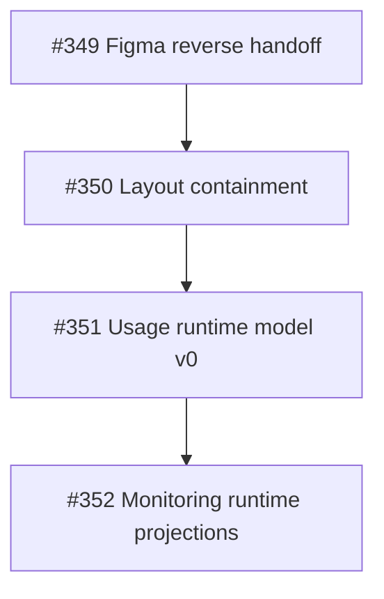
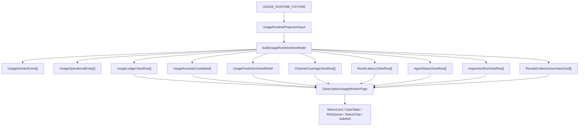
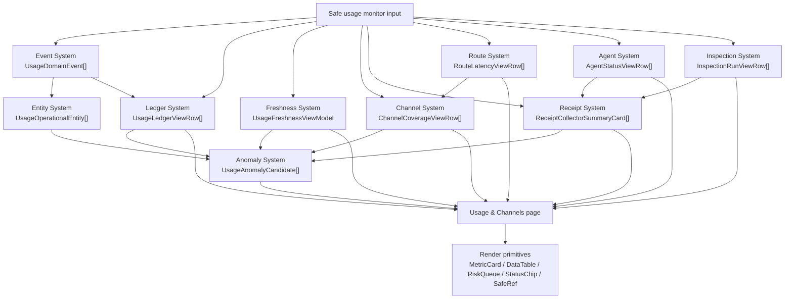

# Admin Runtime Stack Gate

Last updated: 2026-06-21, Asia/Shanghai.

> Status:
> - Type: PR stack governance, runtime-boundary audit, and visual QA gate
> - Risk: C
> - Production impact: None
> - Execution authority: Does not authorize production, AWS, Vultr, Aliyun,
>   DNS, Nginx, systemd, DB, runtime, auth model, schema/migration, token,
>   credential, subscription URL, raw config/log/env, raw log, audit export,
>   SQLite row, or customer-data actions.

This document freezes the current Admin frontend stack into an auditable
dependency contract before more features are added. It covers PRs #350, #351,
and #352 only. It does not mark any Draft PR as ready to merge.

## Current Stack Snapshot

Observed on 2026-06-21:

| PR | Branch | Base | State | Remote check | Role |
| --- | --- | --- | --- | --- | --- |
| #350 | `codex/admin-ui-layout-containment` | `codex/admin-figma-reverse-handoff` | Open Draft, clean | Workers build passed | Layout constraint layer |
| #351 | `codex/admin-runtime-model-v0` | `codex/admin-ui-layout-containment` | Open Draft, clean | Workers build passed | Usage runtime model layer |
| #352 | `codex/admin-monitoring-runtime-projections` | `codex/admin-runtime-model-v0` | Open Draft, clean | Workers build passed | Monitoring projection layer |



## Applied Stack Audit

Observed on 2026-06-21 after refreshing the remote PR branches:

| Check | Result | Evidence |
| --- | --- | --- |
| PR topology | Pass | #350 bases on `codex/admin-figma-reverse-handoff`; #351 bases on #350; #352 bases on #351. |
| #350 layer boundary | Pass | Diff is limited to `DataTable`, workspace CSS, responsive CSS, and style contract tests. No usage runtime, fixture, backend DTO, or API dependency was detected. |
| #351 layer boundary | Pass | Diff adds the usage runtime fixture, ViewModel, page projection, and tests. No route latency, agent status, inspection-run, API client, fetch, or layout-internal dependency was detected in the #351 delta. |
| #352 layer boundary | Pass | Diff extends the same usage runtime model files. No raw API client, `fetch`, `PanelFrame`, `admin-os-workspace`, CSS variable, backend schema, or runtime collector dependency was detected in the #352 delta. |
| Targeted runtime validation | Pass | `npm run admin:test -- usage-view-model.test.ts subscription-usage-monitor.test.tsx` passed with 2 files and 9 tests. |

Residual risks:

- `SubscriptionUsageMonitorPage` still builds the current ViewModel from the
  safe fixture at module scope. This is acceptable for fixture preview, but it
  must become an injected DTO/ViewModel source before live Admin integration.
- #351 and #352 intentionally touch the same five usage files. Any lower-stack
  change requires rerunning the targeted runtime tests and visual QA for #352.
- This audit does not replace the desktop/mobile visual QA freeze; it only
  confirms the current dependency direction.

## Applied Visual QA Smoke

Observed on 2026-06-21 against local fixture preview:

| Check | Result | Evidence |
| --- | --- | --- |
| Local preview startup | Pass | `VITE_ADMIN_CONSOLE_TOKEN=local-dev-preview npm run admin:dev` served `http://127.0.0.1:5173/` with HTTP 200. |
| Browser plugin route | Blocked | In-app Browser navigation to `127.0.0.1` and `localhost` was blocked by the browser with `ERR_BLOCKED_BY_CLIENT`; Playwright CLI was used as the fallback path. |
| Interaction path | Pass | Playwright opened `#/fixture-preview`, clicked `Usage & Channels`, and observed heading `Usage & Channels`. |
| Desktop viewport | Pass | At `1600 x 1024`, document/body scroll width stayed at 1600, no framework overlay was detected, and no blueprint adapter text was visible. Runtime tables scrolled inside table containers where needed. |
| Mobile viewport | Pass | At `390 x 844`, document/body scroll width stayed at 390, all runtime sections rendered in a single-column flow, and no horizontal overflow offenders were detected. Tables used mobile stacked-row rendering rather than squeezed desktop columns. |
| Console health | Pass | Playwright console check reported 0 warnings and 0 errors for the visual QA session. |

This smoke check is evidence for the current stack state only. If #350, #351,
or #352 changes again, rerun both the dependency audit and visual QA.

## Topological Contract

Each PR must depend only on the layer below it. A higher PR may use an exposed
contract from a lower PR, but must not tunnel into private implementation
details.

| PR | Allowed dependencies | Must not depend on |
| --- | --- | --- |
| #350 | `DataTable` containment variables, workspace CSS, responsive CSS, style contract tests | Usage runtime model, backend DTOs, API response shape, production data |
| #351 | Existing layout contract from #350, `SubscriptionUsageMonitorRow`, safe fixture, `DataTable` rendering surface | Monitoring panel-specific UI logic, route latency UI, agent status UI, backend schema, React data-fetching dependency |
| #352 | `buildUsageRuntimeViewModel`, `UsageRuntimeProjectionInput`, #351 safe fixture/model exports | Raw API response access in page components, layout constants, `PanelFrame` internals, backend schema or runtime collection behavior |

Red-line checks:

- #352 must not import raw API clients or production response adapters.
- #352 must not encode layout thresholds or table containment rules.
- #351 must not contain component-rendering decisions for route latency,
  agent status, or inspection tables.
- #350 must remain a layout contract and must not learn usage, channel,
  receipt, or anomaly semantics.

## File-Level Diff Boundary

Observed file ownership:

| PR | Files |
| --- | --- |
| #350 | `admin/src/components/primitives/data-table.tsx`, `admin/src/styles/admin-os-workspace.css`, `admin/src/styles/responsive.css`, `admin/src/test/admin-style-contract.test.ts` |
| #351 | `admin/src/features/subscriptions/usage-runtime-fixture.ts`, `admin/src/features/subscriptions/usage-view-model.ts`, `admin/src/pages/subscription-usage-monitor-page.tsx`, `admin/src/test/subscription-usage-monitor.test.tsx`, `admin/src/test/usage-view-model.test.ts` |
| #352 | Same five Admin Usage files as #351, extending the runtime model and page projection from #351 |

The repeated files in #351 and #352 are acceptable because #352 is a strict
extension of the #351 runtime model. They are not acceptable if #352 starts
solving layout containment or backend integration.

## Runtime Data Flow



Key rule: page components render ViewModel outputs. They do not classify
anomalies, compute channel health, calculate receipt state, or parse backend
payloads.

## Runtime System Architecture Graph

The `Usage & Channels` page is not a flat dashboard. Treat it as an
operational intelligence console composed of runtime subsystems. The current
code still implements these subsystems in one ViewModel file; this graph is the
next boundary for review and future refactoring.



Propagation rules:

- Freshness affects whether ledger evidence is trusted, stale, unknown, or
  collector-disabled.
- Receipt state affects channel coverage and anomaly severity.
- Route latency affects channel health, but must not mutate channel runtime
  state from the frontend.
- Agent and inspection state explain receipt/collector evidence availability;
  they do not authorize logs, runtime config, or data-plane actions.
- Anomalies are derived facts. They may route operators to owner pages, but
  they must not create durable cases or close false positives until a separate
  restricted backend contract exists.

## Subsystem Boundary Map

| Subsystem | Input contract | Output contract | Derived state rules | UI contract |
| --- | --- | --- | --- | --- |
| Usage Ledger | Redacted account/order/channel usage rows with collection timestamps | `UsageLedgerViewRow[]` | Traffic label is unknown when collection is disabled or not connected; event refs link row evidence to runtime events. | `UsageLedgerContent` renders table rows only. |
| Freshness | `generatedAt`, latest observed usage/refresh timestamps, collection status counts, stale threshold | `UsageFreshnessViewModel` | Computes fresh/stale/unknown/collector-disabled trust state and observed age. | `FreshnessContent` renders metric cards and taxonomy chips only. |
| Channel Coverage | Issued channel refs, measured channel refs, receipt binding state, usage totals | `ChannelCoverageViewRow[]` | Missing receipt, disabled collector, zero measured rows, and stale samples determine channel health. | `ChannelCoverageContent` renders channel and route tables only. |
| Receipt / Collector | Binding confirmation, disabled collector count, diagnostics availability | `ReceiptCollectorSummaryCard[]` plus agent/inspection rows | Pending receipts and disabled collectors remain evidence, not lifecycle authority. | `ReceiptsCollectorsContent` renders cards and read-only diagnostic tables only. |
| Route Latency | Safe route refs, endpoint refs, p50/p95/p99, sample count, route state | `RouteLatencyViewRow[]` | Latency rows explain channel degradation; they do not change runtime routing from Admin UI. | Rendered inside Channel Coverage. |
| Agent Status | Safe agent/node refs, heartbeat, desired-state pull, receipt push, collector state | `AgentStatusViewRow[]` | Status tones explain evidence freshness and receipt push readiness. | Rendered inside Receipts & Collectors. |
| Inspection Runs | Safe check names, results, durations, next-run labels, owner refs | `InspectionRunViewRow[]` | Inspection result tones explain diagnostic state without exposing logs. | Rendered inside Receipts & Collectors. |
| Anomaly | Usage rows, collection state, quota thresholds, receipt binding, events and entities | `UsageAnomalyCandidate[]` | Priority and severity are derived from over-limit, near-limit, stale, disabled, missing receipt, not collected, measured-zero, and warnings. | `CollectionAnomaliesContent` maps candidates into `RiskQueueItem` only. |
| Entity Graph | Account/order/channel refs plus linked runtime events | `UsageOperationalEntity[]` | Entity state is the max severity of linked events. | Not yet rendered directly; reserved for cross-panel correlation and backend contract design. |

## ViewModel Purity Audit

Current status on 2026-06-21:

| Check | Status | Evidence | Follow-up |
| --- | --- | --- | --- |
| UI reads ViewModel outputs instead of raw API fields | Pass | Page consumes `usageRuntimeViewModel.freshness`, `channelCoverageRows`, `ledgerRows`, `anomalyItems`, `receiptCollectorCards`, `agentStatusRows`, and `inspectionRunRows`. | Preserve this rule when replacing fixture input with live DTO input. |
| UI avoids anomaly classification logic | Pass | Anomaly derivation is in `usage-view-model.ts`; `CollectionAnomaliesContent` only maps candidates to `RiskQueueItem`. | Keep durable case creation outside normal operator UI. |
| UI avoids channel health computation | Pass | Channel state, receipt state, utilization, and route row tones are computed in `usage-view-model.ts`. | Future route/channel DTOs should feed the model, not table components. |
| UI avoids backend parsing | Pass | No `fetch`, API client, or raw response adapter is used in the Usage page. | Add a separate DTO adapter before live integration. |
| UI owns only render text and primitive composition | Partial | Metric card labels and some explanatory strings remain page-owned presentation copy. | Acceptable for fixture preview; keep business rules out of those strings. |
| Runtime model is independent from layout constants | Pass | `usage-view-model.ts` has no `PanelFrame`, CSS, or `admin-os-workspace` dependency. | Keep layout containment in #350 only. |
| Fixture input is injected into page | Partial | `SubscriptionUsageMonitorPage` builds the current ViewModel from `USAGE_RUNTIME_FIXTURE` at module scope. | Replace with injected fixture/live source before live Admin integration. |

Next refactor target, if this moves beyond docs: split
`usage-view-model.ts` by subsystem only after #350/#351/#352 are merged or
explicitly rebased. Do not perform that split inside #352 while it is still
acting as the monitoring projection layer.

## Runtime Boundary

| Layer | Owns | Current implementation | Boundary |
| --- | --- | --- | --- |
| Layout constraint | Overflow containment, table min-width, panel visibility, responsive collapse | #350 CSS and `DataTable` variables | No domain semantics |
| Runtime model | Domain events, operational entities, usage ledger rows, anomaly candidates, freshness and monitoring projections | `admin/src/features/subscriptions/usage-view-model.ts` | No JSX, no layout constants, no production fetch |
| Safe fixture | Synthetic usage rows, route latency rows, agent status rows, inspection rows | `admin/src/features/subscriptions/usage-runtime-fixture.ts` | Safe refs only, no raw URLs, tokens, credentials, logs, config, or customer data |
| Page projection | Render sections in the existing `Usage & Channels` page order | `admin/src/pages/subscription-usage-monitor-page.tsx` | No anomaly engine logic, no raw API parsing |
| Backend contract | Durable DTO, SQL/query ownership, collector/agent/inspection source of truth | Pending docs-only gap map, later implementation gate | Schema/migration/runtime changes are not authorized here |

## Backend Contract Gap Map

This is a reverse-engineered map from the current frontend ViewModel to future
backend DTOs. It is a planning map, not an implementation approval.

| ViewModel output | Required backend facts | Current source | Missing contract |
| --- | --- | --- | --- |
| `UsageLedgerViewRow` | account ref, order ref, channel ref, upload/download/total bytes, collection state, last observed time | `SubscriptionUsageMonitorRow` fixture/API shape | Pagination, query filters, durable historical window |
| `UsageAnomalyCandidate` | quota status, collection status, receipt binding status, warnings, affected refs | Derived from usage rows | Durable anomaly/case identity, false-positive lifecycle, case history |
| `UsageDomainEvent` | usage, collection, receipt, anomaly event facts with related refs | Derived from usage rows and anomaly candidates | Durable event taxonomy and retention policy |
| `UsageOperationalEntity` | account/order/channel state and linked event list | Derived from rows/events | Cross-panel entity index and canonical lifecycle state |
| `UsageFreshnessViewModel` | generated time, latest observed time, stale threshold, unknown/stale/disabled counts | Derived from usage rows | First-class collector health summary |
| `ChannelCoverageViewRow` | issued/measured counts, utilization, receipt state, last measured age, error rate | Derived from usage rows and bindings | Channel rollup endpoint and error-rate source |
| `RouteLatencyViewRow` | route ref, source/target refs, p50/p95/p99, sample count, state | Safe frontend fixture | Route latency summary source; runtime measurement changes remain Risk A if they alter data-plane behavior |
| `AgentStatusViewRow` | agent ref, node ref, version, heartbeat, desired-state pull, receipt push, collector state | Safe frontend fixture | No-secret agent status DTO |
| `InspectionRunViewRow` | check name, latest result, duration, next run, owner object | Safe frontend fixture | Safe inspection summary DTO; raw logs remain privileged |
| `ReceiptCollectorSummaryCard` | pending/missing receipt count, disabled collector count, diagnostics availability | Derived from usage rows plus fixture state | Collector/receipt aggregate endpoint |

## Visual QA Gate v1

Run this after #350, #351, and #352 are stacked locally and before any Draft PR
is marked ready.

Desktop viewport: `1600 x 1024`

- [ ] `Usage & Channels` has no document-level horizontal overflow.
- [ ] Every `PanelFrame` keeps visible content; no height collapse.
- [ ] `DataTable` columns do not compress below readable width.
- [ ] Table content scrolls inside its table container when needed.
- [ ] `Collection Anomalies` does not squeeze `Usage Ledger`.
- [ ] `Receipts & Collectors` cards do not wrap chips into broken rows.

Mobile viewport: `390 x 844`

- [ ] Workspace collapses to a single-column review flow.
- [ ] Tables either keep horizontal scroll or switch to explicit stacked-row
  rendering; desktop columns must not be squeezed into unreadable mobile text.
- [ ] Section order remains `Collection Freshness`, `Channel Coverage`,
  `Usage Ledger`, `Collection Anomalies`, `Receipts & Collectors`.
- [ ] Cards stack cleanly; no desktop grid is simply squeezed into mobile.
- [ ] Safe refs and state chips do not create page-level horizontal overflow.

Content checks:

- [ ] No blueprint/design-note copy is visible in normal operator content.
- [ ] No raw logs, audit rows, runtime config, token, credential, subscription
  URL, raw environment value, SQLite row, or customer data is visible.
- [ ] Key rendered content is sourced from ViewModel outputs, not duplicated
  page-local static arrays.

Suggested local commands:

```bash
git diff --check origin/master...HEAD
npm run admin:test -- usage-view-model.test.ts subscription-usage-monitor.test.tsx
npm run admin:test
npm run admin:build
npm test
```

Suggested visual route:

```text
http://127.0.0.1:5173/#/fixture-preview
```

If Browser cannot hold the viewport or screenshot state reliably, use Chrome
with a temporary local profile and keep the check local-only.

## Merge Gate

Do not mark #352 ready before:

1. #350 has passed review or has an explicit decision to stay Draft.
2. #351 has passed review against #350.
3. #352 has passed review against #351.
4. Visual QA Gate v1 has current evidence for desktop and mobile.
5. The backend contract gap map has been accepted as planning-only.

Do not merge this stack out of order. If a lower PR changes, rerun the targeted
runtime model tests and visual QA for the top PR.
