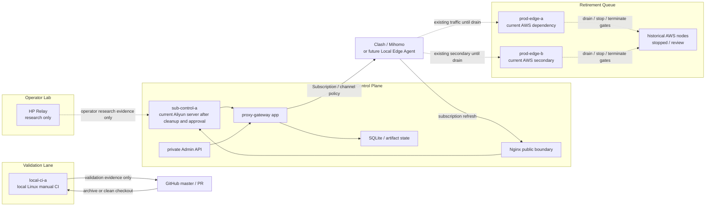

# Aliyun Control / Local CI / Node Retirement Plan

Last updated: 2026-05-26, Asia/Shanghai.

> Status:
> - Type: Active architecture and Risk A planning document
> - Risk: C for this document; A for any production, cloud, DNS, Nginx,
>   systemd, SQLite, secret, node, runtime, CI-host, or cutover mutation
> - Execution authority: Does not authorize production migration, CI-host
>   mutation, DNS changes, Nginx changes, SQLite movement, secret movement,
>   edge-node creation, service changes, or cleanup by itself
> - Production impact: None
> - Source of truth for: the target rebuild direction where the current Aliyun
>   server becomes the production subscription control plane, a local Linux
>   server becomes manual CI, and non-Aliyun / non-HP nodes are drained through
>   controlled retirement gates

## Purpose

The project direction is now:

```text
current Aliyun server:
  production subscription control plane

local Linux server:
  manual CI / clean validation host

clean rebuild servers:
  no longer the default near-term target; non-Aliyun / non-HP nodes move to a
  controlled drain and retirement queue
```

This plan replaces the earlier default assumption that a clean new server is
the preferred first physical subscription-control candidate. After the latest
business split, the default near-term target is tighter: Aliyun for
user management/subscription distribution, HP for validation/operator lab, and all
other nodes drained and retired after explicit A-tier gates. The existing clean
new-server control-plane runbook remains a fallback if the Aliyun host cannot
be safely promoted.

This document is planning only. It records the target boundaries and execution
order so later Risk A work can be performed without mixing CI, production
subscription authority, edge traffic, and operator-lab experiments.

## Target Role Split

### Aliyun Subscription Control Plane

Target role:

```text
sub-control-a:
  runs the proxy-gateway subscription service
  owns SQLite subscription state and opaque artifact state
  renders Subscription V2 output
  keeps Admin API private
  terminates or sits behind the approved Nginx public boundary
  serves sub.globalcirclecat.com after separately approved promotion
  does not run repository CI
  does not serve as a general edge traffic node
```

The current Aliyun server can be considered for this role only after it is
removed from the CI lane, cleaned, inventoried, and validated through a separate
Risk A execution record.

### Local Linux Manual CI Host

Target role:

```text
local-ci-a:
  runs clean repository validation
  runs npm ci, npm test, admin:test, and admin:build
  receives archive-based or otherwise approved source transfer
  stores no production .env, tokens, subscription URLs, SQLite files, cloud
    credentials, node passwords, customer data, or long-lived repository
    credentials
  cleans per-run workspaces and caches after validation
  is not staging, production, or deploy approval
```

The local Linux server replaces the Aliyun manual CI fallback only after it is
validated and documented. Until then, existing validation records remain
historical facts, not a reason to keep CI on the future production control host.

### Non-Aliyun Node Drain / Retirement

Target role:

```text
prod-edge-a / prod-edge-b / historical nodes:
  remain runtime dependencies until Aliyun promotion and drain are approved
  must be removed from subscription output before shutdown unless the operator
    explicitly accepts a stale-client window
  must not own future subscription authority
  must not be kept as the default clean edge target
  must be stopped or terminated only through separate Risk A records
```

Clean edge rebuilds are deferred. If the technical MVP branch later proves a
new channel needs a dedicated edge, that work must enter through a separate
integration and edge-node approval gate.

### HP / Operator Lab

Target role:

```text
HP Relay:
  operator lab and network research
  local upstream and channel behavior testing
  no production authority
  no CI authority
  no staging role
```

HP evidence can inform edge and local-agent design, but it must not become
production by accident.

## Target Topology



## Required Separation Rules

```text
CI must not run on the production subscription control plane.
Production subscription control must not run on the manual CI host.
Non-Aliyun nodes must not own future subscription state or Admin.
Operator lab must not become production, staging, CI, or prod-edge-c.
Clean edge rebuilds are deferred unless a later technical MVP integration gate
approves them.
Manual CI evidence is not staging, not deploy approval, and not production
approval.
```

## Phased Rebuild Program

### Phase 0: Documentation And Direction Freeze

Goal:

```text
Record the new target split and stop expanding the old clean-new-control-host
assumption.
```

Allowed actions:

```text
docs-only updates
project-state updates
planning records
local repository validation
```

Forbidden actions:

```text
production mutation
cloud mutation
DNS mutation
runtime config changes
secret movement
SQLite movement
CI host mutation
edge-node lifecycle mutation
```

### Phase 1: Local Linux CI Readiness

Goal:

```text
Prepare the local Linux server to replace Aliyun as the manual CI host.
```

Required approval phrase before any CI-host mutation:

```text
Approve local Linux manual CI bootstrap. No production secrets, no production data, no deploy, no staging.
```

Required validation:

```text
OS, CPU, RAM, disk recorded
Node.js 22 recorded
npm recorded
git recorded if used
archive-based validation path tested
npm ci passed
npm ci --prefix admin passed
npm test passed
npm run admin:test passed
npm run admin:build passed
cleanup completed
```

### Phase 2: Aliyun Production-Control Candidate Inventory

Goal:

```text
Verify whether the current Aliyun server can safely become the production
subscription control plane after CI is moved away.
```

Required approval phrase before any Aliyun host mutation:

```text
Approve Aliyun subscription control-plane candidate preparation. No DNS change, no user traffic, no production authority transfer, no edge traffic.
```

Required read-only inventory before mutation:

```text
current services and listeners
current firewall / security boundary
current CI workspaces and credentials, if any
Node.js and npm versions
disk and backup capacity
Nginx availability if already installed
systemd service inventory
WireGuard or other existing network services, if any
log redaction risks
host clock and NTP state
public IP and DNS state
```

Hard stop if:

```text
the host contains production secrets from unrelated systems
the host contains unmanaged CI credentials that cannot be cleaned
listener exposure cannot be minimized
logs contain sensitive values that cannot be redacted
the host is also required for unrelated production traffic
backup/restore capacity is insufficient
```

Current inventory record:

```text
docs/production-replacement-records/2026-05-26-aliyun-ci-cleanup-inventory.md
```

Current findings:

```text
The Aliyun host is reachable and has Node.js 22, npm, and git available.
No active manual-CI workspace, repository archive, GitHub CLI config, or git
credential file was found in the read-only scan.
The approved cleanup record
`docs/production-replacement-records/2026-05-26-aliyun-ci-cleanup.md` removed
the remaining root npm/cache residue and rechecked it absent.
The approved candidate-preparation record
`docs/production-replacement-records/2026-05-26-aliyun-sub-control-candidate-preparation.md`
deployed a private candidate app, loopback-only Nginx boundary, and UFW
hardening.
WireGuard wg-home remains active on UDP 51820 as an explicitly preserved lab
path; it was not mutated or promoted.
No DNS, production authority, user traffic, production SQLite copy, artifact
copy, edge traffic, AWS, public Admin, or cutover mutation has been performed.
```

### Phase 3: Aliyun Subscription-Control Candidate Bootstrap

Goal:

```text
Run proxy-gateway as a candidate subscription-control service on Aliyun without
production authority.
```

Required validation:

```text
repository artifact deployed from validated commit
Node.js 22 present
npm ci behavior validated before or during artifact build
proxy-gateway app starts on loopback
/api/health passes locally
Admin routes require auth locally
public Admin remains blocked if Nginx is configured
no edge data-plane listener is opened
no production DNS points to the candidate
no production SQLite authority has moved
```

Execution record:

```text
docs/production-replacement-records/2026-05-26-aliyun-sub-control-candidate-preparation.md
```

Current candidate status:

```text
proxy-gateway-candidate.service: active / enabled
candidate app: 127.0.0.1:3456 only
candidate Nginx: 127.0.0.1:18080 only
UFW: active, deny incoming, allow outgoing, allow OpenSSH and existing wg-home
public HP-side checks: 3456, 18080, 80, and 443 closed; 22 open
AliDNS: still points production subscription domains to prod-edge-a
AWS prod-edge-a/prod-edge-b: still running
```

### Phase 4: State Copy And Rendering Validation

Goal:

```text
Validate subscription rendering and artifact behavior on Aliyun using an
approved private state-copy path.
```

This phase requires separate approval because it handles production-derived
SQLite/artifact state.

Required validation:

```text
fresh source backup exists
source SQLite integrity_check passes
private transfer path approved
candidate restore path is separate from repository checkout
candidate SQLite integrity_check passes after restore
subscription rendering works through private operator validation
artifact validation works through private operator validation
no raw tokens, URLs, .env values, passwords, private keys, or customer data are
printed or recorded
```

### Phase 5: Non-Aliyun Node Drain

Goal:

```text
Remove AWS and other non-Aliyun / non-HP nodes from future user dependency
before shutdown.
```

Each node requires a separate Risk A record covering:

```text
current DNS references
current subscription-output references
current runtime role
current instance state
whether stale clients may still use the node
rollback dependency
stop approval
termination approval, if any
```

Required before stop:

```text
Aliyun is promoted or the operator accepts the remaining dependency
subscription output no longer emits the node, or stale-client window is accepted
DNS no longer points active names to the node, unless explicitly accepted
rollback plan is documented
```

### Phase 6: Promotion And Cutover

Goal:

```text
Promote Aliyun to production subscription control only after candidate, state,
edge, DNS, Nginx, and rollback gates pass.
```

This requires a separate promotion runbook and explicit approval. It must cover:

```text
final backup
data authority source
DNS or gateway routing change
Nginx public boundary
Admin private access
subscription refresh validation
opaque artifact validation
  node drain validation
rollback to current production authority
observation window
```

### Phase 7: Legacy Cleanup

Goal:

```text
Clean old nodes only after the new control plane and clean edge nodes have
passed the observation window.
```

Cleanup may include:

```text
removing old CI workspaces from Aliyun
retiring old AWS edge/control co-location after drain
retiring old green/canary carrying instances after drain
retiring legacy blue after separate approval
closing obsolete security-group or firewall ingress
removing stale local operator URLs
```

Cleanup must not happen before rollback is no longer needed.

## Work Queue

Recommended order:

```text
1. Local Linux CI readiness is documented and HP manual CI has passed.
2. Aliyun read-only inventory is documented.
3. Aliyun manual CI lane cleanup is completed and rechecked.
4. Aliyun subscription-control candidate preparation is approved and recorded.
5. Candidate control-plane service is bootstrapped without production authority.
6. Validate private state copy and subscription rendering after separate
   state-handling approval.
7. Promote Aliyun user-management / subscription-distribution after separate
   promotion approval.
8. Drain non-Aliyun / non-HP nodes from DNS and subscription output.
9. Stop, then later terminate old nodes only after observation windows and
    separate approvals.
```

## Relationship To Existing Documents

```text
docs/CI_MANUAL_VALIDATION.md:
  should transition from Aliyun manual CI toward local Linux manual CI.

docs/SUBSCRIPTION_CONTROL_EDGE_ARCHITECTURE.md:
  owns the control-plane / edge-data-plane split.

docs/SUBSCRIPTION_CONTROL_PLANE_NEW_SERVER_RUNBOOK.md:
  remains the fallback if the Aliyun host cannot safely become sub-control-a.

docs/PRODUCTION_EDGE_FLEET.md:
  owns historical edge slot semantics and must be read before draining current
  prod-edge-a / prod-edge-b dependencies.

docs/ALIYUN_USER_SUBSCRIPTION_DISTRIBUTION_RUNBOOK.md:
  owns the latest business decision: Aliyun for user management/subscription
  distribution, HP for validation/lab, and all other nodes in controlled
  retirement queue.

docs/PROJECT_TOPOLOGY.md:
  shows the target topology after this direction is accepted.

docs/PROJECT_CONTEXT.md:
  keeps only compact current direction, blockers, and next actions.
```

## Non-Goals

This plan does not authorize or perform:

```text
production DNS changes
production traffic cutover
SQLite restore or migration
secret copying
production .env copying
production subscription URL disclosure
tenant or artifact mutation
Nginx changes
systemd changes
Aliyun host mutation
local Linux host mutation
edge-node creation
AWS node drain / stop / termination
WireGuard changes
legacy node termination
security-group cleanup
self-hosted runner registration
```

## Current Decision

The preferred target is:

```text
Use the current Aliyun server as the future production subscription
control-plane candidate after it exits the CI lane.

Use a local Linux server as manual CI.

Drain and retire non-Aliyun / non-HP nodes after Aliyun promotion and
observation, unless a later approved technical MVP integration gate requires a
new edge.
```

The immediate next execution should be Aliyun private state-copy validation
approval, not production DNS, not public Admin exposure, not edge traffic, not
node shutdown, and not Aliyun production promotion.
