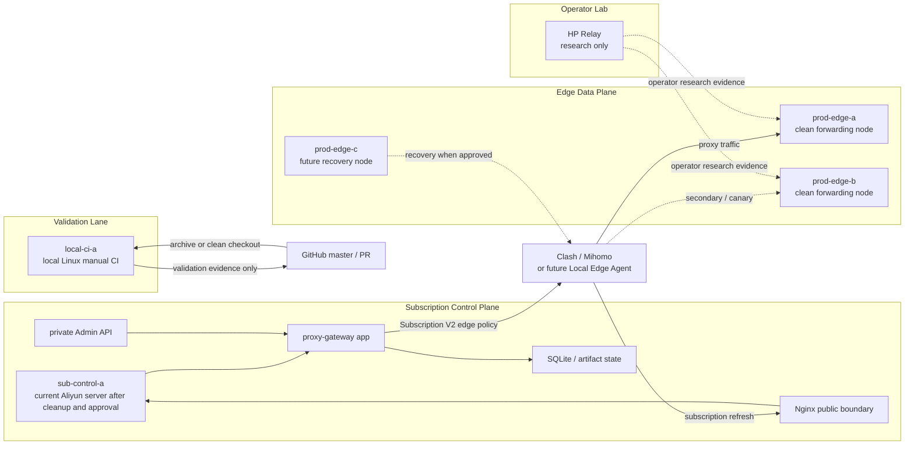

# Aliyun Control / Local CI / Clean Edge Rebuild Plan

Last updated: 2026-05-26, Asia/Shanghai.

> Status:
> - Type: Active architecture and Risk A planning document
> - Risk: C for this document; A for any production, cloud, DNS, Nginx,
>   systemd, SQLite, secret, node, runtime, CI-host, or cutover mutation
> - Execution authority: Does not authorize production migration, CI-host
>   mutation, DNS changes, Nginx changes, SQLite movement, secret movement,
>   edge-node creation, service changes, or cleanup by itself
> - Production impact: None
> - Source of truth for: the target rebuild direction where the current Aliyun
>   server becomes the production subscription control plane, a local Linux
>   server becomes manual CI, and clean servers become traffic forwarding edges

## Purpose

The project direction is now:

```text
current Aliyun server:
  production subscription control plane

local Linux server:
  manual CI / clean validation host

clean rebuild servers:
  traffic forwarding / edge data-plane capacity
```

This plan replaces the earlier default assumption that a clean new server is
the preferred first physical subscription-control candidate. Clean servers are
now preferred for edge data-plane rebuilds. The existing clean new-server
control-plane runbook remains a fallback if the Aliyun host cannot be safely
promoted.

This document is planning only. It records the target boundaries and execution
order so later Risk A work can be performed without mixing CI, production
subscription authority, edge traffic, and operator-lab experiments.

## Target Role Split

### Aliyun Subscription Control Plane

Target role:

```text
sub-control-a:
  runs the proxy-gateway subscription service
  owns SQLite subscription state and opaque artifact state
  renders Subscription V2 output
  keeps Admin API private
  terminates or sits behind the approved Nginx public boundary
  serves sub.globalcirclecat.com after separately approved promotion
  does not run repository CI
  does not serve as a general edge traffic node
```

The current Aliyun server can be considered for this role only after it is
removed from the CI lane, cleaned, inventoried, and validated through a separate
Risk A execution record.

### Local Linux Manual CI Host

Target role:

```text
local-ci-a:
  runs clean repository validation
  runs npm ci, npm test, admin:test, and admin:build
  receives archive-based or otherwise approved source transfer
  stores no production .env, tokens, subscription URLs, SQLite files, cloud
    credentials, node passwords, customer data, or long-lived repository
    credentials
  cleans per-run workspaces and caches after validation
  is not staging, production, or deploy approval
```

The local Linux server replaces the Aliyun manual CI fallback only after it is
validated and documented. Until then, existing validation records remain
historical facts, not a reason to keep CI on the future production control host.

### Clean Edge Data Plane

Target role:

```text
prod-edge-a / prod-edge-b / prod-edge-c:
  clean rebuild traffic forwarding nodes
  carry proxy traffic
  expose only approved edge listener ports
  report safe health and readiness summaries
  do not own subscription SQLite state
  do not expose Admin
  do not generate or issue subscription artifacts
  can be replaced without moving subscription authority
```

Clean servers should be used here first because edge nodes are meant to be
replaceable capacity.

### HP / Operator Lab

Target role:

```text
HP Relay:
  operator lab and network research
  local upstream and channel behavior testing
  no production authority
  no CI authority
  no staging role
```

HP evidence can inform edge and local-agent design, but it must not become
production by accident.

## Target Topology



## Required Separation Rules

```text
CI must not run on the production subscription control plane.
Production subscription control must not run on the manual CI host.
Edge nodes must not own subscription state or Admin.
Operator lab must not become production, staging, CI, or prod-edge-c.
Clean servers are preferred for forwarding edge nodes, not for CI.
Manual CI evidence is not staging, not deploy approval, and not production
approval.
```

## Phased Rebuild Program

### Phase 0: Documentation And Direction Freeze

Goal:

```text
Record the new target split and stop expanding the old clean-new-control-host
assumption.
```

Allowed actions:

```text
docs-only updates
project-state updates
planning records
local repository validation
```

Forbidden actions:

```text
production mutation
cloud mutation
DNS mutation
runtime config changes
secret movement
SQLite movement
CI host mutation
edge-node lifecycle mutation
```

### Phase 1: Local Linux CI Readiness

Goal:

```text
Prepare the local Linux server to replace Aliyun as the manual CI host.
```

Required approval phrase before any CI-host mutation:

```text
Approve local Linux manual CI bootstrap. No production secrets, no production data, no deploy, no staging.
```

Required validation:

```text
OS, CPU, RAM, disk recorded
Node.js 22 recorded
npm recorded
git recorded if used
archive-based validation path tested
npm ci passed
npm ci --prefix admin passed
npm test passed
npm run admin:test passed
npm run admin:build passed
cleanup completed
```

### Phase 2: Aliyun Production-Control Candidate Inventory

Goal:

```text
Verify whether the current Aliyun server can safely become the production
subscription control plane after CI is moved away.
```

Required approval phrase before any Aliyun host mutation:

```text
Approve Aliyun subscription control-plane candidate preparation. No DNS change, no user traffic, no production authority transfer, no edge traffic.
```

Required read-only inventory before mutation:

```text
current services and listeners
current firewall / security boundary
current CI workspaces and credentials, if any
Node.js and npm versions
disk and backup capacity
Nginx availability if already installed
systemd service inventory
WireGuard or other existing network services, if any
log redaction risks
host clock and NTP state
public IP and DNS state
```

Hard stop if:

```text
the host contains production secrets from unrelated systems
the host contains unmanaged CI credentials that cannot be cleaned
listener exposure cannot be minimized
logs contain sensitive values that cannot be redacted
the host is also required for unrelated production traffic
backup/restore capacity is insufficient
```

### Phase 3: Aliyun Subscription-Control Candidate Bootstrap

Goal:

```text
Run proxy-gateway as a candidate subscription-control service on Aliyun without
production authority.
```

Required validation:

```text
repository artifact deployed from validated commit
Node.js 22 present
npm ci behavior validated before or during artifact build
proxy-gateway app starts on loopback
/api/health passes locally
Admin routes require auth locally
public Admin remains blocked if Nginx is configured
no edge data-plane listener is opened
no production DNS points to the candidate
no production SQLite authority has moved
```

### Phase 4: State Copy And Rendering Validation

Goal:

```text
Validate subscription rendering and artifact behavior on Aliyun using an
approved private state-copy path.
```

This phase requires separate approval because it handles production-derived
SQLite/artifact state.

Required validation:

```text
fresh source backup exists
source SQLite integrity_check passes
private transfer path approved
candidate restore path is separate from repository checkout
candidate SQLite integrity_check passes after restore
subscription rendering works through private operator validation
artifact validation works through private operator validation
no raw tokens, URLs, .env values, passwords, private keys, or customer data are
printed or recorded
```

### Phase 5: Clean Edge Rebuild

Goal:

```text
Build clean forwarding nodes that carry traffic but do not own subscription
authority.
```

Each edge node requires a separate Risk A record covering:

```text
provider / region / instance identity
public and private IP
security group or firewall rules
approved edge listener set
runtime service inventory
node ID and provider-neutral label
health checks
rollback path
whether the node is canary-only, active-secondary, or standby
```

Required edge boundary:

```text
no Admin
no subscription SQLite authority
no artifact authority
no CI workspaces
no production control-plane backups
no unapproved mesh membership
```

### Phase 6: Promotion And Cutover

Goal:

```text
Promote Aliyun to production subscription control only after candidate, state,
edge, DNS, Nginx, and rollback gates pass.
```

This requires a separate promotion runbook and explicit approval. It must cover:

```text
final backup
data authority source
DNS or gateway routing change
Nginx public boundary
Admin private access
subscription refresh validation
opaque artifact validation
edge data-plane validation
rollback to current production authority
observation window
```

### Phase 7: Legacy Cleanup

Goal:

```text
Clean old nodes only after the new control plane and clean edge nodes have
passed the observation window.
```

Cleanup may include:

```text
removing old CI workspaces from Aliyun
retiring old AWS edge/control co-location
retiring old green/canary carrying instances
retiring legacy blue after separate approval
closing obsolete security-group or firewall ingress
removing stale local operator URLs
```

Cleanup must not happen before rollback is no longer needed.

## Work Queue

Recommended order:

```text
1. Finish this docs-only direction PR.
2. Read-only inventory for the local Linux CI host.
3. Bootstrap and validate local Linux manual CI.
4. Mark Aliyun manual CI usage as retired after local CI proves clean.
5. Read-only inventory for the current Aliyun server as sub-control-a candidate.
6. Clean the Aliyun host and bootstrap candidate control-plane service.
7. Validate private state copy and subscription rendering.
8. Build clean forwarding nodes.
9. Run promotion/cutover planning.
10. Retire old nodes only after the observation window.
```

## Relationship To Existing Documents

```text
docs/CI_MANUAL_VALIDATION.md:
  should transition from Aliyun manual CI toward local Linux manual CI.

docs/SUBSCRIPTION_CONTROL_EDGE_ARCHITECTURE.md:
  owns the control-plane / edge-data-plane split.

docs/SUBSCRIPTION_CONTROL_PLANE_NEW_SERVER_RUNBOOK.md:
  remains the fallback if the Aliyun host cannot safely become sub-control-a.

docs/PRODUCTION_EDGE_FLEET.md:
  owns clean forwarding node roles and edge slot semantics.

docs/PROJECT_TOPOLOGY.md:
  shows the target topology after this direction is accepted.

docs/PROJECT_CONTEXT.md:
  keeps only compact current direction, blockers, and next actions.
```

## Non-Goals

This plan does not authorize or perform:

```text
production DNS changes
production traffic cutover
SQLite restore or migration
secret copying
production .env copying
production subscription URL disclosure
tenant or artifact mutation
Nginx changes
systemd changes
Aliyun host mutation
local Linux host mutation
edge-node creation
WireGuard changes
legacy node termination
security-group cleanup
self-hosted runner registration
```

## Current Decision

The preferred target is:

```text
Use the current Aliyun server as the future production subscription
control-plane candidate after it exits the CI lane.

Use a local Linux server as manual CI.

Use clean rebuild servers as replaceable traffic forwarding nodes.
```

The immediate next execution should be local Linux CI readiness, not production
DNS, not SQLite movement, not edge cleanup, and not Aliyun production promotion.
