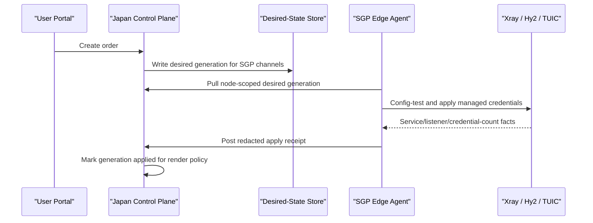

# Edge Agent Pull / Apply / Receipt Architecture

Last updated: 2026-06-10, America/Los_Angeles.

> Status:
> - Type: Active architecture design
> - Risk: C for this document, B for repository protocol/store/agent tests,
>   A for production deployment, systemd units, firewall, Nginx, runtime
>   config, schema migration, live credential lifecycle activation, or traffic
>   rollout
> - Execution authority: This document does not authorize production mutation,
>   DNS, Nginx, firewall, service restart, runtime config write, account or
>   password generation, live order creation, subscription URL/token/password
>   output, SQLite row dump, raw runtime config output, payment, or public
>   Admin exposure
> - Source of truth for: How a remote data-plane node receives control-plane
>   desired state, applies it locally, and returns redacted receipts before its
>   channels are treated as normally renderable

Current repository implementation status:

- Implemented repo-only: protocol and redaction helpers, durable desired-state
  / receipt / lease storage, private data-plane agent routes disabled by
  default, node-scoped agent service authentication, node-side dry-run agent,
  explicit fail-closed apply support with injected runtime adapters and
  protected credential material lookup, subscription render fail-closed gate,
  and render proof blocking for remote channels without a fresh applied
  receipt, plus a production runner contract that refuses public control-plane
  base URLs and requires private transport, protected material lookup, and
  declared runtime adapters before apply mode can run.
- Not yet implemented: production systemd/runtime installation, private
  SGP-to-Japan transport activation, public Nginx boundary changes, real node
  agent activation, protected production env/material wiring, and any
  production runtime apply loop.
- Production remains blocked behind a separate Risk A gate with read-only
  inventory, staging validation, explicit approval, backup, and rollback.

## Problem

The current single-control-plane / multi-data-plane direction is correct, but
manual remote handoff consumption is not a durable deployment model.

The repeated failure shape is:

```text
user creates order
  -> Japan control plane creates SGP edgeCredentialRef rows
  -> Japan writes SGP handoff files
  -> subscription renderer can include SGP channels
  -> SGP runtime has not consumed the fresh handoff yet
  -> client imports the bundle but SGP channels time out
```

This means credential creation, subscription rendering, and runtime application
are not yet tied to one verifiable state machine.

## Decision

Move remote data-plane synchronization from manual handoff consumption to a
node-side pull / apply / receipt loop.

The control plane remains authoritative for accounts, orders, subscription
artifacts, credential lifecycle, and usage ledger state. Each data-plane node
owns only local runtime application for its approved channel refs.



## Core Rule

A remote channel is not fully renderable merely because a credential row exists.

It is normally renderable only when all of these are true:

- the channel is eligible by node policy, pool, lifecycle, and user entitlement;
- the control plane has created desired state for the order and channel;
- the target data-plane node has returned an `applied` receipt for the latest
  desired generation;
- the node lease or health heartbeat is fresh;
- the channel is not disabled, retired, maintenance-only, or canary-only for
  this user.

Emergency or operator-only render proofs may still inspect pending channels,
but normal subscription output must fail closed when a required remote receipt
is absent or stale.

## Contracts

### Node Identity

Each data-plane node has a stable identity:

```text
nodeRef
physicalNodeRef
allowed channelRefs
agent identity
lease status
```

The agent may only request desired state for its own `nodeRef` and approved
`channelRefs`.

### Desired State

The desired-state document is node-scoped and generation-based.

Safe fields:

```text
nodeRef
generation
channelRefs
edgeCredentialRefs
validUntil
action
materialDigest
createdAt
```

Sensitive fields must travel only through protected runtime material storage
and must not be logged, printed, committed, or returned through public APIs.

Forbidden in docs, logs, public responses, and chat:

```text
raw passwords
raw UUID values when they function as credential material
private keys
subscription URLs
tokens
raw runtime config
raw environment values
raw SQLite rows
customer data
```

### Apply Receipt

The agent posts one redacted receipt per generation and channel.

Receipt fields:

```text
nodeRef
generation
channelRef
agent status: applied | failed | unchanged | stale | rejected
store status: applied | failed | drift_detected
configTest: passed | failed | not_supported
serviceActive: true | false
listenerPresent: true | false
credentialCount
materialDigestSet
appliedAt
reasonCode
```

The receipt proves only the managed runtime state for the channel. It does not
authorize the order, payment, entitlement, or account lifecycle.

### Lease And Expiry

The agent renews a short lease. If the lease becomes stale:

- new subscription renders must withhold the node's channels or mark them
  non-default according to policy;
- Admin should show the node as stale;
- the agent should prune expired or disabled credentials on the next successful
  apply cycle.

## Minimal Implementation Shape

This design intentionally avoids Redis, Kafka, NATS, RabbitMQ, and a separate
microservice for the current scale. Keep the modular monolith and add a small
private edge-agent protocol.

Suggested repository shape:

```text
server/services/edge/data-plane-agent-protocol.mjs
server/services/edge/data-plane-agent-service.mjs
server/routes/data-plane-agent.mjs
agent/edge-agent.mjs
agent/production-edge-agent.mjs
server/tests/data-plane-agent-protocol.test.mjs
server/tests/data-plane-agent-service.test.mjs
server/tests/data-plane-agent-routes.test.mjs
server/tests/edge-agent-dry-run.test.mjs
server/tests/production-edge-agent-runner.test.mjs
server/tests/channel-subscription-render-proof.test.mjs
```

The first implementation should be repo-only and synthetic:

- validate desired-state schema;
- validate receipt schema;
- verify secret redaction;
- prove render fail-closed when receipt is missing;
- prove render allowed when latest generation has a fresh applied receipt;
- prove disabled/expired credentials are omitted from desired state;
- prove idempotent replay of the same generation.
- prove explicit apply remains disabled by default, refuses missing protected
  material, and posts only redacted receipts when an injected runtime adapter
  succeeds.

## Production Gates

### Gate 1: Repo Contract

Risk: B.

Implement desired state, receipts, redaction, render gating, and tests without
production mutation.

Status: implemented at repository level. The repo now has dry-run and
explicitly enabled injected-apply coverage, plus a production runner contract
for private transport and protected material injection. This does not authorize
deployment, production route exposure, systemd installation, runtime mutation,
or real agent activation.

Validation:

```powershell
node --test server\tests\data-plane-agent-protocol.test.mjs server\tests\data-plane-agent-service.test.mjs server\tests\data-plane-agent-routes.test.mjs
node --test server\tests\edge-agent-dry-run.test.mjs
node --test server\tests\production-edge-agent-runner.test.mjs
node --test server\tests\channel-subscription-render-proof.test.mjs
git diff --check origin/master...HEAD
npm test
npm run project-state:check
```

### Gate 2: Staging Agent Proof

Risk: A if it touches a real host, even if staging.

Use synthetic credentials and a staging-only node to prove:

- agent can pull desired state over a private authenticated path;
- agent can apply to an injected test runtime adapter only after explicit apply
  enablement and protected material lookup;
- agent can post redacted receipts;
- control plane render policy reacts to receipt state;
- no public Admin or raw material exposure.

### Gate 3: SGP Production Activation

Risk: A.

Only after exact approval:

- back up Japan control-plane env/config/DB and SGP runtime config/systemd
  metadata;
- install the SGP agent with restricted identity;
- enable agent pull for SGP channel refs;
- run config-test before every runtime restart;
- restart only approved SGP runtime services after validation;
- verify receipts, listeners, health, and public boundaries;
- keep rollback to previous protected runtime configs and control-plane
  release.

## Non-Goals

This architecture does not:

- create a public Admin surface;
- put accounts, orders, or subscription artifacts on data-plane nodes;
- require a shared database on the data-plane node;
- require Redis, queue workers, or a microservice split;
- copy runtime config or credential material into Git;
- output secrets, tokens, passwords, subscription URLs, raw logs, raw env, raw
  config, SQLite rows, or customer data;
- authorize DNS, Nginx, firewall, payment, runtime, or live-order changes.
