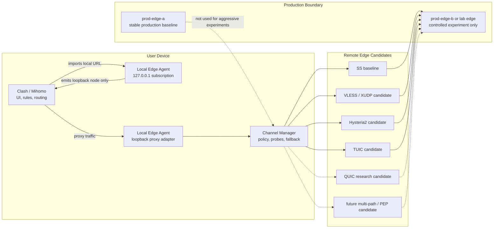

# Local Edge Channel Technical MVP

Last updated: 2026-05-26, Asia/Shanghai.

> Status:
> - Type: Active technical MVP design
> - Risk: C for this document, B for repository-only prototypes, A for any
>   remote edge, protocol runtime, production config, DNS, Nginx, systemd,
>   credential, artifact, node, or cutover execution
> - Execution authority: Does not authorize protocol deployment, edge-node
>   mutation, Local Edge Agent production activation, DNS changes, Nginx
>   changes, artifact issuance, credential issuance, traffic migration, or
>   cutover
> - Production impact: None
> - Source of truth for: the frontier data-plane technical MVP definition for
>   Local Edge Agent channel work

## Definition

Technical MVP does not mean the lowest-tech implementation.

For this project:

```text
Technical MVP = shortest safe path to prove frontier-grade transport capability
```

The current production MVP remains the stable operating baseline:

```text
prod-edge-a + prod-edge-b
Subscription V2
opaque artifact canary
Shadowsocks-only data plane
Clash/Mihomo direct remote-node connection
```

The new technical MVP is separate. The long-term client-side shape can still be:

```text
Local Edge Agent
  -> Channel Manager
  -> controlled remote-edge channel
  -> measured data-plane quality loop
```

The immediate implementation track is simpler: use Clash/Mihomo's native
protocol support first, and make the subscription renderer express channel
candidates directly in YAML. The Local Edge Agent remains a parked future
node/agent adaptation asset until that line is explicitly reopened.

The MVP should prove whether platform-controlled channel candidates can improve
real proxy-session stability, quality, resilience, and observability without
changing the user's main Clash/Mihomo workflow.

## Safety Boundary

The project should describe "low fingerprint" and "anti-interference" as
authorized reliability, privacy, and transport-quality goals:

```text
reduce abnormal protocol shape
avoid unnecessary credential exposure
measure and reduce timeout / jitter / packet-loss symptoms
protect user-visible import material
fail back to a known baseline
```

Do not frame this work as malicious evasion, unauthorized access, attack
traffic hiding, or traffic laundering. Any protocol experiment must stay inside
owned infrastructure and explicitly approved operator-device canaries.

## Target Architecture



Clash/Mihomo should see a stable local node:

```yaml
proxies:
  - name: GlobalCircle Local
    type: socks5
    server: 127.0.0.1
    port: <local-agent-port>
```

Remote protocol details should be owned by Local Edge Agent and remote-edge
runtime, not exposed as the main user-facing product contract.

## Goals

The technical MVP should measure six capabilities:

```text
Resilience: recover from channel failures quickly
Quality: lower latency, jitter, and failure rate
Throughput: avoid excessive tunnel overhead
Anti-interference: remain usable under path instability and loss symptoms
Low fingerprint: keep transport shape controlled and non-noisy
Observability: identify whether failure is local, channel, node, or target-side
```

This is not a claim that any one protocol automatically solves those problems.
The MVP must prove them with measurements.

## Candidate Channel Matrix

### SS Baseline

Purpose:

```text
current known production data-plane baseline
control case for experiments
rollback target
```

Limits:

```text
shared-password model
limited identity granularity
direct node exposure in current production YAML
observability mostly outside the app control plane
```

### VLESS / XUDP Candidate

VLESS is a lightweight Xray client/server protocol with UUID-based
authentication. It gives the project a larger identity and transport-composition
space than shared Shadowsocks credentials.

XUDP is relevant as an UDP aggregation / proxying candidate in the Xray Mux
model. Project X documents Mux as a way to distribute multiple TCP connections
over one TCP connection to reduce handshake latency, not as a throughput
booster; its second use is distributing multiple UDP connections through XUDP.

Mihomo's VLESS configuration surface includes fields such as:

```text
udp
uuid
flow
packet-encoding: xudp
tls
servername
reality-opts
network
smux
```

This makes VLESS/XUDP a reasonable canary candidate, but not a production
promise.

### Hysteria2 / TUIC Candidates

Hysteria2 and TUIC are additional Clash/Mihomo-native candidate families for the
direct subscription renderer track. They belong in the same repository-only
renderer contract as VLESS/XUDP until a separate A-tier runtime canary approves
remote service deployment, node config activation, and rollback.

The renderer contract can express Hysteria2 fields such as:

```text
ports
hop-interval
password
up / down
obfs
obfs-password
sni
skip-cert-verify
fingerprint
alpn
bbr-profile
```

The renderer contract can express TUIC fields such as:

```text
token
uuid
password
udp-relay-mode
congestion-controller
bbr-profile
sni
alpn
disable-sni
reduce-rtt
request-timeout
max-udp-relay-packet-size
fast-open
skip-cert-verify
max-open-streams
```

These fields are a renderer capability, not proof that matching edge runtime
services have been deployed.

### QUIC Research Candidate

QUIC is a UDP-based multiplexed secure transport with connection migration
support. It belongs in the research queue for agent-to-edge channels because it
may help with connection setup, stream multiplexing, and path-change behavior
when both client and server are under platform control.

Do not confuse:

```text
HTTP/3 subscription gateway:
  may improve refresh/control delivery only

QUIC data-plane channel:
  would be a Local Edge Agent transport candidate and needs its own runtime

QUIC path migration:
  useful only when the endpoint implementation and validation are controlled
```

### MPTCP / PEP Research Candidate

Multipath TCP can use multiple paths between peers and manages subflows under a
reliable byte-stream model. It is useful as a research reference for future
multi-path behavior, but it is not a near-term Node/Mihomo configuration switch.

Protocol-enhancing proxies or path-enhancement mechanisms should stay research
items until the project has a tested agent-to-edge runtime boundary.

## Measurement Contract

The MVP must produce real evidence, not subjective "feels faster" results.

Minimum test set:

```text
known 204 / connectivity targets
common HTTPS targets
long-lived TCP session
UDP probe if the candidate supports UDP
100-request loop
10-minute sustained session
baseline versus candidate comparison
```

Metrics:

```text
success rate
timeout count
P50 / P95 / P99 latency
jitter
connection setup time
reconnection count
channel switch count
client-side error class
remote-side error class
cleanup and rollback time
```

Minimum success bar:

```text
candidate reduces real proxy-session timeouts versus SS baseline
candidate does not regress P95/P99 materially
Clash/Mihomo local import continues to work
generated local YAML does not expose remote secrets, artifacts, or tokens
candidate can be disabled and returned to SS baseline quickly
diagnostics are redacted and actionable
```

## Implementation Stages

### Stage 0: Design And Matrix

```text
Risk: C
Scope: docs-only
Output:
  this document
  VLESS/XUDP/Hysteria2/TUIC canary matrix
  protocol source notes
```

No runtime, protocol deployment, edge mutation, or production change.

### Stage 1A: Repository-Only Direct Subscription Channel Renderer

```text
Risk: B
Scope:
  Clash/Mihomo-native multi-protocol renderer
  SS baseline
  VLESS/XUDP candidate fields
  Hysteria2 candidate fields
  TUIC candidate fields
  protocol-specific config placeholder contract
  public config redaction for protocol credentials
  url-test / fallback groups
  fail-closed unsupported protocols
  no production config change
```

This is the current mainline for channel upgrade. It uses the existing
Clash/Mihomo client as the protocol executor and keeps remote runtime deployment
as a separate A-tier gate. Repository config support may define how protocol
candidate secrets are loaded and redacted, but activating those candidates in
production node config remains separate A-tier work.

#### Stage 1A Config Contract Design

Design intent:

```text
Keep node candidate definitions in repository config format.
Load protocol credentials from environment placeholders only at runtime.
Allow the renderer to receive concrete protocol fields after config loading.
Never expose protocol credentials through public config summaries.
Keep production node activation separate from repository support.
```

Protocol candidate fields may include credentials beyond the original
Shadowsocks `password`, for example:

```text
VLESS:
  uuid

Hysteria2:
  password
  obfs-password / obfsPassword

TUIC:
  uuid
  password
  token
```

The repository config contract treats these as sensitive runtime material:

```text
loadProxyConfig:
  may replace sensitive `${ENV_NAME}` placeholders in memory

publicProxyConfig:
  must recursively remove sensitive protocol credential fields before returning
  diagnostics or public summaries
```

This design keeps PR-level renderer/config work useful for channel development
without changing tracked production node config or enabling any runtime channel.

### Stage 1: Repository-Only Agent Channel Harness

```text
Risk: B
Scope:
  Local Edge Agent channel interface
  mock channel
  local metrics collector
  redacted diagnostics
  benchmark harness
```

No production transport, no device credential storage, no service install, no
real remote edge mutation.

### Stage 2: Lab Edge Runtime Proof

```text
Risk: A
Scope:
  lab edge or explicitly approved prod-edge-b canary only
  one operator device
  explicit rollback
  no prod-edge-a mutation
```

Requires runbook, read-only inventory, explicit approval, validation evidence,
and cleanup path.

### Stage 3: Controlled prod-edge-b Canary

```text
Risk: A
Scope:
  prod-edge-b or replacement canary slot
  operator-device only
  no broad user activation
  no prod-edge-a baseline change
```

This stage must prove reliability and rollback before broader rollout.

## Non-Goals

This technical MVP does not:

```text
replace current prod-edge-a production baseline
change production DNS
change production Nginx
retire legacy query-token access
issue artifacts broadly
install Windows services
install drivers
enable TUN or virtual NIC
mutate system proxy / PAC / routes
expose public local agent listeners
claim traffic quota enforcement
claim automatic carrier/DPI detection
claim any protocol is production-ready without metrics
```

## Source Notes

External protocol references used for this design:

- Project X VLESS docs:
  `https://xtls.github.io/en/config/inbounds/vless.html`
- Project X outbound Mux / XUDP docs:
  `https://xtls.github.io/en/config/outbound.html`
- MetaCubex Mihomo VLESS docs:
  `https://wiki.metacubex.one/config/proxies/vless/`
- MetaCubex Mihomo Hysteria2 docs:
  `https://wiki.metacubex.one/en/config/proxies/hysteria2/`
- MetaCubex Mihomo TUIC docs:
  `https://wiki.metacubex.one/en/config/proxies/tuic/`
- RFC 9000 QUIC:
  `https://www.rfc-editor.org/rfc/rfc9000`
- RFC 8684 MPTCP:
  `https://www.rfc-editor.org/rfc/rfc8684`
