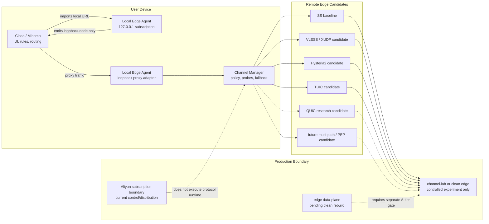

# Local Edge Channel Technical MVP

Last updated: 2026-05-27, Asia/Shanghai.

> Status:
> - Type: Active technical MVP design
> - Risk: C for this document, B for repository-only prototypes, A for any
>   remote edge, protocol runtime, production config, DNS, Nginx, systemd,
>   credential, artifact, node, or cutover execution
> - Execution authority: Does not authorize protocol deployment, edge-node
>   mutation, Local Edge Agent production activation, DNS changes, Nginx
>   changes, artifact issuance, credential issuance, traffic migration, or
>   cutover
> - Production impact: None
> - Source of truth for: the frontier data-plane technical MVP definition for
>   channel-upgrade work

## Definition

Technical MVP does not mean the lowest-tech implementation.

For this project:

```text
Technical MVP = shortest safe path to prove frontier-grade transport capability
```

The current production state is no longer a serving Shadowsocks edge baseline.
As of the current project context:

```text
Aliyun subscription distribution boundary: promoted
sub.globalcirclecat.com: served by Aliyun control/subscription boundary
edge data-plane traffic: pending clean rebuild or separately approved canary
AWS Singapore prod-edge-a/prod-edge-b: stopped under accepted outage
tracked SS config: historical comparison input only until edge rebuild
```

Therefore this technical MVP treats SS as the comparison and rollback model, not
as proof that a current production edge is serving traffic. The long-term
client-side shape can still be:

```text
Local Edge Agent
  -> Channel Manager
  -> controlled remote-edge channel
  -> measured data-plane quality loop
```

The immediate implementation track is simpler: use Clash/Mihomo's native
protocol support first, and make the subscription renderer express channel
candidates directly in YAML. The Local Edge Agent remains a parked future
node/agent adaptation asset until that line is explicitly reopened.

The MVP should prove whether platform-controlled channel candidates can improve
real proxy-session stability, quality, resilience, and observability without
changing the user's main Clash/Mihomo workflow.

## Safety Boundary

The project should describe "low fingerprint" and "anti-interference" as
authorized reliability, privacy, and transport-quality goals:

```text
reduce abnormal protocol shape
avoid unnecessary credential exposure
measure and reduce timeout / jitter / packet-loss symptoms
protect user-visible import material
fail back to a known baseline
```

Do not frame this work as malicious evasion, unauthorized access, attack
traffic hiding, or traffic laundering. Any protocol experiment must stay inside
owned infrastructure and explicitly approved operator-device canaries.

## Target Architecture



For the future Local Edge Agent track, Clash/Mihomo should see a stable local
node:

```yaml
proxies:
  - name: GlobalCircle Local
    type: socks5
    server: 127.0.0.1
    port: <local-agent-port>
```

For the current Clash/Mihomo-native renderer track, Clash/Mihomo may see
explicit remote protocol candidates in YAML. Remote protocol activation is still
owned by separately approved remote-edge runtime gates, not by this design
document.

## Goals

The technical MVP should measure six capabilities:

```text
Resilience: recover from channel failures quickly
Quality: lower latency, jitter, and failure rate
Throughput: avoid excessive tunnel overhead
Anti-interference: remain usable under path instability and loss symptoms
Low fingerprint: keep transport shape controlled and non-noisy
Observability: identify whether failure is local, channel, node, or target-side
```

This is not a claim that any one protocol automatically solves those problems.
The MVP must prove them with measurements.

## Candidate Channel Matrix

### SS Baseline

Purpose:

```text
current known production data-plane baseline
control case for experiments
rollback target
```

Limits:

```text
shared-password model
limited identity granularity
direct node exposure in current production YAML
observability mostly outside the app control plane
```

### VLESS / XUDP Candidate

VLESS is a lightweight Xray client/server protocol with UUID-based
authentication. It gives the project a larger identity and transport-composition
space than shared Shadowsocks credentials.

XUDP is relevant as an UDP aggregation / proxying candidate in the Xray Mux
model. Project X documents Mux as a way to distribute multiple TCP connections
over one TCP connection to reduce handshake latency, not as a throughput
booster; its second use is distributing multiple UDP connections through XUDP.

Mihomo's VLESS configuration surface includes fields such as:

```text
udp
uuid
flow
packet-encoding: xudp
tls
servername
reality-opts
network
smux
```

This makes VLESS/XUDP a reasonable canary candidate, but not a production
promise.

### Hysteria2 / TUIC Candidates

Hysteria2 and TUIC are additional Clash/Mihomo-native candidate families for the
direct subscription renderer track. They belong in the same repository-only
renderer contract as VLESS/XUDP until a separate A-tier runtime canary approves
remote service deployment, node config activation, and rollback.

The renderer contract can express Hysteria2 fields such as:

```text
ports
hop-interval
password
up / down
obfs
obfs-password
sni
skip-cert-verify
fingerprint
alpn
bbr-profile
```

The renderer contract can express TUIC fields such as:

```text
token
uuid
password
udp-relay-mode
congestion-controller
bbr-profile
sni
alpn
disable-sni
reduce-rtt
request-timeout
max-udp-relay-packet-size
fast-open
skip-cert-verify
max-open-streams
```

These fields are a renderer capability, not proof that matching edge runtime
services have been deployed.

### QUIC Research Candidate

QUIC is a UDP-based multiplexed secure transport with connection migration
support. It belongs in the research queue for agent-to-edge channels because it
may help with connection setup, stream multiplexing, and path-change behavior
when both client and server are under platform control.

Do not confuse:

```text
HTTP/3 subscription gateway:
  may improve refresh/control delivery only

QUIC data-plane channel:
  would be a Local Edge Agent transport candidate and needs its own runtime

QUIC path migration:
  useful only when the endpoint implementation and validation are controlled
```

### MPTCP / PEP Research Candidate

Multipath TCP can use multiple paths between peers and manages subflows under a
reliable byte-stream model. It is useful as a research reference for future
multi-path behavior, but it is not a near-term Node/Mihomo configuration switch.

Protocol-enhancing proxies or path-enhancement mechanisms should stay research
items until the project has a tested agent-to-edge runtime boundary.

## Measurement Contract

The MVP must produce real evidence, not subjective "feels faster" results.

Minimum test set:

```text
known 204 / connectivity targets
common HTTPS targets
long-lived TCP session
UDP probe if the candidate supports UDP
100-request loop
10-minute sustained session
baseline versus candidate comparison
```

Metrics:

```text
success rate
timeout count
P50 / P95 / P99 latency
jitter
connection setup time
reconnection count
channel switch count
client-side error class
remote-side error class
cleanup and rollback time
```

Minimum success bar:

```text
candidate reduces real proxy-session timeouts versus SS baseline
candidate does not regress P95/P99 materially
Clash/Mihomo local import continues to work
generated local YAML does not expose remote secrets, artifacts, or tokens
candidate can be disabled and returned to SS baseline quickly
diagnostics are redacted and actionable
```

## Implementation Stages

### Stage 0: Design And Matrix

```text
Risk: C
Scope: docs-only
Output:
  this document
  VLESS/XUDP/Hysteria2/TUIC canary matrix
  protocol source notes
```

No runtime, protocol deployment, edge mutation, or production change.

### Stage 1A: Repository-Only Direct Subscription Channel Renderer

```text
Risk: B
Scope:
  Clash/Mihomo-native multi-protocol renderer
  SS baseline
  VLESS/XUDP candidate fields
  Hysteria2 candidate fields
  TUIC candidate fields
  protocol-specific config placeholder contract
  public config redaction for protocol credentials
  url-test / fallback groups
  quality-class proxy groups for long-haul path selection
  fail-closed unsupported protocols
  no production config change
```

This is the current mainline for channel upgrade. It uses the existing
Clash/Mihomo client as the protocol executor and keeps remote runtime deployment
as a separate A-tier gate. Repository config support may define how protocol
candidate secrets are loaded and redacted, but activating those candidates in
production node config remains separate A-tier work.

Repository-local dry-run support is available for candidate config validation:

```bash
npm run channel:dry-run -- <path-to-proxy-servers.json>
```

The dry-run loads the config, validates protocol families and required fields,
renders Clash YAML in memory, and prints only a safe JSON summary with a local
benchmark plan. It does not connect to a remote node, deploy protocol runtime,
mutate production config, or print credentials.

The renderer can use provider-neutral node metadata for client-side path
selection without exposing that metadata as Clash proxy fields. Supported
metadata today:

```text
qualityClass / quality / channelQuality:
  stable
  weak-network
  long-haul
  high-loss

channelRole / role:
  baseline
  candidate
  canary
```

When weak-network, long-haul, or high-loss nodes are present, the YAML includes
a dedicated `WEAK-NETWORK` `url-test` group with a conservative tolerance for
long-distance path variance. When stable nodes are present, the YAML includes a
`STABLE` fallback group. `GLOBAL` remains a user-visible `select` group and
keeps `AUTO`, quality groups, `FALLBACK`, individual nodes, and `DIRECT`
available. This is still repository-only rendering behavior; it does not deploy
matching protocol runtimes or activate any production node.

Repository-local benchmark result aggregation is available as a code-level
building block through `summarizeChannelBenchmarkResults(...)`. It consumes
already-collected local samples, computes per-probe success rate, timeout count,
and P50/P95/P99 latency summaries, and returns a redacted summary without raw
target URLs, raw errors, tokens, or credentials. It does not run probes, open
network connections, mutate runtime state, or authorize production canaries by
itself.

The same aggregation is available as a local CLI for already-collected samples:

```bash
npm run channel:benchmark-summary -- <path-to-local-samples.json>
```

Repository-local measurement scoring is available through
`scoreChannelBenchmarkSummary(...)`. It consumes a local benchmark summary and
returns safe channel quality classifications:

```text
qualityTier:
  healthy
  degraded
  blocked
  unknown

recommendedPool:
  stable
  canary
  private
  hold
```

The scorer produces `channelScore`, timeout rate, P95 duration, and reason
codes without copying raw target URLs, raw errors, tokens, credentials, or
customer data. It is advisory only. It does not mutate `config/proxy-servers.json`,
assign tenants, change DNS, deploy protocol runtimes, or promote any node.

To score a local benchmark summary:

```bash
npm run channel:benchmark-score -- <path-to-local-summary.json>
```

Repository-local candidate reporting is available through
`buildChannelCandidateReport(...)`. It joins a safe channel config dry-run
summary with a safe measurement score and groups nodes for operator review:

```text
stable
canary
private
hold
missingMeasurement
```

To generate a local candidate report:

```bash
npm run channel:candidate-report -- <path-to-dry-run-summary.json> <path-to-score.json>
```

The report intentionally omits hosts, ports, credentials, tokens, raw
subscription URLs, and raw errors. It does not edit node config, assign tenants,
change DNS, deploy runtime protocols, or authorize canary rollout.

Repository-local decision packaging is available through
`buildChannelDecisionPack(...)`. It turns a dry-run summary and measurement
score into a safe operator artifact with:

```text
selectedBaseline
canaryCandidates
privateCandidates
holdBlockers
requiredNextAction
decisionEvidence
```

To generate a local decision pack:

```bash
npm run channel:decision-pack -- <path-to-dry-run-summary.json> <path-to-score.json>
```

The decision pack is meant for review and archival. It does not make runtime
changes, deploy protocol services, edit subscription output, change DNS, or
approve a Risk A channel canary.

Repository-local runtime inventory summary support is available through
`buildChannelRuntimeInventorySummary(...)`. It converts safe operator-provided
runtime gate facts into the summary contract consumed by the runtime registry.
The summary can record candidate name, protocol, target label, lifecycle
status, deployment readiness, blocker codes, and the next gate. It must not
contain raw hosts, ports, URLs, credentials, raw logs, tokens, subscription
URLs, artifact URLs, cloud credentials, or customer data.

```bash
npm run channel:runtime-inventory-summary -- <path-to-safe-inventory-input.json>
```

Repository-local runtime registry integration is available through
`buildChannelRuntimeRegistry(...)`. It joins the dry-run summary, measurement
score, and a safe runtime inventory summary into one channel system state:

```text
selected baseline
canary-ready candidates
runtime-blocked candidates
missing runtime inventory candidates
required next action
```

To build the registry:

```bash
npm run channel:runtime-registry -- <path-to-dry-run-summary.json> <path-to-score.json> <path-to-runtime-inventory-summary.json>
```

To build the runtime gate packet:

```bash
npm run channel:runtime-gate-packet -- <path-to-runtime-registry.json>
```

To build the full repository-local system decision flow from the three safe
inputs:

```bash
npm run channel:system-decision-flow -- <path-to-dry-run-summary.json> <path-to-score.json> <path-to-safe-inventory-input.json>
```

This closes the repository-side gap between "measurement recommends canary",
"runtime inventory says it is ready", and "an operator can now request the next
Risk A runtime canary gate." The system decision flow emits the normalized
runtime inventory summary, runtime registry, runtime gate packet, and top-level
readiness status in one artifact. These artifacts must not contain hosts,
ports, credentials, raw errors, tokens, subscription URLs, artifact URLs, cloud
credentials, or customer data. They do not contact edge nodes, query cloud APIs,
deploy runtimes, change firewall rules, submit approval phrases, move traffic,
or approve subscription output.

The repository also exposes this decision flow through the protected Admin
platform route `POST /api/admin/platform/channel-system-decision-flow`. The
route is intended for operator review UI/API integration only. It requires
Bearer admin auth through the existing Admin boundary, accepts the same safe
inputs, returns the same redacted readiness artifact, and does not provide
runtime, firewall, DNS, node, approval, traffic, or subscription-output
execution controls.

The Admin Overview now includes a read-only channel system review surface for
that route. Operators can paste a safe evidence packet and receive the redacted
readiness result in the existing protected Admin UI. This UI does not submit
approval phrases, deploy runtimes, mutate runtime inventory, move traffic, or
change subscription output.

Repository-local runtime evidence bridge support is available through
`buildChannelRuntimeEvidenceBridge(...)`. It converts safe runtime evidence
packets into the runtime inventory input consumed by the system decision flow,
then returns both the normalized runtime inventory input and the full channel
system readiness artifact:

```bash
npm run channel:runtime-evidence-bridge -- <path-to-dry-run-summary.json> <path-to-score.json> <path-to-safe-runtime-evidence.json>
```

The bridge accepts only summary evidence such as candidate name, protocol,
target label, boolean read-only checks, blocker codes, and next gate labels. It
does not accept raw hosts, ports, URLs, credentials, raw logs, tokens,
subscription URLs, artifact URLs, cloud credentials, or customer data. It does
not contact edge nodes, query cloud APIs, run probes, deploy runtimes, change
firewall rules, submit approval phrases, move traffic, or approve subscription
output.

The bridge is also available through the protected Admin platform route
`POST /api/admin/platform/channel-runtime-evidence-bridge` and an Admin
Overview review panel. This closes the first repository integration loop from
safe operator runtime evidence to system readiness review without requiring CLI
composition. The UI/API surface remains review-only and does not add approval
submission, runtime deployment, DNS, firewall, traffic, or subscription-output
controls.

Repository-local extended measurement assessment is available through
`assessChannelExtendedMeasurement(...)`. It consumes an already-collected local
benchmark summary and classifies each probe as:

```text
ready_for_decision
needs_extended_measurement
hold_for_investigation
```

The default assessment thresholds require enough samples, high success rate,
low timeout rate, and bounded P95/P99 latency before a candidate can be treated
as ready for an operator decision. The output remains advisory and redacted; it
does not run probes, contact edge nodes, deploy runtime protocols, change
subscription output, or approve any canary.

To assess a local benchmark summary:

```bash
npm run channel:extended-assessment -- <path-to-local-summary.json>
```

To classify a safe measurement bundle report into a follow-up investigation
summary:

```bash
npm run channel:measurement-investigation -- <path-to-bundle-report.json>
```

The investigation report identifies whether a hold is driven by sustained tail
latency, isolated tail spikes, reliability failures, or insufficient evidence.
It gives an advisory next action only; it does not run probes, contact edge
nodes, mutate runtime config, change subscription output, or approve any
Risk A rollout.

To turn an investigation report plus a dry-run config summary into a next
candidate comparison plan:

```bash
npm run channel:candidate-comparison -- <path-to-investigation-report.json> <path-to-dry-run-summary.json>
```

The comparison plan separates baseline references, held protocols, private
capacity, and next comparison candidates. It is useful after a Hysteria2 hold
to identify TUIC or VLESS/XUDP as the next measured candidate family, but it is
still advisory. It does not create servers, run probes, deploy protocol
runtimes, edit subscription output, or approve the Risk A comparison canary.

To create a safe editable fixture from a local dry-run summary:

```bash
npm run channel:dry-run -- <path-to-proxy-servers.json> > channel-dry-run.json
npm run channel:benchmark-fixture -- channel-dry-run.json > channel-samples.json
```

The fixture generator reads only the local dry-run summary and copies only
provider-neutral probe name, protocol, role, and quality class into sample
placeholders. It does not copy dry-run probe hosts, ports, checks, or UDP flags
into the sample fixture, and it does not execute benchmark probes.

Repository-local probe runner scaffolding is available through
`runChannelBenchmarkPlan(...)`. It accepts only a local dry-run benchmark plan
and requires an injected `runProbe` function. There is no default network probe
implementation, so importing this helper does not connect to edge nodes, deploy
runtime protocols, or mutate local or production state. The helper normalizes
runner output into the same versioned sample fixture shape and redacts raw
runner errors from samples.

The local CLI wrapper is explicit opt-in:

```powershell
npm run channel:benchmark-run -- .\path\to\local-dry-run-plan.json `
  --runner .\path\to\trusted-local-runner.mjs
```

The runner module must be a local trusted file and must export `runProbe`.
The repository does not ship a default network probe runner. This keeps the
benchmark path usable for repeatable local experiments without turning a repo
validation command into a hidden remote connection or protocol canary.

For deterministic CLI smoke tests, the repository includes
`scripts/channel-benchmark-synthetic-runner.example.mjs`. It is a synthetic
local runner template only: it derives stable placeholder timings from
provider-neutral protocol and quality-class metadata, imports no network
modules, and does not prove real edge performance.

The preferred local fixture shape is versioned:

```json
{
  "schemaVersion": "channel-benchmark-samples/v1",
  "generatedAt": "2026-05-26T15:30:00.000Z",
  "samples": [
    {
      "probeName": "ss-baseline",
      "protocol": "ss",
      "role": "baseline",
      "qualityClass": "stable",
      "ok": true,
      "durationMs": 100,
      "connectTimeMs": 30,
      "timeToFirstByteMs": 70
    }
  ]
}
```

The command only reads the local file and prints a redacted JSON summary; it
does not execute benchmark probes, contact edge nodes, or read production state.
Unsupported fixture versions and extra top-level metadata fail closed so sample
files do not become a side channel for secrets or raw runtime details.

#### Stage 1A Config Contract Design

Design intent:

```text
Keep node candidate definitions in repository config format.
Load protocol credentials from environment placeholders only at runtime.
Allow the renderer to receive concrete protocol fields after config loading.
Never expose protocol credentials through public config summaries.
Keep production node activation separate from repository support.
```

Protocol candidate fields may include credentials beyond the original
Shadowsocks `password`, for example:

```text
VLESS:
  uuid

Hysteria2:
  password
  obfs-password / obfsPassword

TUIC:
  uuid
  password
  token
```

The repository config contract treats these as sensitive runtime material:

```text
loadProxyConfig:
  may replace sensitive `${ENV_NAME}` placeholders in memory
  validates supported protocol families, host, port, and protocol-required
  credentials before the renderer receives the config

publicProxyConfig:
  must recursively remove sensitive protocol credential fields before returning
  diagnostics or public summaries
```

This design keeps PR-level renderer/config work useful for channel development
without changing tracked production node config or enabling any runtime channel.

### Stage 1: Repository-Only Agent Channel Harness

```text
Risk: B
Scope:
  Local Edge Agent channel interface
  mock channel
  local metrics collector
  safe benchmark result aggregation
  redacted diagnostics
  benchmark harness
```

No production transport, no device credential storage, no service install, no
real remote edge mutation.

### Stage 2: Lab Edge Runtime Proof

```text
Risk: A
Scope:
  channel-lab or explicitly approved clean edge canary only
  one operator device
  explicit rollback
  no Aliyun control-boundary mutation
  no stopped AWS rollback-start mutation
```

Requires runbook, read-only inventory, explicit approval, validation evidence,
and cleanup path. Runtime canary execution gates live in
`docs/CHANNEL_RUNTIME_CANARY_RUNBOOK.md`.

### Stage 3: Controlled Clean Edge Canary

```text
Risk: A
Scope:
  channel-lab or clean replacement edge canary slot
  operator-device only
  no broad user activation
  no Aliyun subscription-boundary change
  no all-user edge activation
```

This stage must prove reliability and rollback before broader rollout.
Use `docs/CHANNEL_RUNTIME_CANARY_RUNBOOK.md` before deploying or exposing any
candidate runtime on `channel-lab`, a clean replacement edge, or another
approved target.

## Non-Goals

This technical MVP does not:

```text
replace current Aliyun subscription boundary
activate edge data-plane traffic
change production DNS
change production Nginx
retire legacy query-token access
issue artifacts broadly
install Windows services
install drivers
enable TUN or virtual NIC
mutate system proxy / PAC / routes
expose public local agent listeners
claim traffic quota enforcement
claim automatic carrier/DPI detection
claim any protocol is production-ready without metrics
```

## Source Notes

External protocol references used for this design:

- Project X VLESS docs:
  `https://xtls.github.io/en/config/inbounds/vless.html`
- Project X outbound Mux / XUDP docs:
  `https://xtls.github.io/en/config/outbound.html`
- MetaCubex Mihomo VLESS docs:
  `https://wiki.metacubex.one/config/proxies/vless/`
- MetaCubex Mihomo Hysteria2 docs:
  `https://wiki.metacubex.one/en/config/proxies/hysteria2/`
- MetaCubex Mihomo TUIC docs:
  `https://wiki.metacubex.one/en/config/proxies/tuic/`
- RFC 9000 QUIC:
  `https://www.rfc-editor.org/rfc/rfc9000`
- RFC 8684 MPTCP:
  `https://www.rfc-editor.org/rfc/rfc8684`
