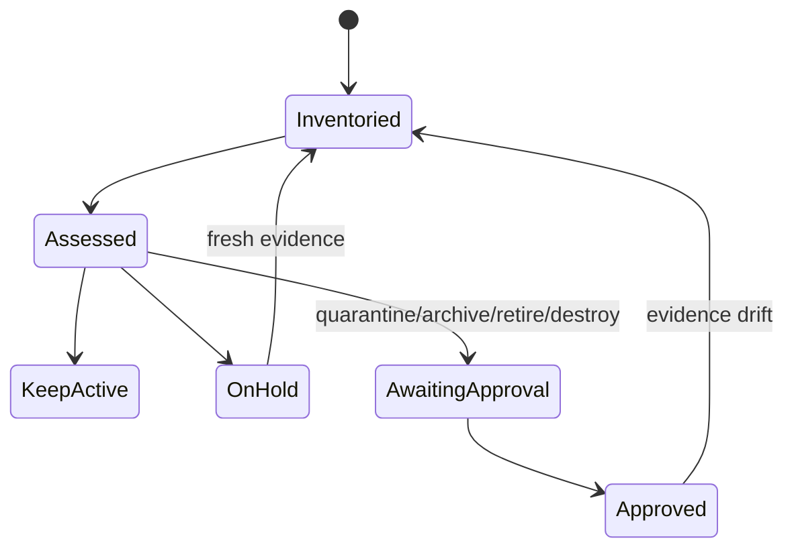
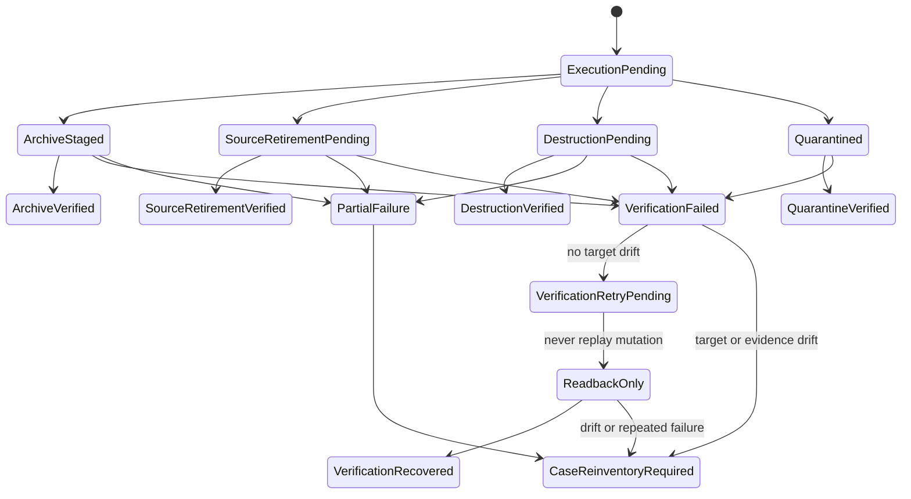

# Master, Archive, And Records Disposition Boundary

Last updated: 2026-08-11, America/Los_Angeles.

```yaml
document_metadata:
  doc_type: canonical
  lifecycle: active
  authority_scope: archive_policy
  superseded_by: null
  last_verified_at: 2026-08-11
  production_authority: false
```

> Status:
> - Type: Active repository hygiene and records-disposition policy
> - Risk: C
> - Execution authority: Does not authorize file moves, deletion, archive
>   writes, workflow dispatch or rerun, Actions-run or artifact deletion, code,
>   CI host, AWS, DNS, Nginx, HTTPS, production config, node, tenant, secret,
>   SQLite, deploy, rollback, or cutover changes
> - Production impact: None
> - Source of truth for: What belongs on `master`, what belongs in archive, how
>   archive-versus-destroy decisions are made, and how agents should avoid
>   treating old material as the current workspace

## Purpose

`master` is the current source baseline, not a general archive. The repository
still needs Git version management, but the main branch should stay focused on
current source, active runbooks, active validation rules, and compact current
state. Historical evidence remains valuable, but it should be reachable through
indexes and archive locations instead of competing with active work.

This document defines the boundary before any large move or deletion happens.
It does not move files by itself.

## Records Disposition Domain

Records Disposition is the bounded context that decides the next governed state
for an exact set of materials. It does not perform the resulting action. A case
may resolve to `KEEP_ACTIVE`, `ON_HOLD`, `QUARANTINE`, `ARCHIVE`,
`RETIRE_SOURCE`, or `DESTROY`; archive and destruction are not forced when a
safer state applies.

Keep the context inside the existing monolith. It does not require a queue,
microservice, event bus, or separate database.

| Capability | Responsibility | Authority boundary |
| --- | --- | --- |
| Asset Inventory | Read exact identities, references, replicas, retention windows, and dependency facts; translate provider-specific observations into domain facts. | Read-only. It cannot propose success from an unavailable connector or incomplete listing. |
| Disposition Decision | Own the `DispositionCase` aggregate, evaluate policy, place holds, and produce an approval-bound decision. | May record a decision only. It cannot call a delete, archive, rerun, provider, or production API. |
| Disposition Execution | Execute one already-approved archive, source-retirement, or destruction command against the exact target set. | Uses the task-specific C-, B-, or A-tier gate. C applies only to an exact content-preserving in-repository Markdown relocation, modeled as `ArchiveVerified` followed by `SourceRetirementVerified`, with index and authority semantics unchanged. Approval of a decision is not execution authority. |
| Audit Evidence | Retain the non-sensitive decision, approval, result, and verification receipt. | Domain-logically immutable: corrections use a superseding record. Reviewed Markdown is not claimed to provide storage-level WORM guarantees. Never stores secret values, subscription material, raw customer data, or unredacted logs. |

### Ubiquitous Language

| Term | Meaning |
| --- | --- |
| `DispositionCase` | Aggregate root for one homogeneous cohort governed by one policy, risk tier, and final choice. |
| `AssetRef` | Exact target identity: repository/path/blob SHA; repository/run ID/attempt; repository/artifact ID/run ID/digest; host/workspace/canonical path/snapshot digest; or provider/scope/name/version identifier for a credential without its value. Branch names, globs, unresolved variables, and display names are not exact identities. |
| `EvidenceSnapshot` | Time-bound, hashed inventory facts used to make the decision. It contains safe metadata, not the governed content or secret values. |
| `RetentionWindow` | Minimum retention floor, maximum retention ceiling or erasure due date, rerun/recovery bounds, and their policy source. A missing or conflicting bound places the case on hold. |
| `Hold` | A legal, privacy, security, incident, retention, recovery, dependency, ownership, or evidence gap that blocks normal archive, source retirement, and destruction. Restricted quarantine may preserve evidence while the hold remains. |
| `KEEP_ACTIVE` | Reject the material as a disposition candidate because it remains current authority or has an active dependency. |
| `ON_HOLD` | Block a final decision or execution until named evidence, ownership, retention, dependency, or approval gaps are closed. |
| `QUARANTINE` | Isolate unsafe or sensitive material under restricted access while preserving required evidence; quarantine is not a normal archive or verified destruction. |
| `ARCHIVE` | Create and verify a non-authoritative, indexed, integrity-verifiable, access-bounded representation for audit, recovery, or archaeology. It does not remove the source. |
| `RETIRE_SOURCE` | Remove an active entrypoint only after references close and required archive/recovery evidence is verified. It does not claim historical copies are destroyed. |
| `DESTROY` | Authorize removal of the exact declared copies after every hold and dependency is closed. Eligibility is not proof that removal occurred. |
| `DestructionVerified` | Post-execution state backed by target-specific readback and a safe receipt. Source retirement, provider expiry, `404`, or `410` alone does not establish it. |
| `TombstoneReceipt` | Minimal durable record of an exact non-sensitive opaque target reference, policy version, decision hash, approval, result, and verification; it never contains the destroyed payload. Any private mapping from opaque reference to subject stays only in an approved evidence vault. |

### Aggregate And State

`DispositionCase` owns:

- `case_id`, exact `asset_cohort`, owner, and asset classification;
- `evidence_snapshot_ref` and digest;
- policy identifier/version, minimum and maximum retention bounds, erasure due
  date when applicable, and rerun or recovery windows;
- active references, replica closure, holds, and recovery dependencies;
- proposed outcome, computed risk tier, required approvals, and `decision_hash`;
- latest execution reference and a read-only projected outcome.

An asset cohort must be split when its members have different owners,
sensitivity, retention rules, risk tiers, or intended choices. Actual execution
is a separate `DispositionExecution` aggregate so retries and partial failures
cannot rewrite the approved decision. `DispositionExecution` alone owns attempt
identity, approved target snapshot, execution status, target-specific results,
readback, and receipt. `DispositionCase` retains only the execution reference
and projection.

Decision aggregate:



Execution aggregate:



`CaseReinventoryRequired` and `VerificationRetryPending` keep the disposition
case open. After partial failure, tombstone the exact successful targets and
form a new cohort from only the failed targets; re-run inventory and dry-run,
compute a new decision hash, obtain fresh approval, and create a new
`DispositionExecution`. A verification retry may repeat readback only when the
target and evidence remain unchanged. It must never replay archive,
source-retirement, quarantine, or destruction side effects.

Any target, scope, evidence digest, policy version, retention window, or
dependency change invalidates prior approval and returns the case to inventory.
A changed final choice creates a superseding case; historical decisions are not
edited in place.

### Decision Identity And Validity

Approval binds a reproducible, secret-free `case_record_v1`, not surrounding
Markdown prose. Encode it as UTF-8 JSON without BOM or trailing newline, reject
duplicate object keys, sort object keys recursively by Unicode code point, and
sort set-like arrays by their exact opaque identifiers. Timestamps are UTC
RFC3339 strings; target counts and bounded sizes are base-10 integers.

The record contains only:

- case and policy identifier/version plus the reviewed policy Git blob SHA;
- exact non-sensitive `AssetRef` values and proposed outcome;
- computed risk, holds, retention floor/ceiling, and recovery boundary;
- `observed_at`, `valid_until`, and evidence-source identifiers;
- `evidence_snapshot_sha256` and the exact dry-run `preview_sha256`;
- required approvals and restoration, rollback, or irreversibility statement.

Use lowercase hexadecimal SHA-256:

```text
evidence_snapshot_sha256 = sha256(canonical evidence_snapshot_v1 bytes)
preview_sha256 = sha256(canonical non-mutating preview_v1 bytes)
decision_hash = sha256(canonical case_record_v1 bytes)
```

A Markdown carrier embeds the exact canonical JSON bytes and all three digests;
human-readable prose is excluded from the hash. Approval expires at
`valid_until`. Any later time, target, target count, policy/blob, evidence,
preview, hold, retention, risk, or recovery change emits
`DispositionApprovalInvalidated` and requires fresh inventory and approval.

### Domain Invariants

1. Unknown or incomplete target identity, ownership, references, replicas,
   retention, or provider visibility produces `ON_HOLD`; it never defaults to
   destruction.
2. Active legal, privacy, security, incident, or investigation holds override
   age, cost, size, and convenience.
3. Active source, tests, runbooks, execution authority, current runtime
   dependencies, and sole rollback material are not destroy-eligible.
4. Archive content must be non-executable by default, indexed, access-bounded,
   integrity-verifiable, and assigned a retention or review date. It must honor
   both the retention floor and any privacy/data-minimization ceiling.
5. `ARCHIVE` does not remove the source. A later source move or removal requires
   the distinct `RETIRE_SOURCE` outcome and verification that the archive or
   recovery contract remains usable.
6. Secret or credential values are never copied to a normal archive. Rotation
   or revocation is a separate Risk A case; only non-sensitive identity and
   outcome metadata may appear in its receipt.
7. Destruction requires the retention floor and rerun/recovery windows to be
   closed, all declared replicas and inbound references to be resolved, and no
   unique audit or rollback fact to remain only in the target.
8. Removing a workflow from the default branch produces source retirement, not
   workflow destruction. Git history and historical run behavior remain
   separate assets.
9. Provider expiry, an artifact download failure, `404`, or `410` records an
   observed availability state only. It is not a verified secure-destruction
   receipt.
10. A disposition decision cannot execute itself. Execution uses an
   exact, separately approved command and fails closed if the selector resolves
   to more or different targets than approved.
11. A partial archive, retirement, destruction, or verification failure remains
    open and must
    report only the exact successful and failed targets. It cannot produce an
    aggregate success claim.
12. Destruction never removes its own decision, approval, tombstone receipt, or
    the minimum safe audit index required to explain what happened.
13. Receipt validation rejects secrets, tokens, subscription URLs, private
    customer data, raw runtime config, raw logs, payload copies, and plain
    digests of low-entropy secret material. Credential receipts retain only
    provider identity/version metadata permitted by the security policy.

### Decision Evaluation

Evaluate every applicable rule. Any `ON_HOLD` or `QUARANTINE` constraint blocks
an enabling outcome, risk is the maximum across all matched constraints, and
assets with incompatible outcomes must be split into separate cohorts.

| Condition | Archive | Destroy | Domain outcome | Minimum process |
| --- | --- | --- | --- | --- |
| Identity, owner, dependency, replica, retention, or inventory completeness is unknown | Safe metadata only | Forbidden | `ON_HOLD` | At least B for contemplated removal; A when production, provider, credential, private-data, or recovery impact cannot be excluded. |
| Legal, privacy, security, incident, or investigation hold is active | Only in the form required by the hold | Forbidden | `ON_HOLD` or `QUARANTINE` | Owner/security decision; conflicting duties are never auto-resolved. |
| Minimum retention, rerun, recovery, or rollback window is open | Allowed when safe and useful | Forbidden | `ARCHIVE`, `KEEP_ACTIVE`, or `ON_HOLD` | Risk follows the asset; window expiry requires fresh inventory. |
| Maximum retention ceiling or erasure due date is reached and no overriding hold applies | Only the minimum safe tombstone permitted by policy | Eligible after exact owner/policy approval | `DESTROY` | B for non-sensitive repository material; A for customer/private, regulated, provider, or runtime material. |
| Asset is current authority or has an active source/runtime dependency | Not as a substitute for the active copy | Forbidden | `KEEP_ACTIVE` | Normal change governance applies. |
| Asset contains unique audit, incident, decision, or recovery facts | Preferred after redaction | Forbidden until the applicable retention decision closes | `ARCHIVE` | B for repository evidence; A when external production recovery or regulated data is affected. |
| Asset contains a secret or credential value | Forbidden in a normal archive | Only after consumer migration and rotation/revocation | `QUARANTINE`, then a separate sensitive-material case | Risk A. |
| A source entrypoint is superseded, all references are closed, and its required archive/recovery representation is verified | Already verified | Not implied | `RETIRE_SOURCE` | B for ordinary tracked source; A for production-connected source or recovery impact. |
| Asset is a reproducible duplicate or generated residue with no hold, reference, unique fact, or recovery value | Optional | Eligible | `ARCHIVE` or `DESTROY` | C may classify or add ignore/index rules; any actual removal is at least B. |
| Rules conflict or evidence changes after approval | Safe metadata only | Forbidden | `ON_HOLD` | Re-inventory and issue a new decision hash. |

### Commands And Events

The domain language is stable even if the first implementation is a checklist
or append-only record rather than code.

| Command | Resulting domain event |
| --- | --- |
| `OpenDispositionCase` | `DispositionCaseOpened` |
| `AttachEvidenceSnapshot` | `EvidenceSnapshotAttached` |
| `AssessDisposition` | `KeepActiveSelected`, `DispositionHeld`, `QuarantineProposed`, `ArchiveProposed`, `SourceRetirementProposed`, or `DestructionProposed` |
| `RecordApproval` | `DispositionApproved` bound to the exact decision hash |
| `RecordEvidenceDrift` | `DispositionApprovalInvalidated` |
| `RequestExecution` | `DispositionExecutionRequested` |
| `RecordExecutionResult` | `QuarantineReported`, `ArchiveReported`, `SourceRetirementReported`, `DestructionReported`, or `DispositionPartiallyFailed` |
| `VerifyDisposition` | `QuarantineVerified`, `ArchiveVerified`, `SourceRetirementVerified`, `DestructionVerified`, or `DispositionVerificationFailed` |

No event broker is implied. Existing reviewed, superseding Markdown records or
a future small append-only store may carry these facts, provided the invariants
remain enforced.

### Asset-Specific Defaults

| Asset | Default disposition boundary |
| --- | --- |
| GitHub workflow source | Close references, tests, and active documentation in one change. Git history may serve as archive only when object reachability, retention, access control, integrity, and restore verification are established; a blob or commit reference alone is insufficient. Do not copy an executable workflow into an active archive path. Production-connected source retirement is Risk A. |
| Historical workflow run | Hold until the complete run/attempt inventory, rerun window, production reach, logs, and child artifacts are known. Archive safe metadata; do not infer operational closure from source retirement. |
| Build or release artifact | Preserve an immutable digest and lineage. A sole rollback artifact remains on hold until an archive with explicit reachability, retention, access control, and restore verification exists; a reproducible, non-sensitive artifact may become destroy-eligible after retention closes. |
| Execution or incident record | Archive by default because it explains decisions and outcomes. Repository evidence destruction is B-tier and requires an Issue, reference closure, owner decision, and tombstone receipt. |
| Local temp, generated output, or worktree | Destroy only after canonical-path validation, Git/worktree inventory, uncommitted-diff and unique-file checks, process/lock checks, and a no-follow symlink boundary. Trash or recycle-bin movement is quarantine, not verified destruction. |
| Secret, credential, customer, or private runtime material | Never enter Git or a normal archive. Inventory without exposing values, then use a separate Risk A privacy/security, rotation, revocation, or destruction gate. |

### Risk Floors

- **Risk C:** Policy, index, ignore rules, non-mutating inventory or status
  text, and an exact content-preserving in-repository Markdown relocation whose
  index and authority semantics remain aligned. The relocation records
  `ArchiveVerified` before `SourceRetirementVerified`, may occur in one PR, and
  still links an Issue under `docs/GITHUB_ISSUE_PR_WORKFLOW.md`. C never
  authorizes content deletion or an external archive write.
- **Risk B:** Exact local generated/temp cleanup, tracked code, tests,
  non-production workflow source, repository artifacts, or repository audit
  evidence; require path and reference closure, dry-run, relevant tests,
  review, and a recoverable move or explicit irreversibility boundary. Use an
  Issue when repository evidence is removed.
- **Risk A:** Production-connected workflow source, external runtime/provider
  resources, historical runs with production reach, Secrets, credentials,
  customer/private data, auth/schema backups, or any action that changes
  production recovery capability. Require read-only inventory, exact targets,
  dry-run, operator/data-owner approval, staged validation, and a verified
  receipt.

Risk is the maximum of asset criticality, irreversibility, sensitivity, and
runtime reach. A person may raise the computed risk but cannot lower it by
label alone.

## Keep On Master

Keep files on `master` when they are needed for current development,
operations, validation, or release decisions:

- current source code, tests, scripts, and package metadata;
- active runbooks and validation entrypoints;
- compact current-state handoff and structured project-state files;
- active architecture boundary docs;
- active production safety docs and execution-record indexes;
- immutable execution records that are still directly referenced by active
  runbooks or current-state docs;
- small archive indexes that point to moved historical material.

`master` should answer:

```text
What is the current source baseline?
What is safe to run locally?
Which production gates are active?
Which docs are authoritative today?
Where is historical evidence located?
```

## Archive Then Retire Source

Create and verify the archive representation before retiring material from the
active reading path. Both domain events may be reviewed in one PR when the move
is byte-preserving and Risk C, but source retirement cannot be claimed before
destination integrity, index, access, and retention checks pass. Apply this to
material no longer needed for current execution:

- stale PR plans, spec drafts, and implementation checklists that are not
  referenced by active runbooks;
- old execution packages after their current-state facts have been summarized
  and indexed;
- historical agent handoff notes that duplicate current docs;
- personal, marketing, media, Telegram, or decorative website drafts;
- old local workspace notes from OneDrive, WorkBuddy, or pre-D-drive checkouts;
- superseded topology diagrams, duplicated closeouts, and overlong narrative
  reports after the useful facts are indexed.

Archive material may live in a separate archive repository, an external archive
path such as `D:\Archives\...`, or a clearly marked in-repo archive index during
transition. It must not contain secrets, tokens, subscription URLs, credentials,
SQLite data, customer data, private keys, or unredacted production logs.

## Never Use Archive As Authority

Archived material is evidence, not authority. Agents must not use it to:

- infer current production state;
- infer current DNS, Nginx, systemd, SQLite, tenant, artifact, or node state;
- approve production mutation;
- decide that an old branch, worktree, or release package is the active
  workspace;
- copy old approval phrases into a new gate without checking the active runbook.

Any drift-prone production fact must be live-verified before Risk A work.

## Server Runtime Boundary

Server runtime state does not belong on `master`:

- `.env` values;
- SQLite databases and backups;
- handoff files;
- raw subscription or artifact material;
- systemd live state;
- Nginx live state;
- host-specific release directories;
- cloud credentials or provider-side inventory output.

The repository may keep templates, redacted examples, release-manifest schemas,
and safe execution records. Real runtime material must stay outside Git unless
it is explicitly redacted and documented as safe.

## Release Boundary

Production releases should be traceable to a Git commit, but the live server
directory does not need to be a Git checkout. The intended lightweight model is:

```text
GitHub master commit
  -> build or archive package
  -> server releases/<commit-or-label>
  -> RELEASE.json manifest
  -> current symlink
  -> systemd runs current
  -> validation record and rollback pointer
```

A future release-management PR may add tooling for release manifests and
read-only release status checks. That tooling would still not grant production
deploy authority by itself.

## Cleanup Sequence

Use small, reviewable steps:

1. Open one `DispositionCase` with exact, resolved asset identities; never use
   an unresolved glob, variable, branch-only selector, home directory, workspace
   root, or provider display name as a destruction target.
2. Capture a read-only `EvidenceSnapshot`: owner, authority role, sensitivity,
   inbound references, replica/child-resource closure, retention and rerun or
   recovery windows, unique facts, rollback dependency, and active holds.
3. Split heterogeneous assets, compute the maximum risk floor, and evaluate the
   decision table. Missing evidence produces `ON_HOLD`.
4. For `ARCHIVE`, define the non-authoritative destination, access boundary,
   safe content/redaction rule, index pointer, integrity digest, and retention
   or review date. Verify the archive before changing the source.
5. For `DESTROY`, prove why archive is not required, every hold and dependency
   is closed, every approved replica is exact, and the minimum safe tombstone
   will remain. Define restoration/rollback where recovery is possible, or an
   explicit irreversibility statement where it is not.
6. Run a non-mutating exact dry-run, freeze its target list and digest in the
   decision hash, and assemble the approval packet with the restoration,
   rollback, or irreversibility boundary. Then obtain the process-appropriate
   approval bound to that exact preview.
7. After approval and before any irreversible step, stage the archive or use a
   recoverable quarantine and validate integrity, access, restore, and rollback
   against the approved preview. If the platform cannot stage or roll back, the
   same exact operator approval must explicitly accept irreversibility, target
   scope, blast radius, tombstone, and post-action validation.
8. Immediately before irreversible execution, repeat a non-mutating drift
   check. Any target count, digest, policy, dependency, or evidence change
   invalidates approval. Execute only through the separately authorized
   risk-tier path. C is limited to the content-preserving in-repository
   Markdown relocation described above; deletion or external
   archive/destruction remains B or A. Record target-specific results, perform
   readback, and keep partial failure open.
9. Update current-state summaries and indexes, retain the safe receipt, and run
   the relevant validation command for the touched surface.

For docs-only boundary work, use:

```powershell
git diff --check origin/master...HEAD
```

For project-state changes, also run:

```powershell
npm run project-state:check
```

## Stop Conditions

Stop and reclassify the task if cleanup would:

- delete evidence without an index or replacement pointer;
- act on incomplete history, reference, replica, owner, retention, or provider
  inventory;
- claim destruction from source retirement, provider expiry, recycle-bin
  movement, `404`, or `410` without target-specific verification;
- change a runbook approval phrase;
- change production semantics;
- move current source code or active tests;
- expose secrets, customer data, raw tokens, subscription URLs, or credentials;
- require live AWS, Aliyun, DNS, Nginx, systemd, SQLite, node, tenant, artifact,
  deploy, or rollback mutation.
