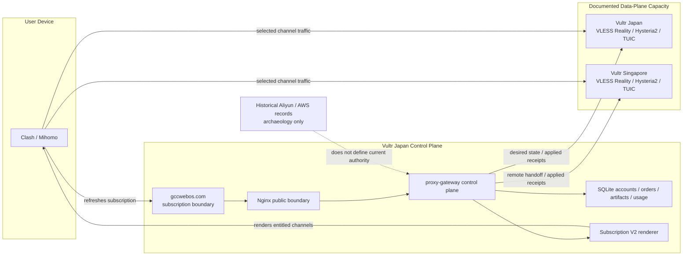
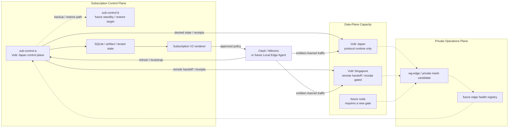
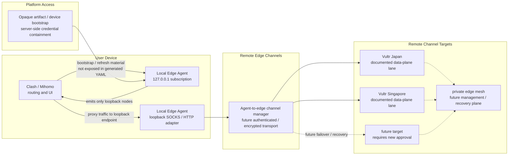
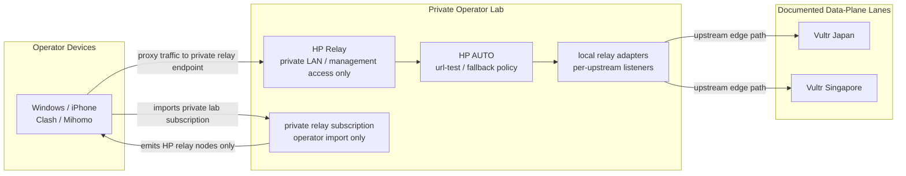
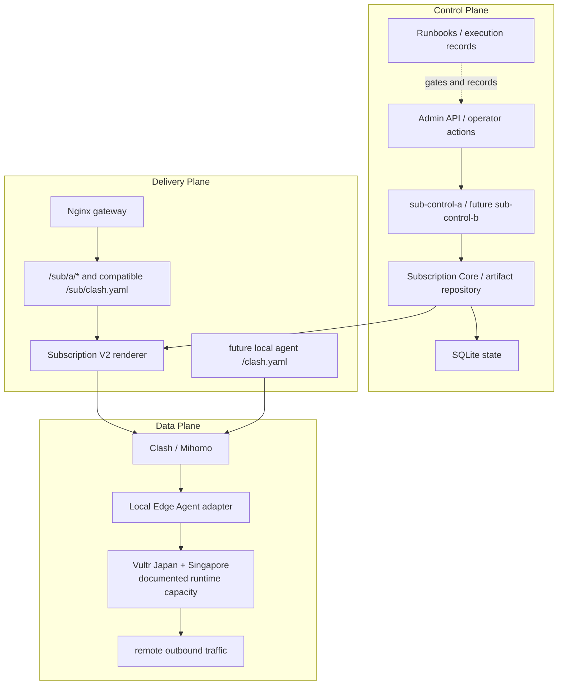
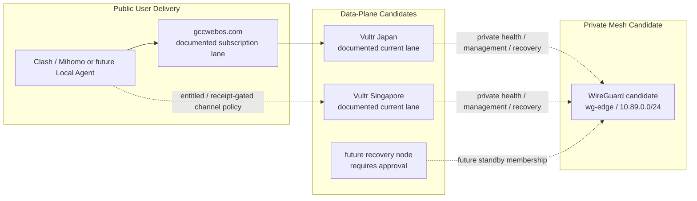

# Project Topology

Last updated: 2026-07-15, America/Los_Angeles.

> Status:
> - Type: Active architecture topology
> - Risk: C
> - Execution authority: Does not authorize code, production, provider, DNS, Nginx,
>   HTTPS, systemd, node, artifact, credential, mesh, service, or cutover changes
> - Production impact: None
> - Source of truth for: Current documented and target topology relationships
>   across local agent, subscription control plane, operator lab relay,
>   subscription delivery, production edges, and server mesh planning. This is
>   not fresh live production inventory.

## Current Documented Production Topology

At the current repository evidence cutoff, the documented production lane uses
Vultr Japan as the subscription control plane and Vultr Japan plus Vultr
Singapore as data-plane capacity. This is a documented topology relationship,
not fresh live proof; any Risk A operation still requires current target
inventory and validation. Aliyun control-center records and the former AWS
`prod-edge-a` / `prod-edge-b` lanes are historical evidence only. Local Edge
Agent work remains a repository prototype and is not production active.



Current documented boundaries:

```text
Vultr Japan control plane: accounts, orders, artifacts, credential lifecycle,
  subscription rendering, protected Admin/operator API, and usage-ledger authority
Vultr Japan data plane: protocol runtime capacity only
Vultr Singapore data plane: optional protocol runtime capacity through Japan
  control-plane handoff and matching applied receipts
AWS: staging/DR evidence only, not current main production authority
Aliyun and retired AWS slots: historical evidence and archaeology only
live health or deployment identity: requires fresh Risk A read-only verification
```

## Subscription Control / Edge Split

The current documented production direction uses Vultr Japan as the
subscription control plane and Vultr Japan/Singapore as data-plane capacity.
The target architecture keeps subscription authority separate from replaceable
edge capacity; any new runtime mutation still requires a fresh Risk A gate.



Target split boundaries:

```text
sub-control-a on Vultr Japan produces subscriptions, owns artifacts, and keeps access state
local Linux owns manual CI after separate validation
Vultr Japan/Singapore data-plane nodes provide protocol capacity but do not own customer truth
Singapore output remains handoff- and receipt-gated by the Japan control plane
Aliyun and former AWS carrying lanes remain historical evidence only
future nodes should only enter service through explicit new gates
future edge rebuilds are deferred unless a technical MVP integration gate approves them
edge nodes should not own subscription state or expose Admin
private mesh is health / validation / recovery infrastructure first
any new physical split, node addition, or runtime mutation remains separate Risk A work
```

## Target Product Topology

The active product direction is not tenant migration. It is a local proxy
production agent plus a subscription control plane feeding server-side
multi-node edge networking.



Target product boundaries:

```text
Clash/Mihomo remains the router and user-facing client.
Local Edge Agent becomes the platform-controlled channel adapter.
Remote Edge or channel targets become the platform-controlled server-side data
plane only after a later approved integration gate.
Opaque artifacts are bootstrap/access material, not the main architecture.
Server Edge Mesh is for edge health, management, validation, and recovery first.
Subscription control and edge data-plane capacity should split over time.
The preferred physical split path is now: Vultr Japan as `sub-control-a`,
Vultr Japan/Singapore as data-plane capacity, and HP/local Linux as manual CI
and operator lab. Historical Aliyun and AWS records remain rollback and
archaeology evidence rather than current authority.
```

Adjacent boundary matrix:

| Concept | Owns | Does not own |
| --- | --- | --- |
| Clash/Mihomo | User-facing routing, rules, UI, and imported subscription handling. | Platform channel selection, server mesh, production edge lifecycle, or subscription authority. |
| Opaque artifacts | Access/bootstrap material and server-side credential containment. | Data-plane routing, local proxying, server mesh membership, or traffic accounting by themselves. |
| Local Edge Agent | Loopback-only client-side adapter and future platform-controlled channel selection. | Clash/Mihomo UI/rules, TUN/driver/system proxy mutation in V1, HP Relay, or Server Edge Mesh. |
| HP Relay | Operator lab diagnostics and upstream/channel behavior research. | Production, staging, CI, data-plane capacity, future recovery nodes, official Local Edge Agent runtime, or Server Edge Mesh. |
| sub-control-a | Vultr Japan control-plane authority, subject to live verification before each Risk A operation. | Edge data-plane traffic, HP Relay, CI, or approval-free runtime mutation. |
| local-ci-a | Local Linux manual CI host for repository validation evidence. | Staging, production, deploy approval, production secrets, SQLite, or subscription URL storage. |
| Historical node retirement | Controlled drain, stop, termination, and security-group cleanup records for superseded Aliyun/AWS lanes. | Approval-free rollback, shutdown, DNS change, or deletion while a live dependency remains. |
| Server Edge Mesh | Private edge-to-edge health, management, validation, and recovery path. | User VPN, Clash/Mihomo endpoint, Local Edge Agent transport in V1, or ordinary customer traffic routing. |
| WireGuard canary | Candidate implementation for the private Server Edge Mesh. | Client VPN product, production traffic migration, opaque artifact migration, or approval-free setup. |

## Operator Lab / HP Relay Topology

The HP Relay is an operator-owned development network node. It is useful for
studying local subscription shape, relay behavior, upstream comparison, and
future Local Edge Agent channel-manager decisions. It is intentionally outside
the production, staging, and CI lanes.



HP Relay boundaries:

```text
operator lab / development network node only
not a production edge, not a data-plane host, and not a public subscription gateway
not staging, not a CI validation host, and not deploy approval
not Server Edge Mesh and not the official Local Edge Agent runtime
private operator access only; no public listener assumption
may consume protected upstream subscription material for diagnostics
must not publish tokens, node passwords, artifact URLs, or customer data
can inform Local Edge Agent and channel-manager design decisions
```

Practical use:

```text
compare upstream edge behavior from one controlled local relay point
test HP AUTO / fallback subscription shape without changing production output
separate local client subscription issues from production gateway issues
collect diagnostic evidence, not production activation evidence
```

## Control, Delivery, And Data Planes



Important separation:

```text
Repository merge does not imply production activation.
Runbook text does not imply execution approval.
Manual CI host is not staging, production, or deploy approval.
Operator lab relay behavior is diagnostic evidence, not CI or production gate.
Subscription refresh success does not prove Shadowsocks data-plane health.
Data-plane traffic accounting cannot be solved by the Node HTTP bridge alone.
```

## Server Edge Mesh Planning Topology

The mesh is planned as a private operational plane between production edges. It
is not a user VPN and is not exposed to Clash/Mihomo or the Local Edge Agent in
V1.



Mesh non-goals for the current stage:

```text
not a user-facing VPN
not ordinary customer traffic routing
not Clash/Mihomo exposed
not Local Edge Agent exposed in V1
not authorized until separate Risk A approval
```

## Work Topology


Use this topology to decide where a change belongs:

```text
docs/code only -> C or B repository PR
validation only -> local tests or local Linux manual CI after validation
operator lab relay -> diagnostics and design evidence only
provider/DNS/Nginx/systemd/runtime -> Risk A execution gate
user-facing import or generated subscription output -> treat as production-sensitive
local agent protocol prototype -> B repository PR until production activation
```
