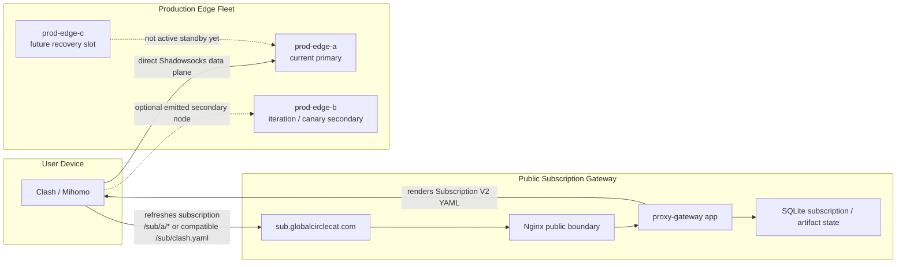
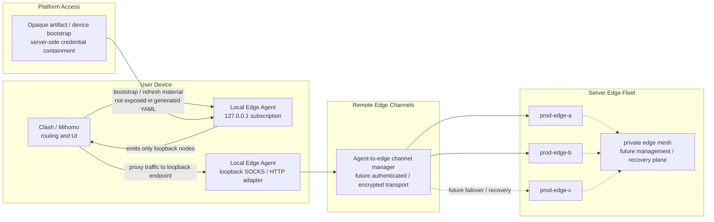
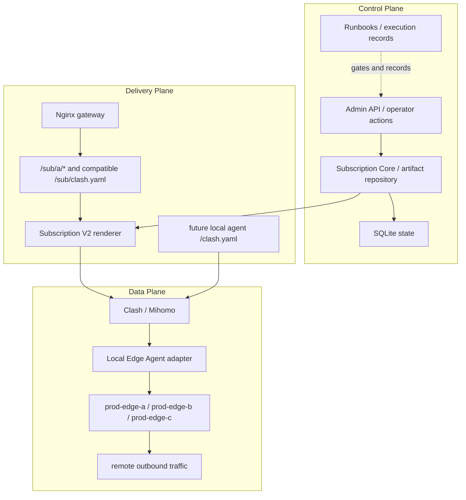
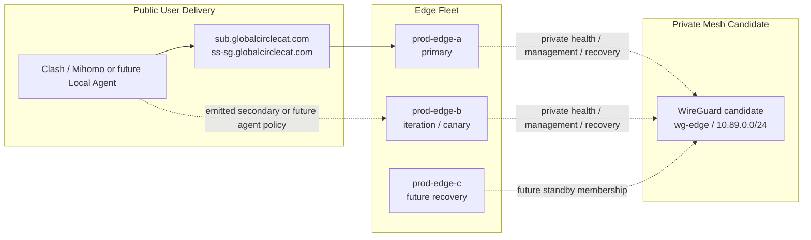
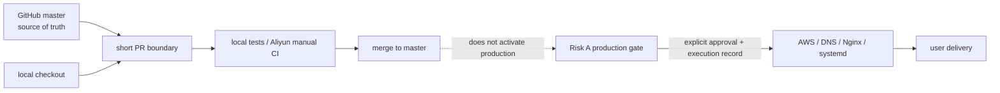

# Project Topology

Last updated: 2026-05-25, Asia/Shanghai.

> Status:
> - Type: Active architecture topology
> - Risk: C
> - Execution authority: Does not authorize code, production, AWS, DNS, Nginx,
>   HTTPS, systemd, node, artifact, credential, mesh, service, or cutover changes
> - Production impact: None
> - Source of truth for: Current and target topology relationships across local
>   agent, subscription delivery, production edges, and server mesh planning

## Current Production Topology

Current production delivery is still a server-side subscription gateway plus
Shadowsocks data-plane nodes. Local Edge Agent work is repository prototype
only and is not production active.



Current production facts:

```text
prod-edge-a: current primary production edge
prod-edge-b: iteration / canary secondary slot
prod-edge-c: future recovery / standby slot, build materials only
legacy blue: stopped, controlled retirement review only
```

## Target Product Topology

The active product direction is not tenant migration. It is a local proxy
production agent plus server-side multi-node edge networking.



Target product boundaries:

```text
Clash/Mihomo remains the router and user-facing client.
Local Edge Agent becomes the platform-controlled channel adapter.
Remote Edge becomes the platform-controlled server-side data plane.
Opaque artifacts are bootstrap/access material, not the main architecture.
Server Edge Mesh is for edge health, management, validation, and recovery first.
```

## Control, Delivery, And Data Planes



Important separation:

```text
Repository merge does not imply production activation.
Runbook text does not imply execution approval.
Manual CI host is not staging, production, or deploy approval.
Subscription refresh success does not prove Shadowsocks data-plane health.
Data-plane traffic accounting cannot be solved by the Node HTTP bridge alone.
```

## Server Edge Mesh Planning Topology

The mesh is planned as a private operational plane between production edges. It
is not a user VPN and is not exposed to Clash/Mihomo or the Local Edge Agent in
V1.



Mesh non-goals for the current stage:

```text
not a user-facing VPN
not ordinary customer traffic routing
not Clash/Mihomo exposed
not Local Edge Agent exposed in V1
not authorized until separate Risk A approval
```

## Work Topology



Use this topology to decide where a change belongs:

```text
docs/code only -> C or B repository PR
validation only -> local tests or Aliyun manual CI
AWS/DNS/Nginx/systemd/runtime -> Risk A execution gate
user-facing import or generated subscription output -> treat as production-sensitive
local agent protocol prototype -> B repository PR until production activation
```
