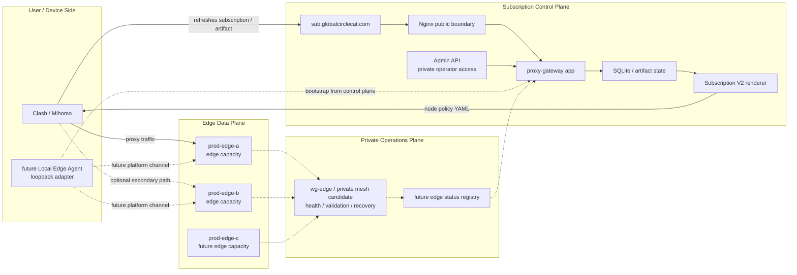

# Subscription Control / Edge Split Architecture

Last updated: 2026-05-26, Asia/Shanghai.

> Status:
> - Type: Active architecture design
> - Risk: C for this document; A for any production control-plane split,
>   edge-node runtime change, DNS change, Nginx change, systemd change,
>   database movement, secret movement, artifact expansion, or traffic cutover
> - Execution authority: Does not authorize code, production, AWS, DNS, Nginx,
>   HTTPS, systemd, node, database, artifact, credential, mesh, service, or
>   cutover changes
> - Production impact: None
> - Source of truth for: the target split between subscription control-plane
>   authority and data-plane edge nodes

## Purpose

The current production host still combines multiple roles:

```text
subscription gateway
Subscription V2 renderer
opaque artifact delivery
SQLite subscription state
Admin API
primary Shadowsocks edge node
```

That co-location is acceptable for the current MVP because it keeps the system
small and operationally understandable. It should not be treated as the target
architecture.

The target architecture separates:

```text
subscription control plane:
  produces subscriptions, owns state, controls access, renders node policy

edge data plane:
  carries proxy traffic, reports health, accepts approved node config
```

This keeps the user import entry stable while making edge nodes easier to add,
replace, test, and retire.

## Core Decision

Use a central subscription control plane to produce access artifacts and
subscription output. Treat production edge nodes as data-plane capacity, not as
subscription authorities.

Recommended target identities:

```text
sub-control-a:
  primary subscription control-plane authority, currently targeted for the
  existing Aliyun server after CI exits and Risk A inventory approves it

sub-control-b:
  future standby or replacement subscription control-plane authority

prod-edge-a:
  production edge data-plane slot

prod-edge-b:
  iteration / canary edge data-plane slot

prod-edge-c:
  future recovery / standby edge data-plane slot
```

The names describe roles. They do not imply current host placement and do not
authorize renaming, DNS changes, or node migration.

Current planning decision:

```text
Use the current Aliyun server as the first `sub-control-a` candidate only after
it exits the CI lane and passes production-control inventory.

Use local Linux as manual CI.

Use clean rebuild servers first for edge data-plane forwarding nodes.

Use the clean new-server control-plane runbook only as fallback if Aliyun is
rejected or cannot be safely cleaned and hardened.
```

## Target Topology



## Role Boundaries

### Subscription Control Plane

The control plane owns user-facing access and policy:

```text
public subscription refresh entry
opaque artifact issuance and validation
server-side tenant / device access state
Subscription V2 rendering
Admin API and operator actions
edge inventory and explicit node policy
SQLite authority until another data-store topology is approved
backup and restore responsibility
```

The control plane should not become a general-purpose proxy path. Its job is to
decide what clients may use and to render safe access material.

### Edge Data Plane

Edge nodes carry traffic and expose limited operational signals:

```text
Shadowsocks or future remote-edge transport
approved node identity
approved public or private listener set
health / readiness summary
edge-level metrics suitable for diagnostics
maintenance-mode state
private mesh membership when approved
```

Edge nodes should not own:

```text
tenant token authority
opaque artifact source of truth
Admin UI exposure
SQLite subscription state
customer subscription rendering
production control-plane backups
payment or entitlement decisions
```

### Private Operations Plane

The private operations plane is optional infrastructure for edge management:

```text
edge-to-edge health
control-plane-to-edge health
validation from one edge to another
future edge status registry
approved recovery drills
```

It is not a user VPN and must not silently become the customer data plane.

## Current State Versus Target

Current production is intentionally co-located:

```text
prod-edge-a currently carries subscription control-plane duties and edge duties.
prod-edge-b is already an emitted iteration / canary edge data-plane slot.
prod-edge-c is build-material / future recovery planning only.
```

Target production separates these duties:

```text
sub-control-a on Aliyun owns subscription and artifact state after promotion.
prod-edge-a/b/c carry proxy traffic and report health.
sub-control-b gives the subscription control plane a recovery path.
```

This document does not require an immediate split. The first useful step is to
make docs, code, and runbooks speak in terms of the target boundary while
keeping the current co-located runtime stable.

## Control, Delivery, And Data Flows

### Subscription Refresh Flow

```text
client -> sub.globalcirclecat.com -> Nginx -> proxy-gateway app
app -> SQLite / artifact state -> Subscription V2 renderer
renderer -> Clash/Mihomo YAML with approved edge nodes
client -> selected prod-edge-* data-plane node
```

The refresh flow is delivery-plane success. It does not prove data-plane health
until a real proxy request succeeds through the selected edge.

### Local Edge Agent Flow

```text
agent -> control plane bootstrap / artifact refresh
agent -> local loopback subscription for Clash/Mihomo
Clash/Mihomo -> local loopback proxy endpoint
agent -> selected remote edge channel
remote edge -> outbound traffic
```

In this model, the control plane bootstraps and authorizes the agent. The edge
data plane carries the traffic.

### Edge Health Flow

```text
edge node -> local health summary
control plane -> public or private health probe
optional mesh -> private health / readiness check
control plane -> operator-visible edge status
operator -> explicit node policy change when needed
```

Health evidence can inform subscription policy, but automatic broad traffic
movement remains a separate design and Risk A execution decision.

## State Ownership

Recommended state split:

```text
Control plane persistent state:
  subscriptions
  opaque artifacts
  device bootstrap records
  tenant entitlement
  edge inventory
  operator audit records

Edge node local state:
  runtime config
  service health
  safe counters / summaries
  local logs with secret redaction
  private mesh keys when approved
```

Do not replicate SQLite subscription state to every edge by default. Edge nodes
should be replaceable capacity. A control-plane standby may receive database
backups or restores only through approved backup/restore gates.

## Security Boundaries

Required boundaries:

```text
Admin remains private and Bearer-protected
control-plane app ports remain behind Nginx or loopback as designed
edge nodes expose only approved data-plane ports
edge nodes do not expose Admin or subscription rendering
tokens, artifact URLs, SS_PASSWORD, CONSOLE_TOKEN, private keys, and SQLite
  content never enter GitHub, PRs, docs, chat, CI logs, or support bundles
mesh access does not bypass application authentication
operator lab nodes do not become production edges
```

This split reduces blast radius. A compromised or failed edge should not also
be the subscription authority.

## Availability And Recovery Model

The control plane becomes a critical dependency. A single active control plane
is acceptable only when backup and recovery are explicit.

Minimum recovery requirements:

```text
fresh SQLite / artifact backup procedure
restore validation procedure
sub-control-b or rebuild plan
DNS or gateway failover plan
public subscription refresh validation
opaque artifact validation
rollback path
execution record for every external mutation
```

Existing clients with cached YAML may continue to use edge nodes for a while if
the control plane is down, but these functions degrade:

```text
new imports
subscription refresh
artifact validation
node policy update
Admin actions
device migration
```

## Migration Strategy

### Phase 0: Documentation Boundary

Name the target split and update source-of-truth docs.

No runtime change.

### Phase 1: Logical Role Separation In Code And Config

Keep the current co-located runtime, but make code/docs distinguish:

```text
subscription control-plane authority
edge data-plane config
edge inventory
node policy output
```

This can be B-tier if it is repository-only and covered by tests.

### Phase 2: Edge Health Registry Prototype

Add repository-level support for safe edge health/status summaries.

No automatic traffic movement and no production activation.

### Phase 3: Edge-Only Node Validation

Validate that an edge node can serve data-plane traffic without subscription
state or Admin exposure.

Any real production edge-node change is Risk A.

### Phase 4: Aliyun Control-Plane Candidate

Move manual CI away from the current Aliyun server, then inventory and validate
that server as the future `sub-control-a` candidate before attempting any
physical split.

This is Risk A because it involves cloud resources and may later involve
production-derived state. The candidate should not receive DNS, customer
traffic, edge data-plane duties, or production authority during this phase.

Use `docs/ALIYUN_CONTROL_LOCAL_CI_REBUILD_PLAN.md` for the current gates. Use
`docs/SUBSCRIPTION_CONTROL_PLANE_NEW_SERVER_RUNBOOK.md` only as the fallback if
Aliyun is rejected by inventory or cleanup gates.

### Phase 5: Control-Plane Standby

Design and validate `sub-control-b` as a restore target or standby.

This is Risk A because it involves database, artifacts, secrets, DNS/gateway
planning, and recovery behavior.

### Phase 6: Optional Physical Split

Move subscription control-plane duties off the primary edge host only after:

```text
Aliyun sub-control-a candidate behavior is proven, or the clean fallback path is chosen
control-plane backups are proven
edge-only node behavior is proven
DNS/gateway strategy is approved
rollback is explicit
operator approval is recorded
```

## Relationship To Existing Documents

```text
docs/PROJECT_TOPOLOGY.md:
  high-level topology diagrams and work-lane placement

docs/PROJECT_OPERATING_MODEL.md:
  source-of-truth, risk, and lane rules

docs/PRODUCTION_EDGE_FLEET.md:
  provider-neutral edge slot planning

docs/SUBSCRIPTION_CONTROL_PLANE_NEW_SERVER_RUNBOOK.md:
  fallback clean new-server candidate gates for `sub-control-a`

docs/ALIYUN_CONTROL_LOCAL_CI_REBUILD_PLAN.md:
  current target split for Aliyun control, local Linux CI, and clean edge nodes

docs/SERVER_EDGE_MESH_DESIGN.md:
  private edge management / recovery plane

docs/LOCAL_EDGE_AGENT_DESIGN.md:
  client-side loopback adapter that will consume control-plane bootstrap and
  use edge data-plane channels
```

If a later execution record conflicts with this design for a specific action,
the later explicitly approved execution record wins for that action.

## Non-Goals

This document does not authorize or implement:

```text
production host split
new AWS resources
DNS changes
Nginx changes
HTTPS changes
systemd changes
SQLite migration or replication
secret copying
artifact expansion
legacy query-token retirement
traffic cutover
automatic failover
distributed database
self-hosted CI
operator lab promotion to production
user-facing VPN
```

## Open Decisions

Before runtime work starts, decide:

```text
1. Whether the current Aliyun server passes inventory as `sub-control-a`.
2. Whether sub-control-b is cold standby, warm standby, or rebuild-on-restore.
3. Whether edge nodes should report health by pull, push, or mesh registry.
4. What edge status fields are safe and useful.
5. Whether Subscription V2 should ever auto-suppress unhealthy edges.
6. How much stale subscription-control data is acceptable during recovery.
7. Whether edge node hosts should use edge-a/b/c.globalcirclecat.com.
8. Which production action first requires the physical control-plane split.
```

## Recommended Next Step

Keep current production co-located. Use this architecture to guide the next
repository work:

```text
1. Move manual CI toward local Linux.
2. Inventory Aliyun as the future `sub-control-a` candidate after CI exits.
3. Use clean rebuild servers for edge data-plane forwarding nodes.
4. Add a repository-only edge status model.
5. Keep generated production YAML changes behind Risk A approval.
6. Keep HP Relay as operator lab evidence, not production topology.
7. Keep Server Edge Mesh as private health / recovery infrastructure first.
8. Defer physical control-plane split until backup/restore and edge-only
   behavior are both proven.
```
