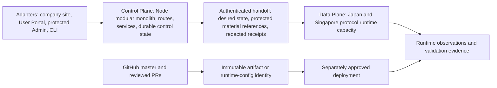

# Architecture Map

Last verified: 2026-11-12 UTC for the DDD context-map cross-reference; topology and runtime facts retain their cited cutoffs.

```yaml
document_metadata:
  doc_type: canonical
  lifecycle: active
  authority_scope: architecture_map
  superseded_by: null
  last_verified_at: 2026-11-12
  production_authority: false
```

> Status:
> - Type: Source-aligned logical architecture map
> - Risk: C
> - Execution authority: Does not authorize production, runtime, provider,
>   deployment, promotion, rollback, schema, auth, credential, or
>   customer-data actions
> - Production impact: None
> - Authority: Derived architecture index only; the authority matrix below
>   governs conflicts
> - Index scope: Control Plane, Data Plane, and Release Plane responsibilities
>   and evidence boundaries at the stated cutoff

## Authority And Derivation Matrix

This layer indexes relationships; it does not become an additional authority.
When statements conflict, use the narrowest current authority for the question:

| Question | Governing evidence | Role of this layer |
| --- | --- | --- |
| What is live in production now? | Fresh Risk A read-only inventory and target validation. | May point to the required gate; must record `not_verified` without live evidence. |
| What is the latest documented release identity? | `docs/CURRENT_RELEASE_STATE.md`, subject to its cutoff and newer validated evidence. | Summarizes links only. |
| What is the source/artifact/release/deployment model? | `RELEASE_MANIFEST.md`. | Cross-references planes and dependencies. |
| What is the current work state and sequencing? | Fresh native Issue/PR records; Project #1 is mutable navigation only. | Provides no competing queue or item status. |
| What are the business bounded contexts and PR-to-domain relationships? | docs/PROJECT_CONTEXT.md owns the stable business spine; docs/project-map/DDD_CONTEXT_MAP.md provides a dated derived context crosswalk; native PRs and source contracts own current state and behavior. | Derived classification only; no new queue, service boundary, or production authority. |
| What machine-readable orientation is retained? | Reviewed definitions in `project-state/lanes.json` plus dated compatibility contracts in `current.json` and `tasks.json`. | Must not create a competing YAML, machine state, or live queue. |
| What topology concepts and historical transitions exist? | `docs/PROJECT_TOPOLOGY.md` and other cited architecture docs, reconciled against current context. | Provides a current-first crosswalk and records reconciliation boundaries. |
| How are agent ownership and delegation governed? | `AGENTS.md` and `docs/MULTI_AGENT_OPERATING_MODEL.md`. | Maps Planner/Architect/Engineer/Reviewer labels onto existing roles. |
| How should the new knowledge documents be read? | This matrix and the precedence rules in each derived document. | Index/derived view only. |

### Topology Reconciliation Boundary

`docs/PROJECT_TOPOLOGY.md` was reconciled on 2026-07-15 to the documented
Vultr Japan control-plane and Japan/Singapore data-plane direction. It remains
a conceptual topology rather than fresh live production proof. Use
`docs/PROJECT_CONTEXT.md` and `docs/CURRENT_RELEASE_STATE.md` for the current
documented handoff and release identity, then verify drift-prone runtime state
through the required Risk A read-only gate.

The precedence order is:

```text
fresh approved live evidence
  -> current authority document for the exact scope
  -> dated project-state compatibility snapshot
  -> this derived project-intelligence layer
  -> historical or conflicting architecture material
```

## System View



This is a logical map of one repository and its runtime boundaries. It does not
declare independently deployed microservices.

## Control Plane

**Responsibility**

Own accounts, entitlements, orders/access requests, delivery generations,
subscription artifacts, credential references, desired-state notifications,
render gates, usage ledgers, quota decisions, and protected operator views.

**Repository surfaces**

- `server/app.mjs` assembles middleware, public routes, protected Admin routes,
  User Portal routes, subscription routes, and data-plane agent routes.
- `server/routes/` owns HTTP adapter boundaries.
- `server/services/` owns reusable domain/application behavior.
- `server/state.mjs` and platform control stores provide composition and
  persistence boundaries.
- `admin/`, `bin/`, and public/static entrypoints are adapters, not independent
  business authorities.

**Current evidence**

`docs/PROJECT_CONTEXT.md` describes one Japan control-plane authority and a
modular-monolith model. That is the current documented architecture direction;
this task did not verify a live host.

## Data Plane

**Responsibility**

Provide protocol runtime capacity and traffic transport. Data-plane nodes do
not own accounts, commercial entitlement, subscription authority, or public
Admin.

**Repository surfaces**

- There is no tracked top-level `runtime/` directory at the inspected source
  head.
- Runtime-adjacent source is distributed across `agent/`, `config/`, `ops/`,
  `schemas/`, selected `scripts/`, edge services, and deployment records.
- `server/routes/data-plane-agent.mjs` and `server/services/edge/` represent
  protected control/data-plane handoff contracts.

**Current evidence**

Current project docs describe Japan and Singapore data-plane capacity and the
VLESS Reality, Hysteria2, and TUIC protocol families. Runtime state, service
health, and config identity require fresh Risk A evidence and were not checked
by this task.

## Release Plane

**Responsibility**

Keep source, review, build, release, deployment, and runtime evidence distinct
and traceable.

**Repository surfaces**

- GitHub Issues and PRs own intent and reviewed diffs.
- `.github/workflows/` builds and validates source/artifacts.
- `RELEASE_MANIFEST.md` defines release units and four independent gates.
- `scripts/create-artifact-manifest.mjs` and
  `scripts/generate-runtime-identity.mjs` create offline identities.
- `docs/CURRENT_RELEASE_STATE.md` and
  `docs/production-replacement-records/` hold dated release/deployment evidence.

**Four gates**

```text
Source Gate -> Merge Gate -> Artifact Gate -> Production Gate
```

Each gate requires its own evidence. Source or artifact success cannot be used
as deployment or live runtime proof.

## Plane Dependencies

| Producer | Consumer | Contract | Hard boundary |
| --- | --- | --- | --- |
| Adapters | Control Plane | HTTP/CLI inputs and safe DTOs | Adapters do not become business authority. |
| Control Plane | Data Plane | Authenticated desired state, protected references, redacted receipts | Protected material and raw runtime data stay out of docs and public surfaces. |
| Data Plane | Control Plane | Redacted usage/status evidence | Observations do not automatically change accounting, quota, recovery, or trust. |
| Source Gate | Artifact Gate | Exact reviewed source identity | Merge does not prove artifact retrievability. |
| Artifact Gate | Production Gate | Immutable identity, checksum, backup/rollback readiness | Artifact existence does not authorize promotion. |
| Production Gate | Runtime evidence | Exact target mutation plus validation | Deployment does not establish indefinite health. |

## Architecture Invariants

- Preserve the modular monolith unless a measured, separately reviewed need
  changes the decision.
- Keep control-plane authority out of edge runtimes.
- Keep public company site, User Portal, and protected Admin boundaries
  explicit even when current frontend builds share the `admin/` workspace.
- Keep runtime identity as an impact dimension, not a new release unit.
- Do not infer production state from `master`, a Draft PR, a successful build,
  an artifact, or a dated record.
- Do not introduce automatic repair, promotion, provider activation, or a new
  orchestration service through this documentation layer.
